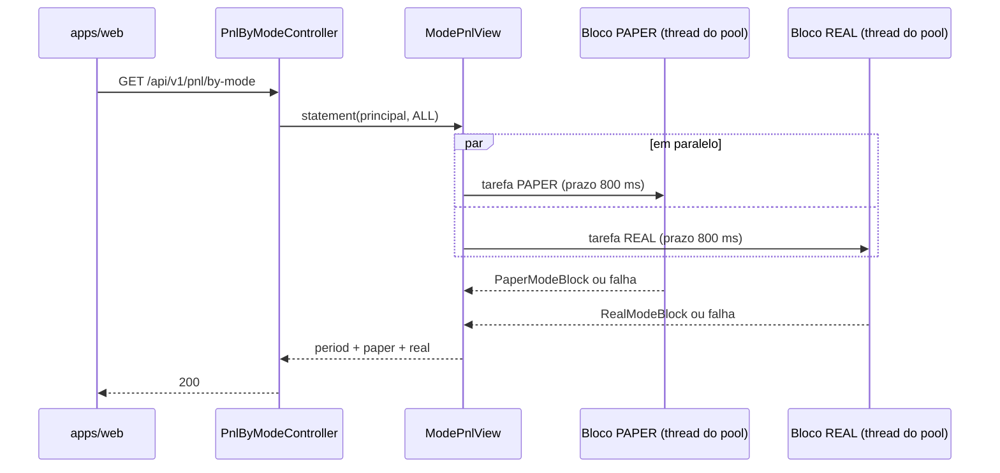

# Desenho de desempenho — U1 `u1-mode-skeleton`

Conversa: português (Brasil). Data: 2026-11-21.

Este arquivo diz como as rotas da U1 ficam dentro do p95 de 1.000 ms (NFR1.1 a NFR1.4) sem cache, sem trava de leitura e sem índice novo. As decisões seguem as respostas confirmadas Q1, Q2 e Q3 [Q1] [Q2] [Q3].

## Resumo das decisões

| Tema | Decisão | NFR |
|---|---|---|
| Montagem do `by-mode` (C4) | Os dois blocos rodam **em paralelo**, cada um numa tarefa própria com o seu tempo limite, num pool limitado do módulo `pnl`. A espera total é a do bloco mais lento, nunca a soma. | NFR1.1, NFR1.9 |
| Tempo limite por bloco | `memetrade.pnl.by-mode.block-timeout`, padrão **800 ms**. | NFR1.9, NFR4.4 |
| Bloco PAPER | Uma transação só de leitura em REPEATABLE READ; o P&L de cada bot pelo mesmo cálculo de hoje (`PnlQueryService`) e o total do modo pelo mesmo cálculo sem filtro de bot. | NFR1.1, NFR2.2 |
| Bloco REAL | **Uma** leitura das ordens assentadas da pessoa (`JdbcRealExecutionStore.settled`), agrupada por `bot_id` na memória; o `RealPnlCalculator` roda por bot e uma vez sobre todas as ordens (total do modo). Os preços são lidos uma vez para todos os mints. | NFR1.1, NFR2.3 |
| Índices | Nenhum índice novo e nenhuma migração. Cada consulta usa um índice que já existe (tabela "Índices"). | NFR1.13 |
| Elegibilidade na criação REAL | Até 3 leituras pontuais, com `memetrade.bots.real-eligibility-timeout`, padrão **500 ms**, dentro do comando idempotente. | NFR1.4, NFR1.8 |
| Cache | Nenhum, nem no servidor nem no navegador além do estado da tela. | NFR1.11 |
| Travas | Nenhuma trava de leitura (`FOR UPDATE`, `FOR SHARE` ou consultiva) nas leituras C2, C3 e C4. | NFR1.7 |
| Medição | Teste de integração com a semente de NFR1.5; p95 só registrado no log; portão no cenário de carga da U2. | NFR1.5, NFR1.6, NFR1.14 |

## Configuração nova

Os valores ficam no `application.yml`, fixos e nunca lidos do ambiente, como o resto de `memetrade.bots` (`BotProperties`). Um valor fora do domínio impede o processo de subir, com uma mensagem que nomeia a propriedade, no mesmo padrão de `BotProperties`.

| Chave | Padrão | Domínio aceito | Dono | Uso |
|---|---|---|---|---|
| `memetrade.pnl.by-mode.block-timeout` | `800ms` | 100 ms a 900 ms | `pnl` (registro novo, nome proposto `PnlByModeProperties`) | tempo limite de cada bloco de C4, contado desde o envio da tarefa ao pool |
| `memetrade.pnl.by-mode.pool-size` | `8` | 1 a 16 | `pnl` | threads do pool dos blocos (no máximo 8 conexões do Hikari ao mesmo tempo) |
| `memetrade.pnl.by-mode.queue-capacity` | `16` | 0 a 64 | `pnl` | fila do pool; cheia, o bloco vira `UNAVAILABLE` na hora |
| `memetrade.pnl.by-mode.real-max-orders` | `50000` | 15.000 a 200.000 | `pnl` | teto de ordens REAL lidas por pessoa no bloco REAL da U1 (ver "Limite e gatilho da leitura REAL") |
| `memetrade.bots.real-eligibility-timeout` | `500ms` | 100 ms a 900 ms | `bots` (campo novo de `BotProperties`) | prazo total das leituras da elegibilidade em C1 e C2 |
| `memetrade.riskcontrol.account-limits-timeout` | `500ms` | 100 ms a 900 ms | `riskcontrol` | prazo das leituras de C3 (`RealAccountLimits`) |

O teto de 900 ms garante que um bloco que estoura o prazo ainda responde abaixo do p95 de 1.000 ms (NFR1.9). Um teste de unidade de cada registro de propriedades confere o padrão e a recusa fora do domínio.

## Orçamento de tempo do `by-mode` (C4)



Texto equivalente: o controlador chama o `ModePnlView` na thread do pedido. O `ModePnlView` envia as duas tarefas ao pool ao mesmo tempo e espera cada uma até o prazo. Cada bloco volta pronto ou vira `UNAVAILABLE`. A resposta é sempre 200.

| Etapa | Onde roda | Orçamento |
|---|---|---|
| Filtros (correlação, autenticação, novo aceite dos termos) | thread do pedido | o custo de hoje; o filtro dos termos faz 1 consulta indexada |
| Diretório dos bots do modo (C8) e cálculo do bloco | thread do pool, dentro da tarefa do bloco | até 800 ms, contados desde o envio ao pool (a espera na fila conta) |
| Montagem e serialização da resposta | thread do pedido | sem acesso ao banco; dezenas de milissegundos no pior caso |

**Por que em paralelo e não em sequência.** Em sequência, dois blocos de 800 ms somariam 1.600 ms, e o NFR1.9 diz que o tempo de um bloco que falha não entra no orçamento do outro. Em paralelo, o pior caso do pedido é o prazo de um bloco, mais a montagem. O precedente no código é o `SystemStatusAssembler` (administração), que já monta seis leituras em paralelo com prazo por parte.

### Execução de cada bloco

- O pool é um `ThreadPoolExecutor` próprio do módulo `pnl` (nome proposto `ModeBlockExecutor`): threads daemon com nome `pnl-mode-block-N`, `pool-size` threads e fila limitada a `queue-capacity`, com recusa imediata quando a fila está cheia. Ele não é um bean do tipo `Executor`, para não trocar o executor de tarefas do Spring Boot (mesmo cuidado do `AdministrationConfig`). É encerrado com o contexto.
- A thread do pedido não abre transação nem segura conexão enquanto espera.
- **Envio com fila cheia.** Com a fila cheia, o `ThreadPoolExecutor` lança `RejectedExecutionException` na hora, na thread do pedido, e não pela future. O `ModeBlockExecutor.submit` captura essa exceção e devolve uma future já concluída com falha (causa `REJECTED`). Assim, a fila cheia vira `UNAVAILABLE` com resposta 200, nunca 500. O `SystemStatusAssembler` não cobre esse caso; ele é novo na U1.
- Cada tarefa:
  1. aplica na própria thread o MDC capturado na thread do pedido (o `correlationId`). `MDC.getCopyOfContextMap()` pode devolver `null`: nesse caso a tarefa chama `MDC.clear()` em vez de `MDC.setContextMap`. No fim, sempre `MDC.clear()`;
  2. confere o prazo antes de abrir a transação: se ele já passou (a tarefa esperou na fila), a tarefa desiste sem ler nada;
  3. abre a própria transação só de leitura. Pedir a conexão ao Hikari pode levar até 2 s (`connection-timeout`), mais que o prazo de 800 ms. Por isso a tarefa **confere o prazo de novo logo depois de a transação abrir**, antes de qualquer leitura, e desiste (devolvendo a conexão) se o tempo acabou;
  4. aplica `set local statement_timeout` igual ao tempo que resta do prazo, para o banco cancelar a consulta que continuaria depois que a resposta já saiu;
  5. recebe o `Principal` (tenant e pessoa) como parâmetro; nunca lê o contexto de autenticação da thread.
- O `ModePnlView` espera com `orTimeout` no prazo. Um prazo esgotado, uma exceção ou a recusa da fila vira `ModeBlockUnavailable` com `code = SERVICE_UNAVAILABLE` e o `correlationId` do pedido (ver `reliability-design.md`, que tem o teste da fila cheia).

Esboço ilustrativo (não é a implementação):

```java
CompletableFuture<PaperModeBlock> paper = blocks.submit(PAPER, deadline,
        () -> paperReader.block(principal, PnlWindow.all()));
CompletableFuture<RealModeBlockResult> real = blocks.submit(REAL, deadline,
        () -> realQuery.modePnl(principal.tenantId(), principal.userId(), PnlWindow.all()));
return new ModePnlStatement(PnlPeriod.all(),
        resultOrUnavailable(paper, PAPER), resultOrUnavailable(real, REAL));
```

O `ModePnlView` só coloca os dois objetos lado a lado; nunca chama aritmética nem os acessores de valor dos tipos PAPER e REAL (regra `NEVER_SUM_MODES`, ver `security-design.md`).

## Bloco PAPER

- Uma transação só de leitura em REPEATABLE READ (o mesmo isolamento do `PnlQueryService.report`), para que as linhas dos bots e o total do modo saiam da mesma fotografia do banco. Isso é o que permite a conferência exata do BR5.10 (NFR2.2).
- Os bots PAPER vêm do diretório C8 (`botsOf(tenant, pessoa, PAPER)`), na ordem de criação.
- Linha de cada bot: o mesmo cálculo de hoje de `GET /api/v1/pnl?botId=` (`PnlQueryService`), reaproveitado pelo método interno e não por cópia, para o valor ser igual ao de hoje por construção (BR5.9).
- Total do modo: o mesmo cálculo sem filtro de bot, a partir do ledger PAPER, nunca a soma das linhas.
- Janela `ALL`: o início interno é `1970-01-01T00:00Z` e o fim é o instante do relógio injetável. O limite de 366 dias continua valendo só na rota pública `GET /api/v1/pnl`; o método interno da janela `ALL` não passa pela validação dela. A resposta de C4 mostra só `period.kind = ALL`, nunca esse início interno.
- O corte em dias inteiros que já existe (`PnlQueryService.periods`) continua: dias fechados vêm de `pnl_daily`, e o dia corrente vem de `fill`.
- Com 5 bots PAPER, o bloco faz 6 cálculos (5 linhas e o total), cada um com uma leitura de `pnl_daily`, uma de `fill` do dia corrente e uma das posições abertas, mais as cotações. Entre um cálculo e o próximo, a tarefa confere o prazo e desiste se ele passou.

## Bloco REAL (primeira implementação de C10)

- Uma transação só de leitura em READ COMMITTED.
- **Uma** leitura das ordens assentadas da pessoa: `JdbcRealExecutionStore.settled(tenant, pessoa)` (pelo `RealExecutionPort.settledOrders`), que já filtra por tenant e pessoa.
- Os preços dos mints são lidos uma vez para o bloco inteiro (`MarketDataQuery.referencePrices` e `decimalsOf`, que leem o banco do `marketdata`), como no `RealPnlService` de hoje.
- As ordens são agrupadas por `RealOrderView.botId()` na memória:
  - linha de cada bot REAL do diretório: `RealPnlCalculator.of(ordens daquele bot, preços)`;
  - total do modo: `RealPnlCalculator.of(todas as ordens, preços)`, o mesmo número de `GET /api/v1/real/pnl` (BR5.5);
  - as ordens sem bot entram só no total.
- Custo da referência (NFR1.10): 5 bots REAL × 2.920 ordens = 14.600 linhas lidas uma vez e ordenadas por `updated_at`; o cálculo é linear em `long`.
- Nenhuma consulta filtra `real_order` por `bot_id`. Esse filtro não tem índice geral (só o índice parcial `uq_real_order_bot_in_progress`, das ordens em andamento) e exigiria uma migração, que a U1 não tem (NFR1.13). Ver "Índices".

## Elegibilidade e limites (C1, C2, C3)

- A elegibilidade (BR2.1) lê, na ordem dos motivos e só até o primeiro que vale:
  1. o kill switch (`RealKillSwitchState.current`, a linha única de `real_kill_switch`);
  2. a configuração `memetrade.real.enabled` (sem leitura no banco);
  3. a carteira do bot ativa (`RealStateQuery.readRealState`);
  4. a liberação (`RealStateQuery.readRelease`).

  São no máximo 3 leituras pontuais indexadas e nenhuma chamada de rede de saída (NFR1.8).
- O prazo `memetrade.bots.real-eligibility-timeout` (500 ms) vale para o conjunto das leituras, não para cada uma. Antes de cada leitura, o código calcula o tempo que resta e aplica `set local statement_timeout` com esse valor. Sem tempo restante, a elegibilidade fica indisponível (503). Os detalhes de transação e falha estão em `reliability-design.md`.
- C2 usa o mesmo componente e o mesmo prazo, na própria transação só de leitura.
- C3 lê a configuração da barreira REAL e o teto da carteira com `memetrade.riskcontrol.account-limits-timeout` (500 ms) e devolve os quatro limites de BR3.1, sem estado novo.
- C1 PAPER não lê a elegibilidade (BR2.5) e mantém o custo de hoje: uma reivindicação de idempotência, uma inserção e um evento de auditoria.

## Índices

Nenhum índice ou migração é necessário na U1. Cada leitura nova usa um índice que já existe:

| Leitura | Consulta (resumo) | Índice que serve |
|---|---|---|
| Diretório C8 | `bot` por `tenant_id`, `owner_user_id`, com `market` e estado | `bot_owner_state_idx (tenant_id, owner_user_id, state, updated_at DESC)` |
| Bloco REAL | `real_order` por `tenant_id`, `user_id`, assentadas, ordenadas por `updated_at` | `real_order_user_created_idx (user_id, created_at DESC)` para achar as linhas da pessoa; a ordenação por `updated_at` é feita sobre as linhas dela (14.600 na referência) |
| Bloco PAPER, linha de um bot | `pnl_daily` por `bot_id` e `utc_day` | `pnl_daily_pk (bot_id, mode, chain, token_mint, utc_day)` |
| Bloco PAPER, total | `pnl_daily` por `owner_user_id` e `utc_day` | `pnl_daily_owner_day_idx (owner_user_id, utc_day)` |
| Bloco PAPER, dia corrente | `fill` por bot ou por pessoa e `filled_at` | `fill_bot_filled_idx (bot_id, filled_at)` e `fill_owner_filled_idx (owner_user_id, filled_at)` |
| Elegibilidade, carteira | `bot_wallet_account` ativa da pessoa | `uq_bot_wallet_account_active_user (user_id) WHERE status = 'ACTIVE'` |
| Elegibilidade, liberação | `real_release` aberta da pessoa na rede | `uq_real_release_open (user_id, network) WHERE revoked_at IS NULL` |
| Elegibilidade, kill switch | linha única | chave primária de `real_kill_switch` |

**Risco registrado.** A ordenação das ordens REAL por `updated_at` acontece depois da busca pelo índice da pessoa. Na referência, são 14.600 linhas, uma ordenação pequena. Se a medição do NFR1.5 mostrar que essa leitura passa do prazo do bloco, a correção **não** é um índice na U1. A correção é a leitura em fluxo na ordem de rede com o índice da tabela `real_entry_slot`, que já é da U2 (C12, C14, PQ-10). A U1 nunca é implantada sem a U2 (NFR8.4).

### Limite e gatilho da leitura REAL

A leitura única da U1 carrega todas as ordens assentadas da pessoa a cada abertura de `/pnl` e `/bots`. Para ela não crescer sem teto:

- **Teto rígido.** A primeira implementação de C10 lê no máximo `memetrade.pnl.by-mode.real-max-orders` ordens (padrão **50.000**, cerca de 3,4 vezes a referência de 14.600), com `limit 50001` na consulta. Se vierem mais, ela não calcula: lança `RealPnlUnavailable`, o bloco REAL vem `UNAVAILABLE` e o log `WARN` leva `cause=TOO_MANY_ORDERS`. Nenhum número parcial sai. O teste de unidade semeia 50.001 ordens de mentira num leitor de teste e confere o `UNAVAILABLE`.
- **Gatilho para antecipar a leitura em fluxo da U2**, conferido no log do `ModePnlLatencyIT` (NFR1.5) a cada Build and Test:
  - p95 de C4 acima de **700 ms** (100 ms abaixo do prazo do bloco); ou
  - qualquer bloco `UNAVAILABLE` na medição (já falha o build).

  Quando o gatilho dispara, o Build and Test registra o resultado e a leitura em fluxo (C12) vira o primeiro item da U2. Não se acrescenta índice na U1.

## Medição (NFR1.5, NFR1.6, NFR1.14)

- Teste de integração novo (nome proposto `ModePnlLatencyIT`), no padrão de `AbstractU9MeasurementIT` e `DashboardOpenLatencyIT`: Failsafe, Testcontainers com PostgreSQL 17 e as migrações da aplicação.
- A semente é a do NFR1.5: 1 pessoa, 10 bots (5 PAPER e 5 REAL), 730 dias, 4 ordens por bot por dia, os lançamentos de ledger nos dois modos **e as linhas de `pnl_daily` dos dias fechados**. Sem `pnl_daily`, o bloco PAPER leria só o dia corrente e a medição sairia otimista.
- Por rota (C1 a C4): 10 pedidos de aquecimento descartados e 100 medidos em sequência; o p95 é o 95º menor tempo; o teste registra no log `route`, `p95Ms` e `targetMs=1000`.
- Um p95 acima da meta não falha o build. O teste falha se um pedido medido não responder com o status esperado (200 nas leituras, 201 na criação).
- Em C4, o teste falha também se algum bloco vier `UNAVAILABLE` na medição. Com a semente de referência, um bloco que estoura 800 ms é um defeito de desempenho, não ruído.
- O portão de 1.000 ms de C4 fica no cenário de carga da CI da U2. A U1 não muda `scripts/load/` nem `load-test.yml` (NFR1.6). O SLI é o `http.server.requests` por `uri`, que já tem histograma (NFR1.14).

## Travas e concorrência com a execução (NFR1.7)

- As leituras de C2, C3 e C4 não têm `FOR UPDATE`, `FOR SHARE` nem trava consultiva. O MVCC do PostgreSQL faz uma leitura nunca esperar uma escrita e vice-versa.
- O `statement_timeout` de cada bloco garante que nenhuma leitura longa da U1 segura uma conexão além do prazo.
- O teste de integração do NFR1.7 roda C4 em paralelo com um ciclo de bot (`CycleRunner`) e confere que o ciclo termina dentro da trava de 2 s que já existe (`memetrade.bots.lock-timeout`).

## Frontend (`apps/web`)

- `/pnl` faz uma leitura de C4 por abertura da tela; `/bots` faz a lista de bots e C4 em paralelo (F5 do functional design). Não há leitura contínua nem consulta periódica na U1.
- "Tentar de novo" de um bloco relê C4 inteira e atualiza só aquele bloco (NFR4.8).
- A tela de criação lê C2 quando abre e C3 só na etapa de limites de um bot REAL.
- Os valores chegam prontos do servidor; a tela só formata (BR7.1, BR7.2) e não faz conta.

## Sources

- `reviews/review-01.md`: achados R-01 a R-06 da revisão deste estágio; decisão do fundador de 2026-11-21 sobre o `DecisionRequest` do ramo REAL.
- `nfr-design-questions.md`: Q1, Q2, Q3 e o resumo confirmado [Q1] [Q2] [Q3].
- `construction/u1-mode-skeleton/nfr-requirements/performance-requirements.md`: NFR1.1 a NFR1.9.
- `construction/u1-mode-skeleton/nfr-requirements/scalability-requirements.md`: NFR1.10, NFR1.11, NFR1.13.
- `construction/u1-mode-skeleton/nfr-requirements/observability-requirements.md`: NFR1.14.
- `construction/u1-mode-skeleton/functional-design/rules.md`: BR2.1, BR2.5, BR5.3, BR5.5, BR5.9, BR5.10; `functional-spec.md`: F4, F5.
- `inception/contract-design/contract-summary.md`: C4, C8, C10 e a pendência PQ-10 (índice e carga na U2).
- `inception/domain-design/components.md`: ModePnlView, RealCreationEligibility, PaperPnl.
- Código lido:
  - `pnl/application/PnlQueryService.java` (`report`, `periods`, limite de 366 dias, REPEATABLE READ);
  - `pnl/application/RealPnlService.java` e `pnl/real/RealPnlCalculator.java`;
  - `realexecution/infra/JdbcRealExecutionStore.java` (`settled`);
  - `administration/domain/SystemStatusAssembler.java` e `administration/infra/AdministrationConfig.java` (paralelo com prazo por parte);
  - `bots/infra/BotProperties.java` e `bots/infra/LockOrder.java` (`lock_timeout`, `statement_timeout`);
  - `application.yml` (Hikari com 20 conexões e espera de 2 s, histograma de `http.server.requests`);
  - migrações `0008-ledger-pnl.sql`, `0010-bots-decision.sql`, `0016-real-bot-wallet.sql`, `0019-real-execution.sql` e `0021-real-operations.sql` (índices).
- `aidlc/spaces/default/memory/team.md`: Testing Posture (Desempenho, Determinismo), Code Style (fronteiras de módulos).

## Assumptions & Open Questions

1. [assumption] Os padrões 800 ms (bloco), 500 ms (elegibilidade e limites), 8 threads e fila de 16 são escolhas deste estágio, dentro do que a Q2 deu como exemplo; o valor exato fica na configuração e é testado, como a Q2 pede. A medição do NFR1.5 pode pedir um ajuste dentro do domínio aceito, registrado no Build and Test.
2. [assumption] O início interno `1970-01-01T00:00Z` da janela `ALL` do PAPER é equivalente a "desde o início", porque nenhum lançamento PAPER é anterior a ele. A Code Generation pode trocar pelo dia da primeira conta PAPER da pessoa, desde que a resposta continue mostrando só `ALL`.
3. [assumption] A ordenação de até 14.600 ordens REAL por `updated_at` cabe no prazo de 800 ms; a confirmação é a medição do NFR1.5. Se não couber, a correção é da U2 (PQ-10), e não uma migração na U1.
4. A densidade da semente (29.200 ordens) vem do NFR Requirements; este estágio acrescenta só a exigência das linhas de `pnl_daily` dos dias fechados.
