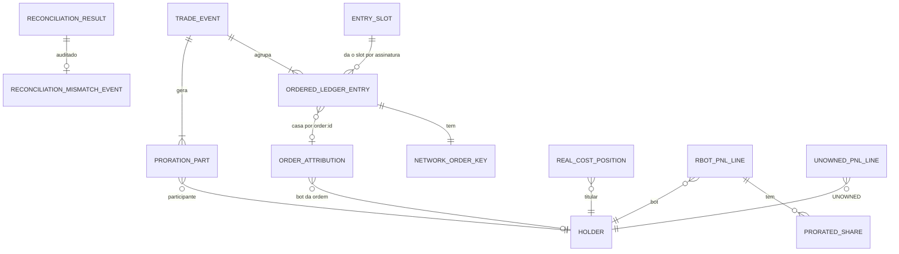

# Especificação funcional — U2 `u2-real-bot-pnl`

Conversa: português (Brasil). Data: 2026-11-22.

Este arquivo é a fonte dos fluxos e das transições de estado da U2. Os dados ficam em `entities.md`, e as decisões em `rules.md`. O diagrama de entidades e o resumo das regras no fim são só vistas derivadas.

## Histórias que esta Unit implementa

As histórias são de `inception/user-stories/stories.md`.

| História | Parte da U2 |
|---|---|
| US3.2 P&L real por bot com custo médio do próprio bot | AC3.2.1 a AC3.2.4 (a U1 entregou AC3.2.5 e AC3.2.6) |
| US3.3 Rateio do "vender tudo e sacar" | inteira |
| US3.4 Rateio da saída condicional | inteira |
| US3.5 Excedente vendido por um bot | inteira |
| US3.6 Ordem no mesmo slot | inteira |
| US3.7 Taxas no bot certo | inteira |
| US3.8 Preço desconhecido não vira zero | inteira |
| US3.9 Bot pausado ou removido | inteira |
| US3.11 P&L rápido sem travar as ordens | a leitura em fluxo e a ausência de trava; o p95 fica com o NFR Design e o cenário de carga |
| US5.1 A venda condicional entra no P&L REAL | inteira |
| US5.2 Um único custo médio REAL | inteira |
| US5.3 O P&L de cada modo fecha com o ledger | AC5.3.1, AC5.3.3 a AC5.3.5 (a U1 entregou AC5.3.2) |
| US5.4 O realizado de um período fecha com o ledger | inteira |
| US7.2 Realizado do período, não realizado de agora | AC7.2.1 (a U3 entrega AC7.2.2 e AC7.2.3) |

A U2 não tem tela própria (kind `service`), por isso não há `frontend-components.md`. As duas mudanças de texto no web que acompanham a troca da fórmula estão na BR10.4 e na seção "Efeito na tela".

## F1 — P&L REAL de uma pessoa, em fluxo (modePnl)

Entrada: tenant e pessoa (do token), período `All` ou `Range [from, to)`. Saída: `RealModePnl` ou indisponível. Regras: BR10.1, BR10.2, BR8.6.

1. Ler do diretório (C8) os bots REAL da pessoa, inclusive os pausados e os removidos, em ordem de criação. Montar a ordem de desempate (BR4.2), com UNOWNED por último.
2. Ler as carteiras do bot da pessoa (`botwallet.api`). Se não há bot REAL nem carteira, devolver o bloco vazio (`empty = true`) e parar.
3. Ler em fluxo as ordens da pessoa que chegaram à rede (C13, `streamSettledOrders`), dentro do orçamento da leitura de atribuição (BR2.7: 500 ms no caminho do P&L, dentro do prazo do bloco de 800 ms; alinhamento A1), e montar o índice compacto `realOrderId → OrderAttribution` (ENT-204). O teto `real-max-orders` é contado no próprio fluxo e, acima dele, o bloco fica `UNAVAILABLE` com `TOO_MANY_ORDERS` (decisão F-2; alinhamento A10).
   - Se uma ordem tem bot que não está no passo 1, marcar UNKNOWN_BOT (BR3.4) e ir ao passo 9. Isso afeta só este bloco de P&L.
   - Para cada ordem `FAILED` do modo Assinada, sem lançamento no ledger, montar uma tentativa virtual com a chave de rede pela assinatura da ordem (BR6.2).
4. Ler em fluxo os lançamentos de negociação das carteiras (BR6.5), na ordem de rede (C12, `streamInNetworkOrder`). A chave e a herança do slot vêm prontas do provedor (BR1.1, BR1.3). Contar as linhas `SLOT_MISSING`. Intercalar as tentativas virtuais do passo 3 na mesma ordem.
5. Agrupar num `TradeEvent` (ENT-207) os lançamentos com a mesma carteira, referência e assinatura, mesmo que outro lançamento fique entre eles na chave. O evento é fechado quando aparece um lançamento de outra (referência, assinatura) num slot efetivo maior, ou no fim do fluxo. A chave do evento é a do lançamento principal, e o instante é o único do evento (BR7.6).
   - Juntar a atribuição do índice do passo 3 e classificar (BR3.1, BR3.2).
   - A taxa vem do `NETWORK_FEE` da referência, ou da ordem quando `feePayer = MAIN_WALLET` (BR6.3).
   - Um RENT sem `SWAP_FILL_IN` na referência segue a BR6.6.
6. Aplicar cada evento, na ordem, pelo procedimento F2. As posições ficam por carteira, titular e token (ENT-206). Ao mesmo tempo, acumular o lado do ledger (F3, passo 1).
7. Conferir que a quantidade de cada carteira e token é igual à do caminho só de quantidade (BR2.5). Uma diferença é `QUANTITY_CONSERVATION`.
8. Ler os preços uma vez, para os tokens com posição aberta (`marketdata.api`), e calcular o não realizado de agora (BR7.2, BR7.3).
9. Conferir (F3). Se der MISMATCH, ir a F4 e parar.
10. Montar a saída:
    - uma `RealBotPnlLine` por bot do passo 1, com realizado e taxas do período, não realizado de agora, total (BR7.4) e shares do período (BR4.7);
    - a `UnownedPnlLine` quando UNOWNED tem algo desde o início (BR5.5);
    - o `RealModeTotal` do lado do ledger (BR7.5), com `unrealizedAsOf` igual ao instante do relógio injetado.

Uma falha de leitura em qualquer passo gera `RealPnlUnavailable` com a causa técnica. O bloco REAL vira `UNAVAILABLE`, e nenhum número parcial sai (C10).

## F2 — Aplicar um evento

As quatro variantes usam as posições de logo antes do evento.

**F2.1 BUY (BR2.1, BR3.1, BR6.1).**
1. Resolver o titular: o bot da ordem ou UNOWNED (com ORDER_RECORD_MISSING quando a ordem foi expurgada).
2. Somar a quantidade e o custo (perna SOL mais RENT) à posição do titular.
3. Somar a taxa às taxas do titular, se o instante dela está no período.

**F2.2 OWN_SALE (BR4.4, BR4.5, BR2.2, BR7.1).**
1. Vendedor X (bot da ordem, ou UNOWNED com ORDER_RECORD_MISSING). Quantidade S, recebido R e taxa F.
2. X vende `min(S, quantidade de X)`.
3. Ratear o excedente E entre todos os outros titulares com quantidade (os outros bots e UNOWNED com a quantidade registrada), pelo maior resto, com peso igual à quantidade de cada um, até a soma deles. É a mesma regra da venda sem bot (BR4.4, decisão D2).
4. O que passar dessa soma vai para UNOWNED sem custo (UNOWNED_NO_COST). A parte de UNOWNED da quantidade registrada leva UNOWNED_EXCESS.
5. Ratear R e F pelas quantidades vendidas por participante (BR4.1, BR4.2).
6. Para cada participante, retirar o custo (BR2.2) e calcular o realizado = recebido − custo retirado.
7. Marcar as partes dos outros bots como SOLD_BY_OTHER_BOT.
8. Se o instante da venda está no período, somar o realizado, o recebido e a taxa às linhas e registrar as shares.

**F2.3 SALE_WITHOUT_BOT (BR4.3, BR4.5, BR4.6, BR6.4).**
1. Origem LIQUIDATION ou CONDITIONAL. Quantidade S executada, recebido R e taxa F.
2. Os participantes são os titulares com quantidade > 0, bots e UNOWNED. Seja H a soma das quantidades deles.
3. Se S ≤ H, ratear S pelo maior resto, com peso igual à quantidade. Senão, todos vendem tudo, e S − H vai para UNOWNED sem custo.
4. Seguir F2.2 a partir do passo 5. As partes dos bots ficam com a origem do evento; a parte de UNOWNED leva UNOWNED_EXCESS ou UNOWNED_NO_COST.

**F2.4 FEE_ONLY (BR6.2, BR6.3).**
1. Ordem de bot que falhou: a taxa vai inteira para o bot.
2. Liquidação que falhou: a taxa é rateada pelas quantidades do token de logo antes da tentativa (origem LIQUIDATION, quantidade e recebido zero). A base é a mesma nos dois modos, porque a tentativa do modo Assinada também entra na ordem de rede (F1, passos 3 e 4). Sem titular, ela vai para "Sem bot" com UNOWNED_NO_COST.
3. Nada muda na quantidade, no custo nem no realizado.

Em todas as variantes, conferir BR8.4 (as partes somam o evento) logo depois de aplicar.

## F3 — Conferência com o ledger

Regras: BR7.5, BR8.1 a BR8.6.

1. Durante F1 (passo 6), acumular o lado do ledger, só pelos lançamentos e pelas ordens, sem olhar as linhas:
   - o recebido dos `SWAP_FILL_OUT`;
   - o custo retirado da carteira em cada venda: o custo da carteira antes menos o de depois (BR2.4);
   - as taxas dos `NETWORK_FEE` de negociação, as do modo Assinada e os RENT fora de compra (BR6.6);
   - o custo e a quantidade das compras.

   Tudo isso vai separado por período (All e o `Range` pedido). Cada valor entra pelo instante único do seu evento, o mesmo que as linhas usam (BR7.6), para que a fronteira do período nunca gere um falso MISMATCH (BR9.5).
2. No fim, calcular o modo:
   - realizado = recebido − custo retirado;
   - taxas;
   - não realizado = soma de `chão(Q × p) − custo da carteira`, ou Unknown;
   - total.
3. Comparar com a soma das linhas dos bots mais a linha "Sem bot":
   - em `All`: o realizado, as taxas, o não realizado e o total (BR8.1);
   - em `Range`: o realizado e as taxas (BR8.2).
4. Em `All`, conferir a conservação de custo e de quantidade por carteira e token (BR8.3).
5. Conferir que a linha "Sem bot" com algum valor diferente de zero tem motivo (BR8.5).
6. Resultado: `MATCH` quando tudo é igual. Senão, `MISMATCH`, com as verificações que falharam e as diferenças (ENT-213).

Para um período `Range`, a conferência roda sobre o próprio período e também sobre `All`, porque o não realizado só é conferido em `All`. As duas saem da mesma passada.

## F4 — Diferença com o ledger

Regra: BR8.7.

1. Gravar o evento de auditoria `REAL_PNL_RECONCILIATION_MISMATCH` (ENT-214), com o tenant, a pessoa, o período, as verificações que falharam, as diferenças em lamports e o `correlationId`. O evento nunca traz endereço de carteira. Ele é gravado depois que a transação de leitura fechou e no máximo 1 vez por hora por impressão digital (a pessoa e os tipos de verificação, sem valores); decisões do fundador de 2026-11-23 sobre as revisões R-01 e R-05 da Code Generation (NFR3.15).
2. Incrementar `pnl_real_reconciliation_mismatches_total` (uma vez por verificação que falhou; alinhamento A3).
3. Lançar `RealPnlUnavailable` com `cause = RECONCILIATION_MISMATCH`. O bloco REAL de C4 sai `UNAVAILABLE` com esse código, e o bloco PAPER sai normalmente.
4. Nenhuma linha, share ou total REAL sai, nem em `botPnl`, nem no `GET /api/v1/real/pnl`.

A diferença aparece para o fundador no evento de auditoria e na mensagem dos testes (AC5.3.3). Para a pessoa, só aparece a indisponibilidade.

## F5 — P&L de um bot (botPnl)

1. Se o bot não é bot REAL da pessoa no diretório, devolver vazio. O chamador responde 404 (C10, AC3.2.6).
2. Rodar F1 inteiro para a pessoa, porque o rateio depende de todos os titulares (BR10.1).
3. Devolver só a linha do bot. Uma diferença com o ledger torna o bot indisponível (F4).

## F6 — Posições da carteira: quantidade sem atribuição, custo à parte

Regras: BR2.4, BR2.5, BR2.7, BR2.8, BR1.6. Decisão do fundador D1 (2026-11-22).

**F6.1 Caminho só de quantidade.** Usado por `positions`, `view`, a barreira REAL, as entradas de venda do RealCycle, os candidatos do LiquidationJob e a quantidade da carteira no RealBotHoldings.
1. O ledger lê os `SWAP_FILL_IN` e `SWAP_FILL_OUT` da carteira, na chave de ordem de rede (BR1.1), no mesmo instantâneo do `view` (R-01 do 261113).
2. A parte pura da porta `RealCostMethod` aplica: IN soma; OUT tira `min(vendido, corrente)`.
3. Ela devolve a quantidade por token. Nenhuma leitura de C13 nem de C8 acontece aqui. Nem uma falha dessas leituras nem um UNKNOWN_BOT bloqueiam a venda, a liquidação, a barreira de venda ou o saque.

**F6.2 Leitura de custo, separada.** Usada pelo RealBotPnl, pelo `GET /api/v1/real/pnl`, pelo fallback de valor da barreira e pelo custo do RealCycle.
1. O leitor pede o custo de uma carteira a uma leitura do `pnl.application`. Ela lê a atribuição (C13 e C8) com o orçamento da BR2.7, aplica F2.1 a F2.3 só no custo e devolve, por token, a soma dos custos dos titulares. O acumulador de custo é a parte pura da porta, com eventos já atribuídos.
2. A barreira só pede o custo quando uma posição da carteira está sem preço e o `value()` precisa dele (perda diária e instantâneo do dia). Uma compra com uma posição sem preço já é recusada antes, por `POSITION_PRICE_UNKNOWN`. Por isso a barreira de compra nunca espera a atribuição para decidir quantidades.
3. Falha (timeout, erro ou UNKNOWN_BOT): a nova dependência `ATTRIBUTION` entra no mapeamento de falha do `RealGateInputsReader`, ao lado de `LEDGER`.
   - A posição sem preço fica sem valor. A compra é recusada, como hoje com preço desconhecido, e a perda diária não é avaliada como cumprida.
   - A venda, a liquidação e o saque seguem.
   - No RealCycle, o custo chega desconhecido; o ciclo não decide compra desse token e a venda segue pela quantidade.
   - No P&L, o bloco REAL fica `UNAVAILABLE` (BR2.7, BR3.4).
4. A medição da latência da leitura de custo sob o lock da carteira é item obrigatório do NFR Design da U2.

A U4 (RealBotHoldings) usa a quantidade da carteira de F6.1 e, para a quantidade própria do bot, a atribuição de F6.2. A regra de falha fechada da própria U4 continua (C15).

## F7 — Gravar o slot na confirmação (recordSlot)

Regras: BR1.4, BR1.5. Contratos: C13, C14.

Gravadores:
- a confirmação da ordem REAL, em `CONFIRMED` ou em `FAILED` com transação;
- o `FillPosting` da condicional;
- a confirmação de depósito, saque e taxa da carteira do bot.

1. Na transação que muda o estado e grava os lançamentos, se a assinatura e o slot da confirmação são conhecidos, chamar `recordSlot(assinatura, slot)`.
2. `RECORDED`: a linha foi inserida em `real_entry_slot`.
3. `ALREADY_RECORDED`: a mesma assinatura já tinha o mesmo slot. Nada muda; a repetição é idempotente.
4. `CONFLICT_REFUSED`: a assinatura já tinha outro slot. O primeiro fica. Gravar o evento `REAL_SLOT_CONFLICT` (ENT-215) com o slot gravado, o recusado e o gravador, e incrementar `ledger_real_slot_conflicts_total` (alinhamento A3). A transação segue: o lançamento e a mudança de estado nunca são desfeitos por causa do slot.
5. Slot desconhecido na confirmação: nada é gravado, e a linha fica `SLOT_MISSING` na leitura.

Linhas anteriores à migração 0023 não são preenchidas (BR1.5, BR1.7).

### Estados de uma assinatura em `real_entry_slot`

```text
SEM_SLOT --recordSlot(s)--> SLOT(s)                       [RECORDED]
SLOT(s)  --recordSlot(s)--> SLOT(s)                       [ALREADY_RECORDED]
SLOT(s)  --recordSlot(t), t != s--> SLOT(s)               [CONFLICT_REFUSED, auditado]
SLOT(s)  --UPDATE/DELETE/TRUNCATE--> recusado pelo banco  [só inserção]
```

Na leitura, uma linha sem assinatura (`RESERVE`, `COMPENSATION`) é `NO_NETWORK_TX`. Uma linha com assinatura sem slot é `SLOT_MISSING`. As duas herdam o slot efetivo (BR1.3).

## F8 — Estado do bloco REAL

```text
LENDO --falha de leitura--> UNAVAILABLE(causa técnica)
LENDO --UNKNOWN_BOT ou MISMATCH--> UNAVAILABLE(RECONCILIATION_MISMATCH)  [auditado; só o bloco de P&L]
LENDO --atribuição fora do orçamento--> UNAVAILABLE(causa técnica)
LENDO --sem bot e sem carteira--> VAZIO
LENDO --MATCH--> PRONTO (linhas, "Sem bot", total)
```

Cada leitura começa em `LENDO`; nada é guardado entre leituras (ADR-004). O estado do bot (`ACTIVE`, `PAUSED`, `REMOVED`) não muda a posse (BR3.3). A U2 não muda a máquina de estados do bot nem a da ordem REAL.

## F9 — Ponto de controle interno da U2

É a decisão do fundador de 2026-11-21, alinhada à BR1.7: não há preenchimento das linhas antigas. Ele fica pronto quando os quatro itens estão verdes na CI, no mesmo commit:

1. **Slot.**
   - A migração `0023-real-entry-slot.sql` existe, com a tabela lateral, os gatilhos e as permissões. O teste de integração confere que a aplicação consegue SELECT e INSERT e não consegue UPDATE, DELETE nem TRUNCATE.
   - `recordSlot` está nos três gravadores (F7), com os testes de `RECORDED`, `ALREADY_RECORDED` e `CONFLICT_REFUSED`.
   - `streamInNetworkOrder` entrega a chave de BR1.1 com a herança de BR1.3. O teste de AC3.6.2 mostra que a ordem de gravação não muda o resultado.
2. **`RealCostMethod`.** A porta pura existe em `ledger.api`, com o caminho só de quantidade e o acumulador de custo por titular (BR2.8).
   - `JdbcRealLedger.positions` e `view` usam o caminho só de quantidade (F6.1), sem nenhuma leitura de C13 nem de C8.
   - A leitura de custo com atribuição existe no `pnl.application` (F6.2), com o orçamento e o mapeamento de falha `ATTRIBUTION` na barreira (BR2.7).
   - O algoritmo de custo próprio do `RealPositions` saiu, e `LedgerArchitectureTest.theLedgerNeverDependsOnThePnl` continua verde sem exceção.
   - Um teste confere que a venda e a liquidação seguem com a leitura de atribuição falhando.
3. **`RealCostBasis`.** Ele implementa BR2.1 a BR2.4, com os testes escritos antes do código, a partir de AC3.2.1, AC3.2.2, AC3.4.2 e dos exemplos ilustrativos da Q1.
4. **Paridade verde.** O teste de BR9.1 passa, com os três oráculos independentes (quantidade bruta e `tokenBalances`, conservação do custo, recálculo por titular) e com AC5.2.1 e AC5.2.2. Os testes da barreira REAL e os do 261113 continuam verdes.

O rateio, a linha "Sem bot", a conferência, o período e a carga ficam para depois do ponto de controle. Se o ponto de controle atrasar, a divisão da U2 no corte da revisão volta ao fundador (`unit-of-work.md`).

## Efeito na tela e nos contratos

- **Web (BR10.4).** No mesmo commit da troca da fórmula:
  - o rótulo "Taxas (já incluídas no realizado e no custo)" do bloco REAL vira "Taxas";
  - a nota "Algumas operações ainda não têm bot dono; o rateio chega na próxima etapa." sai.
  
  O `PnlModeBlock` não calcula nada (BR5.4 da U1). A U3 mostra as shares e a origem.
- **C4 e C10 (BR5.6).** Os motivos de `unowned.reasons` passam a ser `UNOWNED_EXCESS`, `UNOWNED_NO_COST` e `ORDER_RECORD_MISSING`. Tudo muda no mesmo commit: o C10 e o `UnownedPnlLine`, o enum de C4 no `openapi-guest.yaml`, o `ModePnlDtos`, o `schema.d.ts` regerado e as chaves `pnl.noBotReason.*` do `design-system-mapping.md`, que a U3 consome. `RealPnlUnavailable` ganha a causa `RECONCILIATION_MISMATCH`.
- **C10.** A implementação nova aceita `Range`, que a U2 usa nos testes de US5.4; o parâmetro público do período é da U3.
- **C11 e ADR-002 (BR2.8).** A porta fica pura, com o caminho só de quantidade e o acumulador de custo por titular. A atribuição é uma leitura separada. O texto do arredondamento é o da BR2.6, e a paridade é a da BR9.1.
- **C12 (BR1.7).** O último desempate da chave deixa de ser `entryId` e passa a ser `(createdAt, reference, ordem do tipo, idempotencyKey)`.
- **Barreira (BR2.7).** A dependência `ATTRIBUTION` entra no mapeamento de falha do `RealGateInputsReader`, só para o fallback de valor.
- **`GET /api/v1/real/pnl` (BR10.3).** A forma da resposta não muda. O realizado passa a bruto, e as posições e o total vêm do RealBotPnl.

## Diagrama de entidades (derivado de `entities.md`)



Texto equivalente: a assinatura liga o slot aos lançamentos. Cada lançamento tem uma chave e casa com uma ordem. A ordem diz o titular. Os eventos agrupam lançamentos e geram as partes de cada titular. As posições e as linhas são por titular. A conferência, quando falha, gera um evento de auditoria.

## Resumo das regras (derivado de `rules.md`)

| Grupo | Regras | Do que trata |
|---|---|---|
| Ordem e slot | BR1.1 a BR1.7 | chave de rede, assinatura, herança, `recordSlot`, sem preenchimento, ADR-011 alinhado |
| Custo | BR2.1 a BR2.8 | custo sem taxa e com RENT, arredondamento para cima, custo da carteira igual à soma dos titulares, caminho só de quantidade, leitura de atribuição com orçamento e falha, alinhamento de C11 e ADR-002 |
| Titulares | BR3.1 a BR3.4 | titular da compra, classificação das vendas, pausado ou removido, bot desconhecido |
| Rateio | BR4.1 a BR4.8 | maior resto, desempate, venda sem bot, excedente, recebido e taxa, origem |
| Sem dono | BR5.1 a BR5.6 | custo pela Q3, `UNOWNED_EXCESS`, `UNOWNED_NO_COST`, `ORDER_RECORD_MISSING`, motivos no contrato |
| Taxas | BR6.1 a BR6.6 | compra, venda, ordem que falhou, modo Assinada, venda sem bot, só negociação, RENT fora de compra |
| Resultado | BR7.1 a BR7.6 | realizado bruto, não realizado, `unknown`, total, total pelo ledger, período |
| Conferência | BR8.1 a BR8.7 | igualdade exata, período, conservação, partes, motivo, tenant, indisponível |
| Testes | BR9.1 a BR9.5 | paridade com oráculos independentes, propriedade, regressão da condicional, exemplos, fronteira do período |
| Entrega | BR10.1 a BR10.5 | fluxo, só leitura, troca de C10, textos da U1, NEVER_SUM_MODES |

## Sources

- `functional-design-questions.md` desta Unit: Q1 a Q7 e o resumo confirmado.
- `reviews/review-01.md` (R-01 a R-09) e as decisões do fundador de 2026-11-22 (D1 a D3).
- `entities.md` e `rules.md` desta Unit.
- `inception/units-generation/unit-of-work.md` (U2, ponto de controle interno, RK-1, RK-4, RK-8) e `unit-of-work-story-map.md` (linhas da U2, histórias que atravessam Units, ordem dentro da U2).
- `inception/user-stories/stories.md`: US3.2 a US3.9, US3.11, US5.1 a US5.4, US7.2.
- `inception/requirements-analysis/requirements.md`: FR3, FR5, FR7.2, NFR1 a NFR4.
- `inception/domain-design/decisions.md`: ADR-001 a ADR-004, ADR-007, ADR-011.
- `inception/contract-design/contract-summary.md`: C4, C8, C10 a C15, PQ-2, PQ-4, PQ-10.
- `construction/u1-mode-skeleton/`: `functional-design/` (BR5.3, BR5.4, BR5.5 e a nota de C10; a nota e o rótulo do bloco REAL) e `code-generation/code-summary.md` (pendências da U1).
- Código lido: `RealBotPnlQueryV1`, `PaperModeBlockReader`, `RealPnlCalculator`, `RealPositions`, `JdbcRealLedger`, `RealOrderLedger`, `RealLedgerEntries`, `FillPosting`, `pnl.api`, `ledger.api`, `0019-real-execution.sql`, `db.changelog-master.yaml`.

## Assumptions & Open Questions

1. **Resolvido (revisão R-07).** As tentativas do modo Assinada que falharam entram na ordem de rede pela assinatura da ordem (F1, passos 3 e 4). A taxa de uma liquidação que falhou usa a mesma base nos dois modos, as quantidades de logo antes da tentativa.
2. [assumption] Para um período `Range`, a passada também confere `All` (F3). O custo é o mesmo, porque o histórico é percorrido inteiro de qualquer jeito.
3. **Decidido (fundador, 2026-11-22, F-2; alinhamento A10).** O limite de ordens da U1 (`real-max-orders`, causa `TOO_MANY_ORDERS`) fica, com o comportamento da U1, aplicado dentro do fluxo de `streamSettledOrders` da U2: a ordem `real-max-orders + 1` deixa o bloco `UNAVAILABLE`, sem número parcial.
4. O fundador decidiu D1 a D3 em 2026-11-22 (`rules.md`, suposições 1 a 3). Continuam para o gate: o RENT no custo e fora de compra, a taxa da liquidação que falhou, os orçamentos iniciais da BR2.7 e o texto da chave `pnl.noBotReason.UNOWNED_NO_COST` (`rules.md`, suposições 5 a 8).
