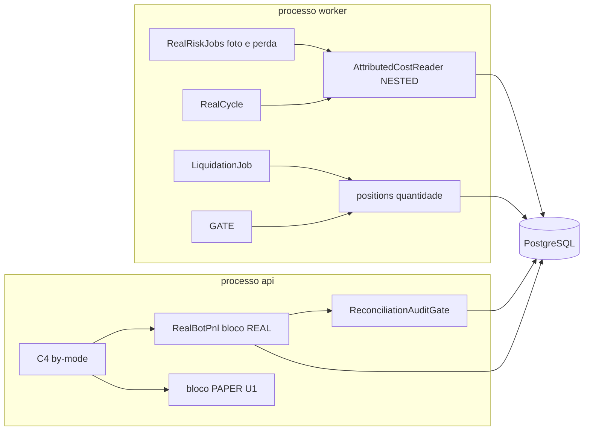

# Componentes lógicos — U2 `u2-real-bot-pnl`

Conversa: português (Brasil). Data: 2026-11-22. Revisado depois de `reviews/review-01.md`, `reviews/review-02.md` e das decisões do fundador de 2026-11-22 (F-1 a F-4, em `performance-design.md`).

Inventário dos componentes que a U2 cria ou muda, onde cada padrão de NFR se aplica, os domínios de falha e o raio de impacto. Fecha com a ordem de construção e a lista de alinhamentos que a Code Generation aplica [Q4] [Q5].

## Processos e recursos compartilhados

| Recurso | Muda? | Uso pela U2 |
|---|---|---|
| Processo `api` (Spring Boot) | não | leitura do P&L REAL (C4, C10, `GET /api/v1/real/pnl`), evento limitado de divergência, confirmação de depósito e saque |
| Processo `worker` | não | barreira REAL, `RealCycle`, `LiquidationJob`, `RealRiskJobs`, confirmação das ordens e das condicionais |
| PostgreSQL 17 | +1 tabela, +1 índice | `real_entry_slot`, `real_ledger_entry_wallet_created_idx` |
| Hikari principal (20 conexões na API, 36 no worker) | não | 1 conexão por leitura |
| Pool `pnl-mismatch-audit` (2 conexões, espera de 250 ms) | novo, na API | só a gravação do evento de divergência |
| Pool `pnl-mode-block` (8 threads, fila de 16) | não | bloco REAL de C4 |
| CloudWatch (`Eureka/App`) | +1 métrica, +1 alarme | divergência do P&L REAL |
| TxSigner, KMS, RPC | não | nenhum uso |

## Componentes

| Componente | Módulo e pacote | Novo ou muda | Responsabilidade | Padrões de NFR |
|---|---|---|---|---|
| Migração `0023-real-entry-slot.sql` | banco, dono `ledger` | novo | tabela lateral, gatilhos, permissões, índice | só inserção, menor privilégio, expand-contract |
| `JdbcRealLedger` | `ledger.infra` | muda | `recordSlot`; `streamInNetworkOrder`; `positions` e `view` só de quantidade na ordem de rede | fluxo com `fetchSize` 500, herança determinista, índice da `0023` |
| `ledger.api.RealLedger`, `NetworkOrderKey`, `NetworkOrderedEntry`, `SlotStatus`, `RecordSlotResult` | `ledger.api` | novo ou muda (C12, C13) | contrato das leituras e do slot | NEVER_SUM_MODES, sem PAPER |
| `ledger.api.RealCostMethod` | `ledger.api` | muda (C11) | porta pura: caminho só de quantidade e acumulador por titular | puro, sem I/O, sem ponto flutuante |
| `ledger.api.RealCost`, `RealCostUnknownReason`, `RealPosition` | `ledger.api` | novo ou muda (C11, F-3) | custo selado `Known` ou `Unknown`; `RealPosition` leva `RealCost` em vez de `long costLamports` | `unknown` explícito, nunca 0 nem `null` |
| `ReadDeadline`, `ReadDeadlineExceeded` (nomes propostos) | `shared` | novo | instante limite do relógio injetado, conferido em cada linha, e `statement_timeout` reaplicado antes de cada busca | prazo duro, sem cancelamento fora de banda |
| `RealPositions` | `ledger.domain` | muda | perde o algoritmo de custo próprio; fica a quantidade | — |
| `LedgerRealSlotMetrics` (nome proposto) | `ledger.infra` | novo | `ledger_real_slot_missing_total`, `ledger_real_slot_conflicts_total` | registro com 0 na subida |
| `JdbcRealExecutionStore.streamSettled` | `realexecution.infra` | novo (C13) | ordens assentadas da pessoa, uma a uma | fluxo, `real_order_user_created_idx`, tenant e pessoa |
| Confirmação da ordem REAL, `FillPosting`, confirmação de depósito, saque e taxa | `realexecution`, `realexits`, `botwallet` | muda | chamam `recordSlot` na transação da confirmação | idempotência, conflito nunca derruba |
| `RealCostBasis` | `pnl.real` | novo | BR2.1 a BR2.4 (custo por titular) | aritmética exata, testes antes |
| `RealProration` | `pnl.real` | novo (fase 2) | rateio pelo maior resto (BR4) | aritmética exata, testes antes |
| `AttributedCostReader` (nome proposto), atrás de `pnl.api.RealWalletCost` | `pnl.application` | novo | custo de uma carteira com atribuição, caminhos `GATE` e `CYCLE` | `NESTED`, `statement_timeout` de 250 ms, falha fechada |
| `RealBotPnl` (substitui `RealBotPnlQueryV1` e `RealPnlCalculator`) | `pnl.application` | novo (fase 2, C10) | F1 a F5 por pessoa | REPEATABLE READ, fluxo, 500 ms de atribuição, conferência exata |
| `ReconciliationAuditGate` (nome proposto) | `pnl.application` | novo | impressão digital, executor de 2 threads e espera limitada; chama `audit.api.RateLimitedAuditPublisher` | 200 ms, falha nunca muda a resposta |
| `MismatchAuditDataSource`, `MismatchAuditWriter`, `RateLimitedAuditPublisher` (nomes propostos) | `audit.infra`, `audit.api` | novo | pool `pnl-mismatch-audit` com `DataSource`, `DataSourceTransactionManager` e `JdbcClient` próprios; trava, recência e `insert` no outbox numa só transação desse pool | não é bean `DataSource`; o `JdbcAuditEventPublisher` não muda |
| Migração `0024-real-risk-day-deferred.sql`, marca de fotografia adiada | banco, dono `riskcontrol` | novo (F-4) | `real_risk_day_deferred` | aditiva, expurgo como `real_risk_day` |
| `PnlModeMetrics` | `pnl.modeview` | muda | etiqueta `cause` em `pnl.mode_block.unavailable` (10 séries) | portão de carga por qualquer `TIMEOUT` do bloco |
| `PnlRealMetrics` (nome proposto) | `pnl.application` | novo | divergência, falha da auditoria, temporizador da atribuição | registro com 0 na subida |
| `RealReferences`, `JdbcAuditEventPublisher`, `WalletHasher` | `audit` | muda | assinatura abreviada e HMAC no `REAL_SLOT_CONFLICT` | sem assinatura completa na auditoria |
| `RealGateInputsReader`, `RealGateUnavailable`, `RealRiskPolicy`, `RealRiskJobs` | `riskcontrol` | muda | `ATTRIBUTION` só nas rodadas (`value`), nunca no `buy`; `priced` e `positionsValue` com `RealCost` e valor selado; fotografia adiada e recusa `DAY_SNAPSHOT_PENDING` (F-4) | transação continua utilizável; custo e preço desconhecidos recusam a compra |
| `RealCycle` | `bots.worker` | muda | custo desconhecido não decide compra; saídas por preço decidem e saídas por custo são puladas com `COST_UNKNOWN` | quantidade sempre chega |
| `PnlByModeProperties`, `application.yml`, `main.tf` | `pnl.infra`, IaC | não muda (F-2) | o teto `real-max-orders` e a variável `MEMETRADE_PNL_BYMODE_REALMAXORDERS` ficam; o teto passa a ser aplicado dentro do fluxo | — |
| `PnlModeBlock` | `apps/web` | muda (fase 2) | rótulo "Taxas" e saída da nota (BR10.4) | — |
| `real-ops-alerts.yml`, `real-ops.tf`, `app-metrics.tf` | IaC | muda | regra e alarme da divergência | paridade testada |
| `scripts/load/pnl-plans.mjs`, cenário `pnl-by-mode` | carga | novo | portão manual de C4 e do plano | workflow manual |

## Domínios de falha e raio de impacto

Texto equivalente: na API, C4 monta o bloco PAPER e o bloco REAL lado a lado; o bloco REAL lê o banco e, numa divergência, grava o evento limitado. No worker, as rodadas de risco e o ciclo pedem o custo à leitura com atribuição num ponto de salvamento; a barreira (compra e venda), a liquidação e as vendas usam só o caminho de quantidade.

| Falha | Raio de impacto | Fica de pé |
|---|---|---|
| Leitura do bloco REAL (erro, `TIMEOUT`, divergência, `UNKNOWN_BOT`) | o bloco REAL de C4, `botPnl` e `GET /api/v1/real/pnl` daquela pessoa | bloco PAPER, resposta 200, ordens, barreira, saque |
| Gravação do evento de divergência (inclusive o pool `pnl-mismatch-audit` sem conexão em 250 ms) | nenhum (a resposta não muda) | tudo; só a auditoria perde aquela gravação, contada em `pnl_real_reconciliation_audit_failures_total` |
| Leitura de custo nas rodadas ou no ciclo | as compras da carteira afetada: no ciclo, naquele ciclo; na rodada do dia, até a fotografia ser gravada (F-4) | quantidade, vendas, liquidação, saque, saídas por preço, o resto do ciclo |
| Conflito de slot | nenhum (auditado e contado) | a confirmação, os lançamentos, o estado da ordem |
| `recordSlot` com o banco fora | a confirmação inteira, como hoje | a repetição da confirmação pelo caminho que já existe |
| Migração `0023` | a implantação (o `db-migrate` falha antes da troca das imagens) | as imagens anteriores, que não usam nada da `0023` |

## Fronteiras de módulo (ArchUnit)

- `ledger` nunca depende de `pnl` (`LedgerArchitectureTest.theLedgerNeverDependsOnThePnl`, sem exceção).
- `pnl.application` lê o ledger REAL só por `ledger.api`, as ordens só por `realexecution.api` e os bots só por `pnl.api.BotDirectory` (C8); nunca as tabelas deles.
- `riskcontrol.real.infra` e `bots.worker` pedem o custo só por `pnl.api.RealWalletCost`.
- `pnl` grava o evento limitado só por `audit.api.RateLimitedAuditPublisher`; só o `MismatchAuditWriter` depende do `MismatchAuditDataSource`.
- A regra de ponto flutuante e a de NEVER_SUM_MODES cobrem os pacotes novos.
- Só `riskcontrol.real`, `bots.worker` e `pnl` dependem de `RealCost.Known`; `realexecution` (liquidação) e `botwallet` (saque) não dependem de `RealCost` (F-3).

## Ordem de construção (Q4)

| Passo | Conteúdo | Saída |
|---|---|---|
| 0 | Linha de base da barreira (`docs/perf/u2-barrier-baseline.md`) | commit próprio, antes de qualquer mudança na barreira |
| Fase 1 | `0023`, `recordSlot` nos três gravadores, `streamInNetworkOrder`, `RealCostMethod` com o caminho só de quantidade, `RealCostBasis`, leitura de custo `GATE`/`CYCLE` com `NESTED`, paridade com três oráculos | **ponto de controle interno**: os sete itens no mesmo commit com o `ci` verde (`reliability-design.md`) |
| Divisão | Se a fase 1 não ficar verde na primeira passada (o commit dos sete itens mais um de correção) ou se a medição da leitura de custo (rodadas e ciclo) passar das metas | U2a (fase 1) e U2b (fase 2), como o fundador já decidiu |
| Fase 2 | rateio, "Sem bot", taxas, conferência, período, atribuição `PNL`, troca do `RealBotPnlQueryV1` (com o teto no fluxo), `GET /api/v1/real/pnl` pelo pool, etiqueta `cause`, textos da tela (BR10.4) e do contrato (BR5.6), métricas da divergência, alarme, runbook, cenário `pnl-by-mode` e texto pronto do `load-test.yml` | Build and Test, que só fecha com a execução verde de `pnl-by-mode` (NFR1.25) |

## Alinhamentos para a Code Generation [Q5]

Aplicados num commit junto com o código que eles descrevem, na fase em que o código entra. Nenhum muda uma decisão; todos tiram uma contradição entre texto e código.

| # | Arquivo | Alinhamento | Origem |
|---|---|---|---|
| A1 | `construction/u2-real-bot-pnl/functional-design/rules.md` BR2.7 e `functional-spec.md` | "800 ms dentro do p95 de 1 s de C4, no caminho do P&L" passa a **500 ms**, dentro do prazo do bloco de 800 ms (`memetrade.pnl.by-mode.block-timeout`) | D-NFR1 |
| A2 | `functional-design/entities.md` ENT-215 | `txSignature` (completa) vira `txSignatureAbbrev` (4 … 4) e `txSignatureHmac` (HMAC-SHA-256 pelo `WalletHasher`, chave `memetrade.audit.wallet-hmac-key`); acrescentar `tenantId` e `correlationId` | D-NFR2, NFR3.9 |
| A3 | `functional-spec.md` F4 e F7; `rules.md` BR1.4 e BR8.7; `inception/contract-design/contract-summary.md` C13 | `real_pnl_reconciliation_mismatch_total` → `pnl_real_reconciliation_mismatches_total`; `real_slot_conflicts_total` → `ledger_real_slot_conflicts_total` (vale também para a U4) | R-04, NFR2.11, NFR2.13 |
| A4 | `nfr-requirements/nfr-requirements-questions.md` Q1 e o resumo | uma linha que aponta para D-NFR1 (500 ms no caminho do P&L, portão de `TIMEOUT` de 0,5%) e D-NFR3 (portão do workflow manual `load-test`, não da CI) | R-10 |
| A5 | `nfr-requirements/observability-requirements.md`, "Critérios mensuráveis das quatro métricas" | "as quatro" passa a **"as cinco"** | R-10 |
| A6 | `construction/u1-mode-skeleton/nfr-design/performance-design.md`, "Configuração nova" | "fixos e nunca lidos do ambiente" passa a "lidos por `@ConfigurationProperties`, com o padrão no `application.yml` e, para `block-timeout`, a variável da tarefa `api`"; a linha de `real-max-orders` continua (o teto fica, decisão F-2) | pendência da U1 (`code-summary.md`, R-05 da U1) |
| A7 | `construction/u1-mode-skeleton/nfr-requirements/scalability-requirements.md` NFR8.1 (só o da U1) | "0 mudanças nas definições de tarefa do ECS" passa a "0 recursos de serviço novos; as três variáveis sem segredo do `api_environment` do `infrastructure-specification.md` da U1". O NFR8.1 da U2 não muda: a U2 não toca na definição de tarefa (F-2, a retirada da variável foi desfeita) | pendência da U1 |
| A8 | `construction/u1-mode-skeleton/functional-design/rules.md` BR1.9 | acrescentar a decisão do fundador sobre o `DecisionRequest` REAL (teto da conta e `limitsVersion = 0`) e o 422 de `changeLimits`, hoje só no `reliability-design.md` da U1 | pendência da U1 |
| A9 | `functional-design/rules.md` BR1.1, BR1.2 e BR1.3; `contract-summary.md` C12 (`order` e `fallback`) | a ordem de gravação da herança passa de `(created_at, entry_id)` a `(created_at, reference, kind_rank, idempotency_key)`, e todo desempate de texto (`tx_signature`, `reference`, `idempotency_key`) usa `COLLATE "C"` | decisão F-1 do fundador (2026-11-22) |
| A10 | `functional-spec.md`, suposição 3, e `performance-requirements.md`, nota do `real-max-orders` | o teto fica, com o comportamento da U1, aplicado dentro do fluxo da U2 | decisão F-2 do fundador (2026-11-22) |
| A11 | `contract-summary.md` C11 (`RealPosition: "sem mudança"`, regra "o custo restante nunca fica menor que o real") e `functional-design/entities.md` ENT-206 | `RealPosition` passa a `(mint, tokenBaseUnits, RealCost cost)`, com `RealCost` selado `Known(long)` ou `Unknown(reason)`; `RealWalletCost` devolve `WalletCost` selado; um custo desconhecido nunca vira 0 | decisão F-3 do fundador (2026-11-22), revisão R-02 |
| A12 | `observability-requirements.md` da U1 (contador `pnl.mode_block.unavailable`) | o contador ganha a etiqueta `cause` (10 séries) | revisão R-03 |
| A13 | `aidlc/spaces/default/intents/261113-trading-real-bot/construction/u3-real-risk/functional-design/rules.md` BR4.4 (a fotografia do dia da barreira, não a BR4.4 desta Unit) | acrescentar: sem fotografia de hoje e com a marca de adiamento do dia (custo `Unknown`), a primeira avaliação de compra é recusada (`DAY_SNAPSHOT_PENDING`) e não grava `FIRST_EVALUATION`; a rodada tenta de novo a cada 5 min e, numa carteira com a marca, grava a fotografia só com custo `Known`, com a base de cada posição no maior entre cotação e custo | decisão F-4 do fundador (2026-11-22), revisão 02 R-11 |
| A14 | `nfr-requirements/performance-requirements.md` NFR1.4 e NFR1.26 | NFR1.4 passa a medir a leitura de custo das rodadas e do ciclo (sem a trava); NFR1.26 diz que a compra com posição sem preço não lê a atribuição e fica na meta da compra de NFR1.5 | revisão 02 R-13 |

O texto pronto do `.github/workflows/load-test.yml` continua em `nfr-requirements/performance-requirements.md` (NFR1.9). Ele é entregue ao responsável na fase 2, no mesmo commit em que o cenário entra em `scripts/load-test.sh` e `scripts/load/load-test.mjs`.

## Sources

- `nfr-design-questions.md`: Q1 a Q5 e o resumo confirmado [Q1] [Q2] [Q3] [Q4] [Q5].
- `reviews/review-01.md` (R-01 a R-09) e as decisões do fundador de 2026-11-22 (F-1 a F-3).
- `construction/u2-real-bot-pnl/nfr-requirements/`: os cinco arquivos de requisitos, `tech-stack-decisions.md`, `reviews/review-02.md` (R-08 a R-10).
- `construction/u2-real-bot-pnl/functional-design/functional-spec.md` (F1 a F9), `rules.md`, `entities.md`.
- `inception/contract-design/contract-summary.md`: C8, C10 a C14.
- `construction/u1-mode-skeleton/nfr-design/` (pool, prazo do bloco, ponto de salvamento) e `construction/u1-mode-skeleton/code-generation/code-summary.md` (pendências registradas).
- Código lido: os arquivos citados em `performance-design.md`, `security-design.md`, `reliability-design.md` e `observability-design.md`.
- `aidlc/spaces/default/memory/team.md`: Code Style (fronteiras de módulos), Way of Working (`.github/workflows/` é do responsável), Testing Posture.

## Assumptions & Open Questions

1. [assumption] Os nomes marcados como "nome proposto" são deste estágio; os contratos (C10 a C14) e o comportamento não mudam se a Code Generation escolher outros.
2. [assumption] A1 a A14 são edições de texto feitas pela Code Generation, como a Q5 decidiu; este estágio não edita esses arquivos.
3. A9, A10, A11 e A13 já têm a aprovação do fundador (decisões F-1 a F-4 de 2026-11-22); A7 ficou restrito à pendência da U1.
