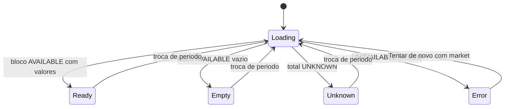
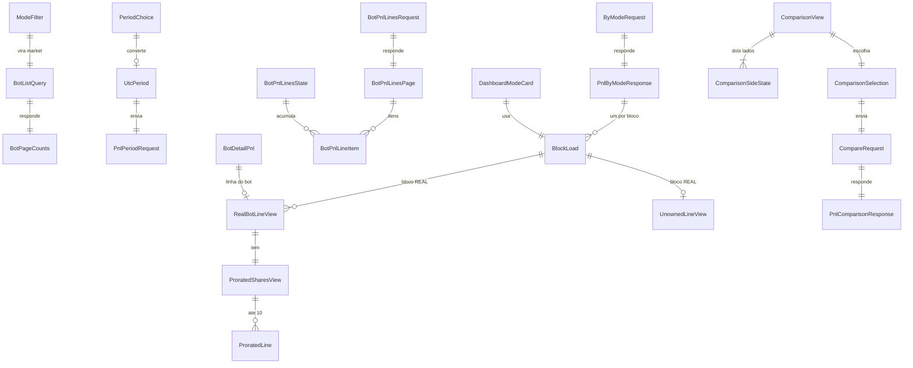

# Especificação funcional — U3 `u3-pnl-views`

Conversa: português (Brasil). Data: 2026-11-23.

Este arquivo é a fonte de verdade dos fluxos e das máquinas de estado das telas da U3. Os dados ficam em `entities.md` e as decisões em `rules.md`; o diagrama entidade-relacionamento e o resumo das regras no fim deste arquivo são derivados deles.

## Histórias que a U3 implementa

As histórias estão em `inception/user-stories/stories.md`. A divisão vem de `unit-of-work-story-map.md`.

| História | O que a U3 entrega | O que fica com outra Unit |
|---|---|---|
| US2.3 | filtro Todos, Simulado e Real em `/bots` (F1) | — |
| US3.10 | detalhe do bot REAL com a origem de cada linha (F4) e as parcelas rateadas no bloco REAL (F3) | o cálculo das parcelas (U2) |
| US4.1 | o painel sem total geral (AC4.1.2) (F6) | AC4.1.1, AC4.1.3 a AC4.1.5 (U1) |
| US4.2 | o aviso no painel, no detalhe do bot simulado e na comparação (F4, F5, F6) | AC4.2.1, AC4.2.3, AC4.2.6, AC4.2.7 (U1) |
| US4.3 | o painel com os dois totais (F6) | — |
| US4.4 | contraste, cor com texto, rótulos e foco no painel e no detalhe | AC4.4.4 e AC4.4.5 em `/pnl` (U1) |
| US4.5 | 360 px e estados distintos no painel e no detalhe | AC4.5.2 em `/pnl` (U1) |
| US7.1 | o período de `/pnl` (F2) | — |
| US7.2 | a data no fuso da pessoa e os instantes UTC na API (F2, F4) | AC7.2.1, o não realizado de agora no cálculo (U2) |
| US8.1 | a comparação (F5) | — |

## F1 — Filtrar a lista de bots por modo

Regras: BR1.1 a BR1.7, BR3.2, BR6.3.

1. A pessoa abre `/bots` ou `/bots?mode=REAL`. A tela lê `mode` do endereço. Um valor ausente ou inválido vale Todos e sai do endereço (BR1.7).
2. A tela chama, em paralelo:
   - `listBots` com `state` (se houver) e `market` (se o filtro não é Todos);
   - C4 com o mesmo `market` (ou sem ele em Todos), `period=ALL` (BR1.6).
3. Com a resposta de `listBots`:
   - `totalCount = 0`: "Você ainda não tem bots." e "+ Novo bot"; o filtro e o aviso não aparecem (BR1.3);
   - `matchingCount = 0` com o filtro de modo: "Você não tem bots reais." ou "Você não tem bots simulados." e "Ver todos os bots" (BR1.3);
   - senão, a lista na ordem de criação, com o selo de modo e o P&L de cada bot procurado pelo `botId` no bloco do modo (BR6.3).
4. O foco vai para o rádio marcado do filtro (BR1.4).
5. A pessoa troca o filtro com as setas ou o clique:
   1. o endereço troca o `mode` (sem nova entrada no histórico);
   2. os pedidos pendentes são descartados e os passos 2 e 3 se repetem;
   3. a linha "Mostrando N de M bots." é anunciada (BR1.5).
6. "Ver todos os bots" volta para Todos e leva o foco ao rádio Todos.
7. O P&L de uma linha indisponível mostra "P&L indisponível agora"; o "Tentar de novo" da lista relê só o bloco em erro (BR3.2).

## F2 — Escolher o período em `/pnl`

Regras: BR2.1 a BR2.7, BR3.1, BR6.2.

1. A pessoa abre `/pnl`. Sem `periodo` no endereço, vale "Desde o início" (BR2.1).
2. A tela pede C4 sem `market`:
   - em ALL, com `period=ALL`;
   - nos demais, com `period=RANGE`, `from` e `to` em UTC (BR2.4).
3. Os dois blocos carregam cada um por si e mostram o próprio estado.
4. A pessoa marca "Hoje", "Últimos 7 dias" ou "Últimos 30 dias":
   1. a tela calcula o intervalo pelos dias locais (BR2.2) e o converte por `toUtcPeriod`; o par UTC fica fixo até a próxima aplicação, mesmo depois da meia-noite local;
   2. o endereço fica `?periodo=hoje`, `7d` ou `30d`;
   3. o texto "Mostrando: …" é anunciado (BR2.7);
   4. a tela relê C4 sem `market` e, com a comparação aberta, relê C6 (BR2.6);
   5. a tabela PAPER "Ver por token" lê `GET /api/v1/pnl` com o mesmo par UTC (BR2.9);
   6. uma resposta do período anterior que chega depois é descartada.
5. A pessoa marca "Intervalo": os campos "De" e "Até (inclusive)" e "Aplicar" aparecem; nada é relido ainda.
6. A pessoa clica em "Aplicar" (ou Enter num campo):
   - válido: igual ao passo 4, com `?periodo=intervalo&de=…&ate=…`; o foco fica em "Aplicar";
   - inválido (fim antes do início, mais de 366 dias em UTC, data vazia ou intervalo que começa depois de hoje): a mensagem do campo (BR2.3) é anunciada por `role="alert"`, o foco vai ao primeiro campo com erro, as datas ficam e os blocos continuam com o último período válido.

7. A pessoa volta a "Desde o início": os blocos releem com `period=ALL`, e o lugar da tabela por token mostra "Escolha um período para ver o resultado por token", sem pedido a `GET /api/v1/pnl` (BR2.9, decisão do fundador de 2026-11-23). Os totais por modo aparecem sempre.

## F3 — Ler e reler um bloco; parcelas rateadas e "Sem bot"

Regras: BR3.1 a BR3.4, BR4.7, BR4.8, BR6.1.

1. Cada bloco de C4 vira o próprio `BlockLoad`: `UNAVAILABLE` ou uma falha da rota viram erro com o código (BR3.3).
2. No bloco REAL pronto (variante `full`):
   1. cada bot REAL mostra o `ProratedLines` quando `prorated.count > 0` (BR4.7);
   2. a linha "Sem bot" aparece quando algum valor dela não é "0", com cada motivo em texto (BR4.8).
3. A pessoa clica em "Ver N linhas rateadas":
   1. a lista abre com `aria-expanded="true"`;
   2. com mais de 10 parcelas, a lista termina com "Ver todas no detalhe do bot".
4. Um bloco está em erro e a pessoa clica em "Tentar de novo":
   1. a tela pede C4 com `market` igual ao do bloco e o período em vigor (BR3.1, BR3.2);
   2. só aquele bloco volta para carregando; o outro fica como estava;
   3. com a resposta, só aquele bloco muda, e o foco vai para o título dele (BR3.4).

## F4 — Detalhe do bot

Regras: BR4.1 a BR4.6, BR2.5, BR2.8, BR8.2, BR9.3, BR10.1, BR10.2.

1. A pessoa abre `/bots/{id}`. A tela lê `GET /api/v1/bots/{id}`:
   - 404: "Bot não encontrado." e "Voltar para Meus bots", sem nenhum dado (BR8.2). Fim;
   - erro: o texto, o código e "Tentar de novo".
2. Com o bot lido, o cabeçalho mostra o nome, o selo e "Modo: Real, em SOL · não pode ser trocado" ou "Modo: Simulado, em dólares · não pode ser trocado".
3. A tela lê C4 com `market` igual ao modo do bot e `period=ALL` (o bloco inteiro, custo aceito), e procura a linha do bot pelo `botId` (BR4.6). O cabeçalho usa só `GET /api/v1/bots/{id}` e essa linha. O `PnlModeBlock` variante `bot` mostra o total, o realizado, o não realizado e as taxas, "desde o início" (BR2.8).
4. Bot PAPER: o aviso do simulado aparece (`role="note"`) e as seções que já existem continuam (BR4.5). Fim.
5. Bot REAL:
   1. o aviso não aparece (tela só de P&L real, AC4.2.6);
   2. a tela lê C5 com `limit=50`, sempre "desde o início": C5 não tem período, e é assim que esta Unit lê a Q3 (BR4.6);
   3. as linhas aparecem na ordem recebida (BR4.2), com a data no fuso da pessoa (BR2.5), as seis colunas e a origem em texto (BR4.1, BR4.4).
6. Com `nextCursor`:
   1. "Carregar mais" pede a página seguinte e desabilita o botão;
   2. as linhas novas entram no fim, e o foco vai para a primeira delas;
   3. se a página seguinte falha, as linhas já mostradas ficam, e o erro aparece junto do botão.
7. Um 404 de C5 (bot que deixou de ser da pessoa, ou PAPER) troca a tela inteira por "Bot não encontrado." (BR8.2).

## F5 — Comparar um bot simulado com um bot real

Regras: BR5.1 a BR5.6, BR2.6, BR6.1 a BR6.3.

1. Em `/pnl`, a pessoa abre "Comparar um bot simulado com um bot real" (ou chega por `?comparar=`). A vista lê a lista de bots da pessoa (`listBots`, que traz `market` e `templateId`).
2. Sem nenhum par possível (nenhum PAPER com um REAL de mesmo `templateId`): o estado sem par (BR5.1). Fim.
3. A pessoa escolhe o bot simulado. "Bot real" passa a listar só os REAL de mesmo `templateId`. Com um único par possível, os dois já vêm escolhidos.
4. Com os dois escolhidos:
   1. o endereço fica `?comparar=<paperId>,<realId>` (BR5.6);
   2. a tela lê C6 com o período em vigor;
   3. cada lado mostra "Carregando a comparação…".
5. Com a resposta 200:
   - cada lado mostra o próprio bot na própria moeda, e o aviso aparece só no lado simulado (BR5.4);
   - um lado `UNAVAILABLE` mostra o erro só nele (BR5.5).
6. Com 422 `TEMPLATE_MISMATCH`: a explicação aparece, o bot real é limpo e o foco vai ao select "Bot real" (BR5.2).
7. Com 404 com `reason`: "Bot não encontrado." no lado indicado, o select dele é limpo e recebe o foco (BR5.3).
8. A troca de período relê C6 com os mesmos ids (BR2.6). Fechar a vista tira `comparar` do endereço e devolve o foco ao botão.

## F6 — Painel com os dois totais

Regras: BR7.1 a BR7.5, BR6.2, BR9.2, BR10.1.

1. A pessoa abre `/`. O painel mostra a região "Resultados por modo · desde o início" com os dois cartões em carregando, junto do `BotsCard`.
2. A tela lê C4 sem `market` e com `period=ALL`, e C2 (elegibilidade), em paralelo.
3. Cada cartão mostra o próprio estado (BR7.2):
   - o simulado com valor mostra o aviso (BR7.3);
   - o real vazio mostra "Sem bots reais." e o link conforme C2 (BR7.4).
4. "Ver o resultado simulado" e "Ver o resultado real" levam a `/pnl` (AC4.3.4).
5. "Tentar de novo" de um cartão relê só aquele cartão com `market` (BR3.2).
6. O canal ao vivo traz um evento (BR7.5):
   - `pnl.updated` relê só o cartão simulado (C4 com `market=PAPER`);
   - `real.order.state` com `CONFIRMED` ou `FAILED`, ou `real.conditional.state`, relê só o cartão real (C4 com `market=REAL`);
   - os demais eventos não releem;
   - cada cartão relê no máximo uma vez a cada 30 s; um evento dentro da janela fica pendente e relê no fim dela;
   - o total novo é anunciado no máximo uma vez a cada 30 s por cartão.

## F7 — Conferência de ponta a ponta

Regras: BR12.1, BR10.1, BR6.2.

O spec `e2e/zz-paper-real-unico` continua o último da suíte. Ele usa os dois bots e as duas compras que já faz e acrescenta os casos de `frontend-components.md` ("Acréscimos ao spec de ponta a ponta"). O comando de verificação continua `bash scripts/verify.sh`.

## Máquinas de estado das telas

### Bloco por modo (`/pnl`, painel, lista e detalhe)

| De | Evento | Para |
|---|---|---|
| — | abertura, troca de período | `loading` (os dois blocos) |
| `loading` | bloco disponível com valores | `ready` |
| `loading` | bloco disponível sem bots ou sem operações | `empty` |
| `loading` | bloco disponível com o total `UNKNOWN` | `unknown` |
| `loading` | `UNAVAILABLE` ou falha da rota | `error` |
| `error` | "Tentar de novo" (C4 com `market`) | `loading` (só este bloco) |
| `ready`, `empty`, `unknown` | troca de período, canal ao vivo (painel) | `loading` |

O estado de um bloco nunca muda por um evento do outro bloco.

### Filtro de `/bots`

| De | Evento | Para |
|---|---|---|
| `ALL` | escolher Simulado | `PAPER` |
| `ALL` | escolher Real | `REAL` |
| `PAPER` ou `REAL` | escolher Todos, "Ver todos os bots" | `ALL` |
| `PAPER` | escolher Real | `REAL` |
| `REAL` | escolher Simulado | `PAPER` |

Cada transição troca o endereço, descarta o pedido pendente e relê a lista e o P&L com o novo `market`.

### Seletor de período

| De | Evento | Para |
|---|---|---|
| `ALL` | marcar Hoje, 7 ou 30 dias | `TODAY`, `LAST_7` ou `LAST_30` (aplicado, par UTC fixo) |
| qualquer | marcar "Intervalo" | `RANGE_EDITING` (nada é relido) |
| `RANGE_EDITING` | "Aplicar" válido | `RANGE` (aplicado) |
| `RANGE_EDITING` | "Aplicar" inválido | `RANGE_INVALID` (blocos com o último período válido) |
| `RANGE_INVALID` | editar um campo | `RANGE_EDITING` |
| qualquer | marcar "Desde o início" | `ALL` (aplicado) |

### Linhas do detalhe do bot REAL

| De | Evento | Para |
|---|---|---|
| `loading` | página com itens | `ready` |
| `loading` | página vazia | `empty` |
| `loading` | 404 | `notFound` (a tela inteira vira "Bot não encontrado.") |
| `loading` | outra falha | `error` |
| `error` | "Tentar de novo" | `loading` |
| `ready` | "Carregar mais" | `loadingMore` |
| `loadingMore` | página seguinte | `ready` (itens anexados, foco na primeira linha nova) |
| `loadingMore` | falha | `moreError` (linhas mantidas) |
| `moreError` | "Tentar de novo" (mesmo cursor) | `loadingMore` |
| `loadingMore` | 400 do campo `cursor` (a lista mudou desde a última página) | `cursorStale` ("A lista mudou desde a última página.", linhas mantidas) |
| `cursorStale` | "Recarregar do início" (1ª página sem cursor; o cursor recusado nunca é repetido) | `loading` (os itens são trocados) |

Alinhamento A9 (Code Generation da U3, 2026-11-23): as duas últimas transições acompanham o 400 que C5 devolve quando a âncora do cursor some (`RealPnlLineCursorRejected`); o `BotPnlLines` as implementa.

### Comparação

| De | Evento | Para |
|---|---|---|
| `closed` | abrir, ou endereço com `comparar` | `choosing` ou `noPair` |
| `choosing` | os dois bots escolhidos | `comparing` (cada lado em `loading`) |
| `comparing` | 200 | cada lado em `ready` ou `error` |
| `comparing` | 422 `TEMPLATE_MISMATCH` | `mismatch` (bot real limpo) |
| `comparing` | 404 com `reason` | `choosing` (lado indicado em `notFound`) |
| `mismatch` | escolher outro bot real | `comparing` |
| lado em `error` | "Tentar de novo" | lado em `loading` (o outro lado não muda) |
| qualquer aberta | fechar | `closed` |

### Diagrama do bloco por modo

Texto equivalente: todo bloco começa em carregando. Dali vai para pronto, vazio, desconhecido ou erro, conforme a resposta de C4. Do erro, só "Tentar de novo" (C4 com o `market` do bloco) volta a carregar. De pronto, vazio ou desconhecido, a troca de período volta a carregar. Nenhuma transição de um bloco depende do outro.

## Diagrama entidade-relacionamento (derivado de `entities.md`)

Texto equivalente: o filtro vira o `market` de `listBots`, que responde a página com as contagens. O período escolhido vira o par UTC enviado a C4 e C6. A resposta de C4 vira um `BlockLoad` por bloco; o bloco REAL traz as linhas dos bots, cada uma com as parcelas (até 10), e a linha "Sem bot". C5 responde páginas de linhas que o estado do detalhe acumula. A comparação guarda a escolha, envia o pedido de C6 e tem dois lados independentes. Cada cartão do painel usa um `BlockLoad`; o P&L do detalhe é a linha do bot em C4.

## Resumo das regras (derivado de `rules.md`)

| Grupo | Regras | Ideia |
|---|---|---|
| BR1 filtro | BR1.1 a BR1.7 | Todos, Simulado e Real; no endereço `?mode=`; filtro no servidor por `market`; vazio pelo filtro com texto próprio; foco no filtro |
| BR2 período | BR2.1 a BR2.9 | "Desde o início" por padrão; Hoje, 7 e 30 dias e intervalo; dias inteiros no fuso da pessoa; intervalo inclusivo até 366 dias, sem início futuro; UTC na API; não realizado de agora; painel e detalhe sempre desde o início; tabela por token só com período concreto |
| BR3 releitura | BR3.1 a BR3.4 | C4 com `market` responde só um bloco; "Tentar de novo" relê só ele |
| BR4 linhas | BR4.1 a BR4.8 | origem em texto; ordem da rede; 50 por página com cursor; compra com "—"; parcelas e "Sem bot" no bloco REAL |
| BR5 comparação | BR5.1 a BR5.6 | mesmo `templateId`; 422 `TEMPLATE_MISMATCH`; 404 por lado; cada lado na sua moeda; aviso só no simulado |
| BR6 nunca somar | BR6.1 a BR6.3 | nenhuma conta de dinheiro no `apps/web`; nenhum total geral; nenhuma ordenação que misture modos |
| BR7 painel | BR7.1 a BR7.5 | dois cartões, sem total geral; estados próprios; aviso no simulado; link do motivo no real vazio; cada cartão relê com os eventos do próprio modo, com limite de 30 s |
| BR8 tenant | BR8.1, BR8.2 | tenant do token; 404 sem dado |
| BR9 acessibilidade | BR9.1 a BR9.3 | 4,5:1; cor com texto; rótulos com modo e moeda; `aria-live`; foco e cabeçalhos |
| BR10 celular | BR10.1, BR10.2 | 360 px sem rolagem lateral; `TableScroll`; quatro estados distintos |
| BR11 dinheiro | BR11.1, BR11.2 | só `money-format.ts`; nada de `Number()`/`toFixed`; PAPER em US$, REAL em SOL |
| BR12 verificação | BR12.1 | spec `zz-paper-real-unico` ampliado |

## Sources

- `functional-design-questions.md` desta pasta: Q1 a Q7 e o resumo confirmado.
- `entities.md` e `rules.md` desta pasta.
- `inception/user-stories/stories.md` e `inception/units-generation/unit-of-work-story-map.md` (linhas da U3).
- `inception/refined-mockups/mockups.md` (M4 a M7), `interaction-spec.md`, `accessibility-checklist.md`, `design-system-mapping.md`.
- `inception/contract-design/contract-summary.md`: C2, C4, C5, C6, C10, C17, PQ-6 e PQ-8.
- `construction/u1-mode-skeleton/functional-design/` e `code-generation/code-summary.md`; `construction/u2-real-bot-pnl/code-generation/code-summary.md`.
- Código lido: `apps/web/src/features/pnl/PnlScreen.tsx` (hoje relê a rota inteira e escreve só o bloco repetido), `PnlModeBlock.tsx` (sem `ProratedLines` nem "Sem bot"), `features/bots/BotList.tsx`, `features/bots/BotDetail.tsx`, `features/dashboard/DashboardScreen.tsx` (`PnlCard` e `DashboardRealPnl`), `e2e/zz-paper-real-unico/paper-real-unico.spec.ts`.

## Assumptions & Open Questions

1. **Decisão do fundador (2026-11-23): tabela por token.** O seletor de período antigo da seção "Simulado por período" de `PnlScreen` (hoje com 7 dias como padrão) sai; o `PeriodSelector` vale para os dois blocos. A tabela "Resultado por token" do PAPER fica dentro do bloco Simulado e só aparece com um período concreto (Hoje, 7 dias, 30 dias ou intervalo de até 366 dias), lida de `GET /api/v1/pnl` com o mesmo par UTC; em "Desde o início" aparece a nota "Escolha um período para ver o resultado por token" (BR2.9). Os totais por modo aparecem sempre. A conferência e o ledger PAPER continuam embaixo, com o selo e as leituras de hoje.
2. **Decisão do fundador (2026-11-23): "Hoje".** A opção "Hoje" da Q6 entra no período (BR2.1, BR2.2); as quatro opções do AC7.1.2 continuam presentes.
3. [assumption] O cabeçalho do detalhe lê o bloco inteiro de C4 para achar uma linha (custo aceito, BR4.6); C5 é sempre "desde o início", leitura da Q3 coerente com o contrato de C5.
4. [assumption] A comparação lê a lista de bots por `listBots` sem filtro para montar os dois `select`; com mais de 50 bots, a vista pede as páginas seguintes antes de montar as opções.
5. [assumption] O "Tentar de novo" da lista `/bots` (P&L indisponível de um modo) relê só aquele bloco por BR3.2; a lista em si continua com o "Tentar de novo" que já existe.
6. Nenhuma pergunta aberta bloqueia esta etapa.
