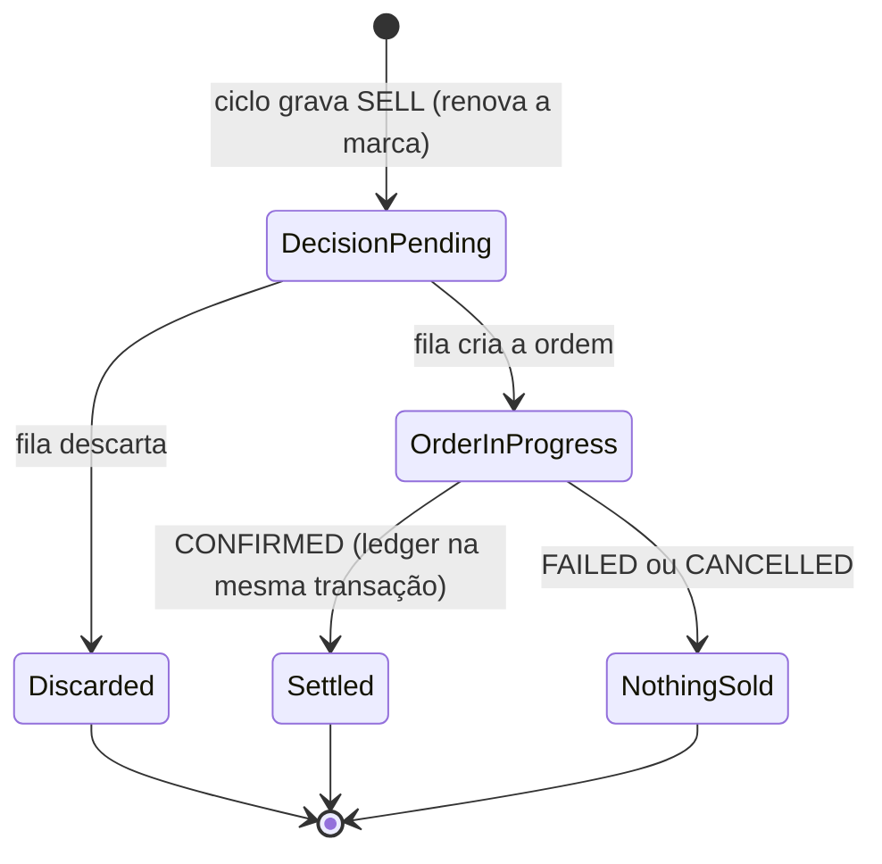
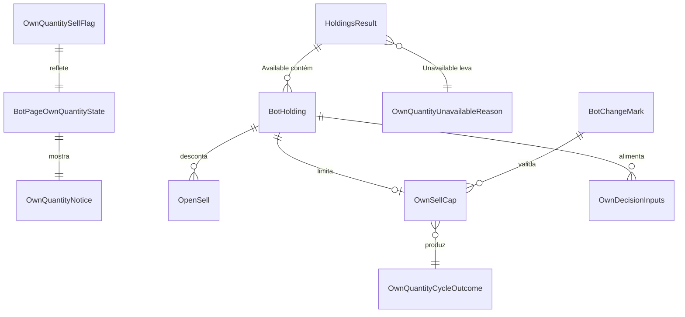

# Especificação funcional — U4 `u4-own-quantity-cycle`

Conversa: português (Brasil). Data: 2026-11-24. Unit `service`, complexidade M, risco alto (venda real). Este arquivo é a fonte da verdade dos fluxos e das transições. As entidades estão em `entities.md` e as regras em `rules.md`. As duas seções no fim são vistas derivadas.

## Histórias que esta Unit implementa

Fonte: `inception/user-stories/stories.md`.

| História | O que entrega | Critérios |
|---|---|---|
| US6.1 — O bot real vende só o que comprou | O ciclo REAL vende só a quantidade disponível do bot (F1 a F4) | AC6.1.1 a AC6.1.4 |
| US6.2 — Aviso de que cada bot passa a vender só o que comprou | Campo `realOwnQuantitySell` (C7) e o aviso na lista `/bots` (F5) | AC6.2.1 a AC6.2.3 |

As duas só são ligadas depois da Performance Validation do intent `261113-trading-real-bot` (BR5.2). O código sai com a flag desligada.

## O que existe hoje e o que muda

| Peça | Hoje (código lido) | Com a flag ligada |
|---|---|---|
| `SlotDispatcher` e lista de bots ativos | Entregam só o bot e o escopo; o mercado só é conhecido depois da trava | A lista de bots ativos (`JdbcBotRepository.activeDispatch()`) traz também o mercado do bot; o despachante entrega `DispatchedBot(ref, market)` por `CycleRunner.runDispatched`, e `run(BotRef, Instant)` continua para os chamadores de hoje, com o mercado decidido pela conferência P1 (BR2.5, alinhamento A15) |
| `CycleRunner` | Uma transação por ciclo, trava só a linha do bot, grava a decisão e renova a marca do bot no fim | Antes de abrir a transação, para um bot REAL que vai rodar, lê a marca do bot e depois o RealBotHoldings (F1); sob a trava, confere a marca antes de gravar uma venda (F3) |
| `RealCycle.inputs` e montagem do pedido | Posições da carteira inteira (caminho só de quantidade) e custo da carteira pelo caminho CYCLE da U2, num savepoint; fecha o registro de abertura de um mint fora das posições | Posições próprias disponíveis e custo próprio; mints sem quantidade disponível saem dos tokens do pedido, só no ramo REAL; o registro de abertura deles não é fechado (F2, BR1.6, BR1.8) |
| `DecisionEngine`, `DecisionRequest`, `PositionInput`, ramo PAPER | — | Não mudam |
| `RealCycle.order` (SELL) | Vende `tokenBaseUnits` da posição inteira da carteira, sem olhar a quantidade da decisão | Vende `min(pedido, disponível)`; zero vira `REAL_NO_OWN_QUANTITY` (F3, BR1.4, BR1.5) |
| `RealDecisionStep` | ORDER_IN_PROGRESS, LIQUIDATION_ACTIVE, posse do bot, barreira, `recordDecision` | Não muda |
| `RealDecision` | Já aceita a quantidade de uma venda | Não muda |
| `RealExecutionPort` | Não tem `openSells`; tem `hasOrderInProgress` por bot | Ganha `openSells` (C16 com a extensão BR1.3) |
| `DecisionConsumer` | Vende `min(decisão, posição da carteira)` | Não muda (BR4.3) |
| `LiquidationJob`, condicionais, saque | Vendem a posição da carteira, sem atribuição | Não mudam (BR4.1) |
| `BotPage` (API) e `BotList` (web) | Sem o campo e sem o aviso | Campo `realOwnQuantitySell` e aviso (F5) |

## F1 — Ler a posição própria antes do ciclo

Gatilho: o despachante de slots chama o ciclo de um bot; a lista de bots ativos já trouxe o mercado do bot (BR2.5).

0. Sem trava e só lendo (`OwnHoldingsStep`, em autocommit), o ciclo confere se vai rodar, nesta ordem: P0 bot REAL, flag ligada e slot dentro dos 5 minutos (sem consulta); P1 a linha do bot, ACTIVE, sem motivo de pausa e de mercado REAL; P2 o slot ainda não reclamado; P3 a pausa do sistema desligada. Se alguma falhar, F1 não acontece e o ciclo segue como hoje (pula dentro da transação, ou roda o PAPER). As conferências que valem continuam dentro da transação, sob a trava (BR2.5).
1. Com o contexto de autenticação do dono do bot, a marca do bot (M0, `bot.change_seq`, inteiro de 64 bits) vem da **mesma consulta da conferência P1**, antes de P2, P3 e do instantâneo; essa leitura termina antes de o instantâneo abrir (BR3.1, alinhamento A9).
2. Chama o RealBotHoldings com tenant, pessoa e bot, e prazo de 250 ms (BR2.2).
3. O RealBotHoldings abre a própria transação só de leitura, num instantâneo (BR2.1), e:
   1. confere que o bot é bot REAL da pessoa no tenant; senão, `Unavailable(BOT_NOT_OWNED)` (BR2.4);
   2. lê, desde a época de cada mint da carteira, os lançamentos na ordem de rede (C12) e as ordens assentadas (C13), e aplica o caminho de atribuição da U2 para obter a quantidade e o custo do titular bot (BR1.1);
   3. lê as vendas em aberto do bot (C16 com a extensão): ordens SELL em andamento e decisões SELL na fila (BR1.3);
   4. calcula, por mint, `disponível = max(0, própria − em aberto)` (BR1.2);
   5. fecha a transação e devolve `Available(holdings, readAt)`.
4. Qualquer falha nos passos 3.1 a 3.4 desfaz a transação própria e devolve `Unavailable(motivo)` sem lançar exceção (BR2.3).
5. Só então o ciclo abre a transação de escrita (como hoje).

Com a flag desligada, F1 não acontece (BR5.1).

## F2 — Montar as entradas de decisão

Dentro da transação do ciclo, depois de travar o bot e conferir que ele está ACTIVE, sem pausa e sem kill switch (como hoje):

1. Lê o estado REAL, a cotação do SOL e as posições da carteira pelo caminho só de quantidade (como hoje). Sem estado ou sem SOL, `REAL_UNAVAILABLE` (como hoje).
2. Com `Available`: para cada mint da carteira,
   - disponível > 0: posição de saída com quantidade disponível e custo `piso(própria_custo × disponível ÷ própria)` convertido em US$ (BR1.6), nota `OWN_QUANTITY_AVAILABLE`;
   - disponível = 0: o mint entra em `heldNotSellable`, nota `NO_OWN_QUANTITY` (BR1.5).
3. Com `Unavailable(motivo)`: todos os mints da carteira entram em `heldNotSellable`, nota `OWN_QUANTITY_UNAVAILABLE` com o motivo; log e métrica (BR2.3).
4. O saldo operável, o teto de compra e os demais dados do motor são os de hoje (BR2.6, BR4.2). A leitura de custo da carteira pelo caminho CYCLE não é feita (BR1.6).
5. A lista de tokens do pedido é montada como hoje (seleção do bot mais as posições) e, só no ramo REAL com a flag ligada, os mints de `heldNotSellable` saem dela (BR1.6). Assim o motor não avalia esses mints para saída nem para compra. O conjunto que impede compra (posições próprias mais `heldNotSellable`) é o conjunto de mints da carteira, igual ao de hoje.
6. O registro de abertura de um mint de `heldNotSellable` não é fechado; só fecha quando a carteira não tem mais o mint (BR1.8).
7. O motor decide, sem mudança. Se ele terminar com NO_TOKENS ou NO_TRADE, as notas por mint do passo 2 ou 3 continuam no contexto da decisão, então o motivo real (NO_OWN_QUANTITY ou OWN_QUANTITY_UNAVAILABLE) nunca some. O contexto é o objeto `context.ownQuantity` que o `DecisionJson` grava só nas decisões REAL com a flag ligada: `read` (`AVAILABLE`, `UNAVAILABLE` ou `NOT_READ`, com `reason` quando houver), `mints` (a nota de cada mint da carteira) e `cap` (o veredito do corte: `NONE`, `CAPPED`, `NO_OWN_QUANTITY`, `STALE_SNAPSHOT` ou `UNAVAILABLE`, com o pedido e a venda em unidades base). É interno: nenhuma rota nem contrato expõe `decision.context` (alinhamento A10).

## F3 — Cortar e gravar a venda

Gatilho: o motor decidiu SELL de um mint.

1. A marca sob a trava (M1) é o `change_seq` da linha devolvida por `LockOrder.lockBot`, sem consulta a mais. O veredito do corte (`OwnSellCap`) é calculado depois de `engine.decide` e **antes** de `decisions.insert`, para a nota entrar no contexto da decisão; `step.submit` só é chamado com venda maior que zero (alinhamento A8). IF M1 ≠ M0 THEN resultado `REAL_OWN_QUANTITY_UNAVAILABLE`, motivo `STALE_SNAPSHOT`, nada é gravado no RealExecution (BR3.1).
2. Com `Unavailable`, resultado `REAL_OWN_QUANTITY_UNAVAILABLE` (BR2.3). (Não deve acontecer, porque F2 tira os mints dos tokens do pedido; é a defesa em profundidade.)
3. `pedido = piso(quantidade da decisão × 10^decimais)`; `venda = min(pedido, disponível)` (BR1.4).
4. IF venda = 0 THEN resultado `REAL_NO_OWN_QUANTITY` (BR1.5).
5. ELSE o candidato SELL com `venda` segue pelo `RealDecisionStep` como hoje: ORDER_IN_PROGRESS, LIQUIDATION_ACTIVE, posse, barreira, `recordDecision` (BR3.3).
6. A transação termina como hoje, renovando a marca do bot (BR3.2).

Pseudocódigo do corte (ilustrativo):

```text
if flag off: sell wallet position as today
if mark_under_lock != mark_before_snapshot: return REAL_OWN_QUANTITY_UNAVAILABLE(STALE_SNAPSHOT)
if holdings is Unavailable(r):              return REAL_OWN_QUANTITY_UNAVAILABLE(r)
requested = floor(decision.quantity * 10^decimals)
sell      = min(requested, holdings[mint].available)
if sell == 0:                               return REAL_NO_OWN_QUANTITY
return submit(SELL, mint, sell)              # RealDecisionStep, unchanged
```

## F4 — Depois da gravação (sem mudança)

A decisão vai para a fila do RealExecution. O consumidor trava a pessoa, vende `min(decisão, posição da carteira)` (BR4.3), a ordem passa por PROPOSED → QUOTED → SIGNED → SENT → CONFIRMED/FAILED (ou AMBIGUOUS) e o assentamento grava o ledger na mesma transação da mudança de estado (BR3.4). Enquanto a decisão está PENDING ou a ordem está em andamento, ela é descontada da quantidade disponível do bot (BR1.3).

Estados de uma venda do bot do ponto de vista da quantidade disponível:



Texto equivalente: DecisionPending e OrderInProgress (PROPOSED, QUOTED, SIGNED, SENT, AMBIGUOUS) contam como em aberto; Settled conta no ledger; Discarded e NothingSold não contam em lugar nenhum. Cada venda está em um só desses lugares em qualquer instantâneo.

## F5 — Estado na API e aviso na tela

1. A rota da lista de bots devolve `BotPage.realOwnQuantitySell` = valor da flag na API, sempre presente, false por padrão (BR5.3).
2. A lista `/bots` mostra, quando `realOwnQuantitySell` é true e o filtro de modo é "Todos" ou "Real", um parágrafo com `role="status"` e o texto exato (BR6.1, BR6.2). Não depende da página corrente nem da paginação (D5):
   "Cada bot real vende só a quantidade que ele mesmo comprou. Posições herdadas ou de outros bots continuam na carteira e podem ser vendidas em Vender tudo e sacar."
3. Com o filtro "Simulado", o aviso não aparece. Com a flag desligada, nunca aparece (BR6.3).
4. O aviso fica junto dos outros avisos da lista (o aviso do simulado), sem rolagem lateral em 360 px. A lista `/bots` também recebe o filtro da U3; a U4 integra a mudança no mesmo arquivo (RK-6).

## F6 — Ligar e desligar a flag

1. O código da U4 sai no pipeline normal com a flag desligada em todo ambiente (BR5.1).
2. Depois que a Performance Validation do 261113 passa, o responsável aprova uma implantação só da flag: o mesmo valor nas definições de tarefa da API e do worker, versionadas no Terraform; primeiro devnet, depois mainnet com o mesmo SHA (BR5.2).
3. Ordem para ligar (D4): primeiro a API, depois o worker (BR5.2).
4. Antes de virar o worker, o fundador roda a conferência só de leitura do runbook (seção 11), numa sessão `REPEATABLE READ READ ONLY`: a contagem de decisões SELL em PENDING (inclusive adiadas) é zero **e** a contagem de ordens SELL de bot em andamento também é zero; se não for, espera e confere de novo. Depois que a última tarefa antiga do worker sai da troca rolling, ele repete as duas contagens e lista, na mesma sessão, as decisões SELL gravadas desde a primeira conferência sem a chave `ownQuantity` no contexto (`NOT jsonb_exists(d.context, 'ownQuantity')`): são as gravadas por tarefa antiga (alinhamento A7). Uma decisão assim é vendida como hoje e o excesso vai para o rateio da U2; fica registrada na nota da implantação (BR5.5).
5. Para voltar atrás, ordem inversa: primeiro o worker, depois a API, em implantações só da flag; o ciclo seguinte volta ao comportamento de hoje, sem migração (BR5.4).

## Exemplos trabalhados (unidades base)

Mint `XYZ` com 6 casas decimais: 1 `XYZ` = 1.000.000 unidades base. Carteira do bot com A e B, bots REAL da mesma pessoa. Taxas e valores em lamports.

| # | Situação | Própria de A | Em aberto de A | Disponível | Pedido | Resultado |
|---|---|---|---|---|---|---|
| E1 (AC6.1.1) | A comprou 100 `XYZ` por 100.000.000; B comprou 300 `XYZ` por 450.000.000; carteira 400.000.000 | 100.000.000 | 0 | 100.000.000 | 100.000.000 | Vende 100.000.000. Recebe 200.000.000, taxa 5.000: realizado de A +100.000.000, taxas de A +5.000 |
| E2 (AC6.1.2) | Depois de E1 | 0 | 0 | 0 | — | B continua com 300.000.000 e custo 450.000.000; nenhuma parcela "vendido por outro bot" |
| E3 (teste unitário do corte) | Pedido maior que o disponível (por exemplo, 150.000.000). Pelo motor não acontece, porque ele pede a posição inteira passada, que já é o disponível; vale como defesa em profundidade | 100.000.000 | 0 | 100.000.000 | 150.000.000 | Cortada para 100.000.000 |
| E4 (teste unitário do corte) | Pedido menor que o disponível. Também não vem do motor; só testa a função do corte | 100.000.000 | 0 | 100.000.000 | 40.000.000 | Vende 40.000.000 |
| E5 | Decisão SELL de 60.000.000 de A ainda PENDING na fila, sem ordem criada | 100.000.000 | 60.000.000 | 40.000.000 | 40.000.000 | Saída avaliada sobre 40 `XYZ`. Se o motor decidir vender, uma segunda decisão SELL de 40.000.000 é gravada, porque o `RealDecisionStep` só recusa com ordem em andamento, não com decisão na fila. As duas somam 100.000.000 = própria de A |
| E6 | Ordem SELL de A em AMBIGUOUS com 100.000.000 | 100.000.000 | 100.000.000 | 0 | — | `XYZ` em `heldNotSellable`, nota NO_OWN_QUANTITY; sem venda |
| E7 (AC6.1.3) | Só B tem `XYZ`; A nunca comprou | 0 | 0 | 0 | — | `XYZ` sai dos tokens do pedido de A, nota NO_OWN_QUANTITY: A não envia venda de `XYZ` e também não compra `XYZ` (como hoje, porque a carteira tem `XYZ`) |
| E8 | Leitura passa de 250 ms | — | — | — | — | Nota OWN_QUANTITY_UNAVAILABLE(BUDGET_EXCEEDED); todos os mints da carteira saem dos tokens; nenhuma venda neste ciclo; compra de outro token segue como hoje; o ciclo seguinte lê de novo; persistindo acima de 5% das leituras por 15 minutos, alerta (NFR2.12) |
| E9 | Flag desligada, A decide vender `XYZ` | — | — | — | — | Como hoje: vende 400.000.000 da carteira; o excedente de 300.000.000 é rateado para B como "vendido por outro bot" (U2) |
| E10 | Venda em aberto maior que a própria (por arredondamento de uma condicional) | 30.000.000 | 50.000.000 | 0 (piso) | — | Sem venda; nunca negativo |
| E11 (exceção D2) | A 100.000.000, B 300.000.000. A grava SELL 100.000.000. Antes de a fila processar, uma condicional vende 200.000.000 da carteira; pelo rateio A cai para 50.000.000 e B para 150.000.000 | 50.000.000 no ledger | — | — | 100.000.000 | O consumidor corta só pela carteira (200.000.000) e vende 100.000.000: 50.000.000 de A e 50.000.000 de B, marcados "vendido por outro bot". P&L e conferência com o ledger continuam exatos |

Custo da posição de saída em E5: `piso(100.000.000 × 40.000.000 ÷ 100.000.000) = 40.000.000` lamports, o mesmo preço médio de A.

### Concorrência

- **C0 — leitura antes da trava.** M0 é lida antes do instantâneo; um commit de decisão do bot entre as duas leituras só pode gerar STALE_SNAPSHOT a mais, nunca uma venda a mais.
- **C1 — dois ciclos do mesmo bot.** Os ciclos dos slots t e t+5 min de A rodam juntos (o primeiro atrasou). Os dois leem M0 = 17 e disponível 100.000.000. O primeiro trava o bot, grava SELL 100.000.000 e renova a marca para 18. O segundo trava depois, lê M1 = 18 ≠ 17 e termina com `REAL_OWN_QUANTITY_UNAVAILABLE(STALE_SNAPSHOT)`. Total vendido: 100.000.000 ≤ própria (BR3.1).
- **C2 — assentamento durante a leitura.** A ordem SELL de A de 100.000.000 está SENT quando o instantâneo começa: conta como em aberto, disponível 0. Ela assenta durante o ciclo. O ciclo não vende. No ciclo seguinte, o ledger mostra própria 0. A venda nunca é contada duas vezes nem esquecida (BR3.4).
- **C3 — decisão na fila adiada.** A decisão SELL de A fica adiada pela condicional da posição. O ciclo seguinte de A vê a decisão PENDING e a desconta (BR1.3). Sem esse desconto, a segunda decisão, processada depois da primeira assentar, seria limitada só pelo saldo da carteira e venderia a parte de B.
- **C4 — outro bot vende junto.** B vende a própria parte enquanto A também vende. Cada um desconta só as próprias vendas; os índices únicos deixam uma venda por pessoa e mint em andamento de cada vez. Nenhum vende a parte do outro.

## Testes escritos antes do código

Ordem decidida na Q5 e no team.md (venda REAL, idempotência e falha fechada). Rede local (validador Solana), KMS simulado, relógio injetável, PostgreSQL em contêiner.

| # | Teste | Regras | Critério |
|---|---|---|---|
| T1 | E1 e E2: a ordem vende só 100 `XYZ`, realizado e taxas de A, B intacto, sem "vendido por outro bot" | BR1.1, BR1.2, BR1.4, BR1.7, BR7.2 | AC6.1.1, AC6.1.2 |
| T2 | E3 e E4: corte para o disponível; pedido menor vale | BR1.4 | AC6.1.1 |
| T3 | E7 e E6: sem quantidade própria ou tudo em aberto, nenhuma venda; nota NO_OWN_QUANTITY mesmo quando o motor termina com NO_TOKENS; o mint sai dos tokens do pedido; o conjunto de mints que impede compra é idêntico ao de hoje para a mesma carteira (comparação com a flag desligada); o registro de abertura não é fechado | BR1.5, BR1.6, BR1.8, BR4.2 | AC6.1.3 |
| T4 | E5 e C3: decisão PENDING, ordem em andamento e AMBIGUOUS descontadas | BR1.2, BR1.3 | AC6.1.1 |
| T5 | E8: erro de banco, corte do banco e prazo viram Unavailable; nada é lançado; a transação do ciclo segue utilizável; métrica e log; um bot pausado, um slot expirado ou já reclamado não fazem a leitura | BR2.2, BR2.3, BR2.5, BR2.6 | — |
| T6 | Bot de outra pessoa ou de outro tenant → BOT_NOT_OWNED, nenhum dado | BR2.4 | — |
| T7 | Flag desligada: nenhuma leitura do RealBotHoldings, entradas e venda iguais às de hoje, `realOwnQuantitySell` false | BR5.1, BR5.3 | AC6.2.2 |
| T8 | Assentamento em paralelo com o ciclo (C2) nunca faz o ciclo vender mais que a própria; e, quando a leitura do efeito na rede falha, a ordem continua SENT, conta como em aberto e o disponível fica zero | BR3.4 | — |
| T9 | Não vende a parte de outro bot: A e B na mesma carteira, sequências de compra, venda própria, liquidação e condicionais que terminam antes da leitura ou depois do processamento da decisão; as vendas do ciclo de A somadas nunca passam da própria de A. Fora do T9 fica só a exceção aceita (condicional entre a leitura e o processamento), coberta pelo T18 | BR1.7 | AC6.1.2 |
| T10 | C1: dois ciclos do mesmo bot nunca vendem juntos mais que a própria; o segundo termina STALE_SNAPSHOT. Mais: M0 é lida antes de o instantâneo abrir (a ordem das leituras é conferida), e um commit de decisão do bot entre M0 e a trava só produz STALE_SNAPSHOT, nunca uma venda | BR3.1, BR3.2 | — |
| T11 | Decisão reprocessada pela fila ou repetida com a mesma Idempotency-Key → uma só transação | BR3.3 | AC6.1.4 |
| T12 | Paridade: sem vendas em aberto, RealBotHoldings = RealBotPnl em quantidade e custo | BR7.1 | — |
| T13 | Arquitetura: vender tudo, condicionais, liquidação, saque e compra não dependem do RealBotHoldings; realexecution não depende de pnl; leitura fora da transação do ciclo | BR2.1, BR4.1, BR4.3 | — |
| T14 | Separação REAL/PAPER: o ciclo PAPER não lê a flag nem o RealBotHoldings; o pedido de decisão do PAPER é o mesmo de hoje, campo a campo, para os mesmos dados; o motor de decisão não muda | BR4.4, BR1.6 | — |
| T18 | Exceção aceita (E11): condicional executada entre a leitura e o processamento da decisão; o teste documenta que a venda leva parte de B, que essa parte aparece como "vendido por outro bot" e que a soma dos bots mais "Sem bot" bate com o ledger | BR1.7, BR7.2 | AC6.1.2 |
| T19 | Decisão SELL gravada com a flag desligada e processada depois da virada: vende como hoje, o excesso vai para o rateio e a conferência fecha | BR5.5, BR7.2 | AC6.2.2 |
| T20 | Regras de alerta: os 10 casos de NFR7.6 (falha persistente, falha isolada, jitter, fronteira, ruído da cauda, rajada, `BOT_NOT_OWNED` e `STALE_SNAPSHOT` fora do numerador, flag desligada, um bot preso entre 63 e falha passageira), por `promtool test rules` dentro do `RealOpsOwnHoldingsAlertRuleIT` (Testcontainers), com a imagem pelo digest lido do `ci.yml` (F1, F2, F3) | BR2.7 | AC6.1.3 |

Testes da tela (escritos **antes** do código da tela, com o vermelho registrado, pela Q2 do NFR Requirements e o NFR7.1; alinhamento A6):

| # | Teste | Regras | Critério |
|---|---|---|---|
| T15 | Com `realOwnQuantitySell` true e filtro "Todos" ou "Real", o aviso aparece com o texto exato, inclusive quando os bots REAL estão só em outra página | BR6.1 | AC6.2.1 |
| T16 | Com false ou ausente, ou com o filtro "Simulado", o aviso não aparece | BR6.1, BR6.3 | AC6.2.2 |
| T17 | O aviso é achado por `role="status"` com o nome acessível igual ao texto; sem depender de cor; 360 px sem rolagem lateral | BR6.2 | AC6.2.3 |

## Efeito nos contratos

- **C7:** sem mudança de forma; o campo passa a ser sempre enviado (false por padrão).
- **C15:** forma igual. A descrição da concorrência é corrigida aqui: o ciclo trava só o bot, e a garantia vem da marca do bot (BR3.1), não de `withPersonLock`.
- **C16:** `OpenSell` ganha `source` e `sourceId` para incluir as decisões SELL na fila (BR1.3). Aceito pelo responsável (D1).
- **Resultado do ciclo:** dois valores novos, `REAL_NO_OWN_QUANTITY` (20 caracteres) e `REAL_OWN_QUANTITY_UNAVAILABLE` (29), na coluna de 32. Migração só de expansão, sem bloquear a tabela, que cresce a cada ciclo:
  1. `0026`, changeset 1 (`0026-bot-cycle-outcome-not-valid`), com `SET LOCAL lock_timeout = '5s'`: num único `ALTER TABLE`, remover a regra de valores aceitos atual e criar a nova lista (a de hoje mais os dois valores) como `NOT VALID`, que não varre a tabela;
  2. `0026`, changeset 2 (`0026-bot-cycle-outcome-validate`), próprio, também com `lock_timeout` de 5 s: `VALIDATE CONSTRAINT`, que varre sem o bloqueio forte e não impede os inserts dos ciclos;
  3. os `--rollback`: o changeset 2 volta com `SELECT 1` (uma validação não se desfaz) e o changeset 1 recria a lista de hoje `NOT VALID` seguida de validação. A volta só é segura antes de existir uma linha com um dos dois valores novos; com a flag desligada, nenhuma é gravada;
  4. `0027`: o índice parcial `real_decision_request_bot_pending_sell_idx ON real_decision_request (bot_id) WHERE state = 'PENDING' AND side = 'SELL'`, com `CREATE INDEX CONCURRENTLY` (`runInTransaction:false`) depois de `DROP INDEX CONCURRENTLY IF EXISTS` (alinhamento A5).
- **Métrica e alerta (alinhamento A4):** `real_own_holdings_unavailable_total{reason}` com os 3 motivos da leitura (BUDGET_EXCEEDED, READ_FAILED, BOT_NOT_OWNED); `STALE_SNAPSHOT` fica em `real_cycle_sell_capped_total{outcome}`, ao lado de `CAPPED` e `NO_OWN_QUANTITY`; mais `real_own_holdings_reads_total` (o denominador da razão) e o gauge `real_own_holdings_stuck_bots` (F3). Alarmes da razão e do bot preso na regra local e no CloudWatch (BR2.7, NFR2.12, NFR2.18).
- **Lista de bots ativos do worker:** passa a trazer o mercado do bot (interno ao módulo bots, BR2.5).

## Diagrama de entidades (derivado de `entities.md`)



Texto equivalente: a flag define o campo da página, que define o aviso. O resultado da leitura traz as posições próprias ou um motivo. Cada posição própria desconta as vendas em aberto, alimenta as entradas do motor e limita o corte, que a marca do bot valida e que produz o resultado do ciclo.

## Resumo das regras (derivado de `rules.md`)

- **Quantidade (BR1):** própria pela atribuição da U2; disponível = própria − em aberto (ordens em andamento, AMBIGUOUS e decisões na fila), piso zero; venda = min(pedido, disponível); zero → NO_OWN_QUANTITY; mints sem disponível saem dos tokens do pedido só no ramo REAL; não vende a parte de outro bot, salvo a condicional no intervalo (D2); o registro de abertura não fecha por falta de disponível.
- **Leitura (BR2):** só para bot REAL que vai rodar; um instantâneo, transação própria, antes do ciclo, 250 ms, tenant conferido; falha → OWN_QUANTITY_UNAVAILABLE e só a venda para; alerta se persistir (D3).
- **Concorrência (BR3):** marca do bot conferida sob a trava; uma transação por ordem REAL; assentamento atômico.
- **Sem mudança (BR4):** vender tudo e sacar, condicionais, liquidação, saque, compras, RealExecution e PAPER.
- **Flag (BR5):** desligada por padrão; ligar só por implantação auditada separada, depois da Performance Validation, com o responsável; ligar API e depois worker, desligar worker e depois API; worker só vira com a fila sem decisão SELL PENDING (D4); C7 reflete; desligar volta ao de hoje.
- **Tela (BR6):** texto exato da Q4, `role="status"`, com a flag ligada e o filtro diferente de "Simulado" (D5).
- **Conferência (BR7):** paridade com o RealBotPnl e conferência com o ledger.

## Sources

- `construction/u4-own-quantity-cycle/functional-design/functional-design-questions.md` [Q1] a [Q5]
- `inception/units-generation/unit-of-work.md` (U4, RK-6, RK-7) e `unit-of-work-story-map.md` (US6.1, US6.2)
- `inception/user-stories/stories.md` (US6.1, US6.2)
- `inception/requirements-analysis/requirements.md` (FR6, NFR4 a NFR7, Ordem de entrega)
- `inception/domain-design/decisions.md` (ADR-006)
- `inception/contract-design/contract-summary.md` (C7, C15, C16)
- `construction/u2-real-bot-pnl/functional-design/` (rules.md BR2.5, BR2.7, BR4.3, BR4.4; functional-spec.md F6)
- `aidlc/spaces/default/memory/team.md` (Testing Posture, Deployment) e `project.md`
- Código: `bots/worker/CycleRunner.java`, `bots/worker/RealCycle.java`, `bots/application/RealDecisionStep.java`, `bots/infra/LockOrder.java`, `realexecution/api/RealExecutionPort.java`, `realexecution/infra/DecisionConsumer.java`, `realexecution/infra/OrderSettlement.java`, `realexecution/infra/LiquidationJob.java`, `decision/domain/DecisionEngine.java`, `apps/web/src/features/bots/BotList.tsx`, `bots/web/BotDtos.java`

## Assumptions & Open Questions

- **Decisões do responsável em 2026-11-24.** D1: C16 estendido. D2: risco da condicional entre a leitura e o processamento da decisão aceito, com T18 documentando o caso. D3: alerta de indisponibilidade persistente; a saída nesse estado são as condicionais e "Vender tudo e sacar". D4: ordem da virada (ligar API e depois worker; desligar worker e depois API) e fila sem decisão SELL PENDING. D5: aviso pela flag e pelo filtro, sem depender da página.
- **Trava do ciclo.** O código trava só o bot no ciclo; o texto de C15 sobre `withPersonLock` não corresponde ao código. A garantia é a marca do bot (BR3.1).
- **Resultado registrado.** Um mint tirado dos tokens do pedido pode trocar o resultado registrado do motor de HOLD para NO_TRADE ou NO_TOKENS; isso não muda dinheiro, e a nota por mint guarda o motivo real.
- **Flag nos dois serviços.** API e worker leem a mesma variável e viram em ordem (D4). Entre as duas implantações, o aviso pode estar adiantado (ao ligar) ou atrasado (ao desligar); isso não muda dinheiro.
- **Sem `frontend-components.md`.** A U4 é `service` e a mudança de tela é um parágrafo; F5 basta.
