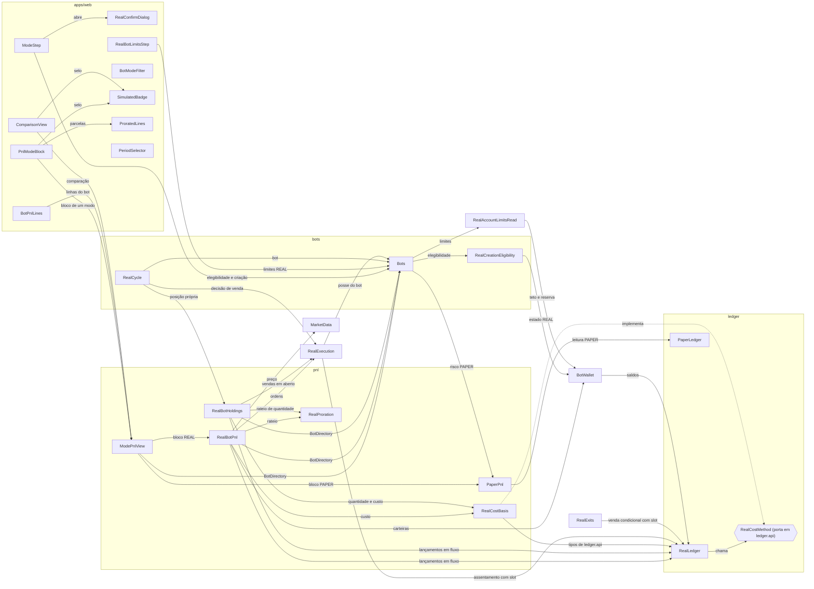

# Componentes — paper-real-unico

Conversa: português (Brasil). Data: 2026-11-21.

Este intent não cria módulo de backend novo. Ele cria sete componentes no backend:
- RealProration;
- RealCostBasis;
- RealBotPnl;
- RealBotHoldings, acrescentado depois da revisão de arquitetura (ADR-006);
- ModePnlView;
- RealCreationEligibility;
- RealAccountLimitsRead.

Também cria dez componentes na interface e muda oito componentes que já existem. Os nomes dos componentes que já existem seguem o código (`apps/api/src/main/java/com/memetrade/`) e o mapa do código.

## Sources

- `domain-design-questions.md` (Q1 a Q6, resumo confirmado com "Looks correct"): a fonte que vincula as decisões.
- `inception/requirements-analysis/requirements.md` (FR1 a FR8, NFR1 a NFR8).
- `inception/user-stories/stories.md` (US1.1 a US8.1).
- `inception/refined-mockups/mockups.md` (OQ1 a OQ7) e `interaction-spec.md`.
- Mapa do código: `aidlc/spaces/default/codekb/eureka-trader-ai/architecture.md`, `component-inventory.md` e `dependencies.md`.
- Código lido nesta etapa:
  - `pnl/application/RealPnlService.java`, `pnl/real/RealPnlCalculator.java` e `pnl/api/`;
  - `ledger/domain/RealPositions.java`, `ledger/api/RealLedger.java`, `RealLedgerView.java` e `RealPosition.java`;
  - `realexecution/api/RealExecutionPort.java` e `RealOrderView.java`;
  - `botwallet/api/RealStateQuery.java`, `RealStateView.java`, `RealReleaseInfo.java` e `RealKillSwitchState.java`;
  - `riskcontrol/api/` e `riskcontrol/real/`;
  - `bots/api/` e `bots/application/BotCommandService.java`;
  - `apps/web/src/features/{bots,pnl,real}` e `apps/web/eslint.config.mjs`.
- Regras ArchUnit lidas:
  - `ArchitectureTest`, `LedgerArchitectureTest`, `BotsArchitectureTest` e `RiskControlArchitectureTest`;
  - `BotWalletArchitectureTest`, `RealOpsArchitectureTest`, `RealExecutionArchitectureTest`, `RealExitsArchitectureTest` e `RealRiskArchitectureTest`.
- `aidlc/spaces/default/memory/project.md`, que tem as regras NEVER somar os modos e ALWAYS manter REAL e PAPER separados, e `team.md` (Fronteiras de módulos, Valores do REAL em inteiros).

```yaml
components:
  # ---------------- Backend: componentes novos ----------------
  - name: RealProration
    summary: Cálculo puro do rateio das vendas REAL sem bot e do excedente vendido por um bot, em lamports, pelo maior resto
    behaviour: >
      Domínio puro em com.memetrade.pnl.real: sem I/O, sem Spring, sem relógio e sem ponto flutuante. Está coberto
      pelas regras PURE_DOMAIN e NO_PAPER do RealExecutionArchitectureTest. Recebe uma venda e as quantidades que cada
      bot tinha logo antes dela. Rateia o valor recebido, a taxa e a quantidade pela proporção dessas quantidades. A
      venda pode ser uma liquidação "vender tudo e sacar", uma condicional executada por inteiro ou em parte (só sobre a
      quantidade executada) ou o excedente de um bot. O rateio em lamports usa o maior resto: cada bot recebe a parte
      inteira; os lamports que sobram vão, um a um, para as maiores frações; o empate é decidido pela data de criação do
      bot e, depois, pelo id do bot. A soma das parcelas é sempre exatamente o valor rateado (FR3.7). Cada parcela leva a
      origem: CLOSED_BY_LIQUIDATION, CLOSED_BY_CONDITIONAL ou SOLD_BY_OTHER_BOT. Sem bot dono, a quantidade vai para a
      parcela sem dono, com o motivo (excedente sem dono ou posição herdada). Os testes são escritos antes do código, a
      partir dos exemplos das histórias (FR5.4, team.md).
    responsibilities:
      - rateio do recebido, da taxa e da quantidade das vendas sem bot pela proporção das quantidades logo antes da venda
      - maior resto em lamports com desempate fixo (criação do bot, depois id)
      - marcação da origem de cada parcela e da parcela sem dono com motivo
    depends_on: []
    dependents:
      - component: RealBotPnl
        interaction: pede o rateio de cada venda sem bot e de cada excedente durante o cálculo na leitura
      - component: RealBotHoldings
        interaction: pede só a parte de quantidade do rateio, sem lamports nem taxas
    external_dependencies: []
    entities:
      - name: ProratedShare
        identifier: saleRef + botId
        attributes: [saleRef, botId, origin, tokenBaseUnits, receivedLamports, feeLamports]
        references:
          - entity: Bot
            owned_by: Bots
            relationship: cada parcela pertence a um bot que tinha quantidade do token logo antes da venda
          - entity: RealLedgerEntry
            owned_by: RealLedger
            relationship: cada parcela vem de um lançamento de venda (SWAP_FILL_OUT) e da taxa do ledger REAL

  - name: RealCostBasis
    summary: O único cálculo de custo médio REAL, por bot ou pela carteira do bot inteira, a partir dos lamports pagos
    behaviour: >
      Domínio puro em com.memetrade.pnl.real. Recebe os preenchimentos de swap já ordenados e devolve, para cada mint,
      a quantidade aberta e o custo em lamports. A ordem usa a chave de ordem de rede comum (ADR-011): primeiro o slot
      de confirmação, depois a assinatura; um lançamento sem slot segue a regra de fallback do ADR-011, sinalizado e
      com o motivo. É a mesma chave para o bot e para a carteira, e a mesma que o RealLedger usa para chamar a porta. O
      custo usa sempre os lamports efetivamente pagos, nunca um preço (FR3.10). A venda tira a mesma proporção do
      custo, com a regra de arredondamento que o Functional Design fixa (pergunta em aberto 2 das histórias). Hoje
      existem dois cálculos: RealPositions arredonda o custo tirado para baixo e o ceilShare do RealPnlCalculator
      arredonda para cima. Depois deste intent fica um só (FR5.2). O ledger não pode depender do pnl
      (LedgerArchitectureTest.theLedgerNeverDependsOnThePnl), então o ledger.api declara a porta RealCostMethod e o
      RealCostBasis a implementa: a dependência de compilação vai do RealCostBasis para o ledger.api, nunca do ledger
      para o pnl. Um teste de paridade confere, com a mesma chave de ordem, que a posição da carteira é igual à soma das
      posições dos bots mais a parcela sem dono, em unidades base e lamports exatos. É o único dono da entidade
      RealCostPosition, que é também o resultado da porta: o ledger.api.RealPosition de hoje é a forma dessa entidade
      quando o titular é a carteira.
    responsibilities:
      - custo médio REAL por bot (lotes de cada bot) e pela carteira do bot inteira
      - regra única de arredondamento do custo tirado numa venda
      - implementação da porta RealCostMethod declarada em ledger.api
    depends_on:
      - component: RealLedger
        interaction: implementa a porta RealCostMethod e usa os tipos de lançamento de ledger.api (dependência de compilação; o RealLedger chama a porta em tempo de execução)
        style: sync
    dependents:
      - component: RealBotPnl
        interaction: custo médio e quantidade aberta de cada bot e da carteira
      - component: RealBotHoldings
        interaction: quantidade e custo próprios de cada bot, sem P&L
    external_dependencies: []
    entities:
      - name: RealCostPosition
        identifier: holderRef + mint
        attributes: [holderRef, mint, tokenBaseUnits, costLamports]
        references:
          - entity: Bot
            owned_by: Bots
            relationship: quando holderRef é um bot, a posição é a quantidade aberta e o custo daquele bot
          - entity: BotWallet
            owned_by: BotWallet
            relationship: quando holderRef é a carteira, a posição é a da carteira do bot inteira (no código, ledger.api.RealPosition)

  - name: RealBotPnl
    summary: P&L REAL por bot, a linha "Sem bot" e o total do modo REAL, calculados na leitura a partir do ledger REAL e das ordens
    behaviour: >
      Serviço de aplicação em com.memetrade.pnl.application, com o cálculo puro em com.memetrade.pnl.real (proposta:
      RealBotPnlCalculator). Lê só pelas interfaces públicas: os lançamentos do ledger REAL da carteira (ledger.api) e
      as ordens REAL com bot_id, origem, slot e assinatura (realexecution.api). As vendas das saídas condicionais
      entram pelos lançamentos com a referência conditional:<id> do ledger REAL (FR5.1). Os metadados dos bots (data de
      criação, id, estado pausado ou removido) chegam pela porta BotDirectory, declarada em pnl.api e implementada pelo
      Bots. Os preços vêm do marketdata.api. Aplica as operações na ordem da rede (slot, depois assinatura), põe cada
      compra no custo médio do próprio bot e realiza o resultado do bot em cada venda. As vendas sem bot e o excedente vão
      para o RealProration. As taxas seguem o FR3.9: a da ordem que falhou fica no bot que a enviou; a do modo Assinada
      fica no bot que decidiu; a da venda sem bot é rateada. Com preço unknown, só o não realizado fica desconhecido
      (FR3.10). A ordem das operações é a chave de ordem de rede do ADR-011. Os lançamentos chegam por uma leitura em
      fluxo, por carteira, de ledger.api, apoiada num índice que inclui o slot (NFR1; o p95 exato fica para o NFR
      Design). Um bot pausado ou removido continua dono dos lotes (FR3.11). O realizado de um período conta só os
      lançamentos com data no período; o não realizado é sempre o de agora (FR7.2). Invariante conferida em teste: a
      soma dos bots mais a linha "Sem bot" é exatamente o P&L do modo calculado pelo ledger (FR5.3). A linha "Sem bot" só
      é diferente de zero com um motivo. O tenant vem do token; o bot de outra pessoa responde 404 e nenhum endereço de
      carteira sai na resposta (NFR3). Nunca lê tabela PAPER (NO_PAPER). O ciclo não usa este componente: a quantidade
      própria vem do RealBotHoldings, que não roda o P&L completo (ADR-006). O P&L REAL da pessoa (GET
      /api/v1/real/pnl) passa a ser o total deste componente, e o cálculo por ordens do RealPnlCalculator é aposentado.
    responsibilities:
      - P&L REAL por bot (realizado, não realizado, taxas, parcelas rateadas)
      - linha "Sem bot" com motivo e total do modo REAL por período
      - conferência exata com o ledger REAL (FR5.3) e inclusão das vendas condicionais (FR5.1)
    depends_on:
      - component: RealCostBasis
        interaction: custo médio e quantidade aberta de cada bot
        style: sync
      - component: RealProration
        interaction: rateio das vendas sem bot e do excedente
        style: sync
      - component: RealLedger
        interaction: lançamentos de swap, taxas e referências da carteira do bot, em fluxo e na ordem de rede (ledger.api)
        style: sync
      - component: RealExecution
        interaction: ordens REAL com bot_id, origem (BOT ou USER_LIQUIDATION), estado, taxa, quem pagou, slot e assinatura (realexecution.api)
        style: sync
      - component: BotWallet
        interaction: carteiras do bot da pessoa (RealStateQuery.botWalletIds)
        style: sync
      - component: Bots
        interaction: data de criação, id e estado dos bots REAL pela porta BotDirectory de pnl.api
        style: sync
      - component: MarketData
        interaction: preço atual para o não realizado; ausente vira unknown
        style: sync
    dependents:
      - component: ModePnlView
        interaction: bloco REAL da visão por modo e linhas de um bot REAL
    external_dependencies:
      - name: PostgreSQL
        kind: database
        purpose: leitura (só pelas interfaces dos módulos donos) dos lançamentos REAL e das ordens; nada é gravado
    entities:
      - name: RealBotPnlLine
        identifier: botId + period
        attributes: [botId, period, realizedLamports, unrealizedLamports, feesLamports, botStatus, shares]
        references:
          - entity: Bot
            owned_by: Bots
            relationship: cada linha é o P&L REAL de um bot REAL da pessoa
          - entity: ProratedShare
            owned_by: RealProration
            relationship: a linha inclui as parcelas rateadas daquele bot
      - name: UnownedPnlLine
        identifier: tenantId + userId + period
        attributes: [realizedLamports, feesLamports, unrealizedLamports, reasons]
      - name: RealModeTotal
        identifier: tenantId + userId + period
        attributes: [realizedLamports, unrealizedLamports, feesLamports, totalLamports, currency]
        references:
          - entity: RealLedgerEntry
            owned_by: RealLedger
            relationship: o total é conferido por igualdade exata com os lançamentos do ledger REAL

  - name: RealBotHoldings
    summary: Leitura só da quantidade e do custo próprios de um bot REAL por mint, para o ciclo, sem o P&L completo (FR6)
    behaviour: >
      Interface própria em pnl.api (RealBotHoldings), implementada num serviço de pnl.application separado do RealBotPnl.
      Ela usa só o caminho de quantidade do RealCostBasis e do RealProration: sem preço, sem taxas, sem período, sem
      realizado e sem a linha "Sem bot". Lê os lançamentos de swap da carteira em fluxo, na chave de ordem de rede do
      ADR-011. Para cada mint do bot, devolve a quantidade própria, o custo próprio e a quantidade disponível para venda.
      A disponível é a própria menos as vendas do mesmo bot ainda não assentadas, lidas em realexecution.api: as ordens
      SELL do bot em PROPOSED, QUOTED, SIGNED, SENT ou AMBIGUOUS. Uma ordem AMBIGUOUS conta como em aberto, o que é o
      lado conservador. Assim, dois ciclos seguidos nunca pedem duas vezes a mesma quantidade. A leitura roda dentro da
      transação curta do ciclo, com um orçamento de tempo próprio (o número fica para o NFR Design, dentro da trava de
      2 s e do limite de 5 s). A falha é fechada: se a leitura passa do orçamento ou falha, o bot não vende naquele
      ciclo. O motivo fica registrado no log e numa métrica, e nenhuma venda da carteira inteira é usada no lugar. O
      tenant e o bot são conferidos (o bot precisa ser da pessoa). Lamports e unidades base em long, com operações
      exatas.
    responsibilities:
      - quantidade e custo próprios do bot por mint, sem P&L
      - desconto das vendas do bot ainda não assentadas
      - orçamento de tempo e falha fechada dentro do ciclo
    depends_on:
      - component: RealCostBasis
        interaction: quantidade e custo próprios de cada bot
        style: sync
      - component: RealProration
        interaction: só a parte de quantidade do rateio das vendas sem bot e do excedente
        style: sync
      - component: RealLedger
        interaction: lançamentos de swap da carteira, em fluxo e na ordem de rede (ledger.api)
        style: sync
      - component: RealExecution
        interaction: ordens com bot_id e as vendas do bot ainda não assentadas (realexecution.api)
        style: sync
      - component: Bots
        interaction: data de criação e id dos bots para o desempate do rateio (BotDirectory)
        style: sync
    dependents:
      - component: RealCycle
        interaction: posição própria do bot (quantidade, custo, disponível) para a decisão e a venda
    external_dependencies: []
    entities:
      - name: BotHolding
        identifier: botId + mint
        attributes: [botId, mint, ownTokenBaseUnits, ownCostLamports, openSellBaseUnits, availableTokenBaseUnits]
        references:
          - entity: RealCostPosition
            owned_by: RealCostBasis
            relationship: a quantidade e o custo próprios vêm da posição do bot calculada pelo RealCostBasis
          - entity: RealOrder
            owned_by: RealExecution
            relationship: as vendas do bot ainda não assentadas reduzem a quantidade disponível

  - name: ModePnlView
    summary: Monta a visão por modo, com o bloco PAPER e o bloco REAL lado a lado e um período único, sem nunca somar os modos
    behaviour: >
      Componente de aplicação e web num pacote próprio do pnl, fora de pnl.real (proposta: com.memetrade.pnl.modeview),
      porque lê os dois modos e a regra NO_PAPER proíbe isso em pnl.real. Recebe um período único: desde o início
      (padrão), últimos 7 dias, últimos 30 dias ou intervalo, com instantes em UTC (FR7). Pede o bloco PAPER ao PaperPnl
      e o bloco REAL ao RealBotPnl, e os coloca lado a lado. Cada bloco tem o próprio tipo e a própria moeda (US$ exato no
      PAPER, lamports no REAL). O bloco PAPER leva sempre o aviso "o resultado simulado não garante o resultado real"
      (FR4.2). Também responde ao P&L de um bot só (o detalhe do bot) e à comparação entre um bot PAPER e um bot REAL do
      mesmo templateId (FR8). A resposta não tem total geral, ranking misturado nem diferença entre moedas (FR4.1).
      Regra de arquitetura (ArchUnit, proposta NEVER_SUM_MODES), sobre duas listas fechadas de tipos: os tipos de
      resultado PAPER (PaperBotPnl, PaperModeTotal e os tipos de resultado do PnlQueryService) e os tipos de resultado
      REAL (RealBotPnlLine, UnownedPnlLine, RealModeTotal, RealCostPosition, BotHolding). (1) Nenhuma classe fora de
      pnl.modeview depende ao mesmo tempo de um tipo de cada lista; a regra vale por classe, então PnlQueryService e
      RealPnlService podem continuar juntos em pnl.application. (2) As classes de pnl.modeview nunca chamam aritmética
      (BigDecimal.add, subtract, Math.addExact, subtractExact, BigInteger.add, Long.sum). (3) Elas também não chamam os
      acessores de valor dos tipos das duas listas: só passam os objetos inteiros para a resposta. Isso fecha a soma
      com + de long, que o ArchUnit não enxerga em bytecode como chamada. (4) Cada parte tem um teste que prova a falha
      com uma classe de amostra. Limite declarado: uma soma com + de long escrita fora de pnl.modeview, numa classe que
      não depende das duas listas, não é visível ao ArchUnit. A rede de segurança é: (a) o teste de contrato do OpenAPI
      confere que o esquema da visão tem só os blocos e o período e nenhum campo de total fora de um bloco (NFR3); (b)
      um teste de propriedade com valores conhecidos confere que, para todo par de um valor PAPER e um valor REAL, a
      resposta traz exatamente esses números nos seus blocos e nenhum terceiro número. Tenant sempre do token; o bot de
      outra pessoa responde 404.
    responsibilities:
      - visão por modo com dois blocos separados e o aviso no simulado
      - período único para os dois blocos
      - P&L de um bot e comparação PAPER x REAL do mesmo templateId, sem diferença calculada
      - regra de arquitetura e teste de contrato que proíbem somar os modos
    depends_on:
      - component: PaperPnl
        interaction: bloco PAPER (P&L por bot e total PAPER do período)
        style: sync
      - component: RealBotPnl
        interaction: bloco REAL (P&L por bot, "Sem bot" e total REAL do período)
        style: sync
      - component: Bots
        interaction: lista, nome, modo e templateId dos bots da pessoa pela porta BotDirectory de pnl.api
        style: sync
    dependents:
      - component: PnlModeBlock
        interaction: lê um bloco da visão por modo pela API REST
      - component: BotPnlLines
        interaction: lê as linhas de um bot REAL pela API REST
      - component: ComparisonView
        interaction: lê a comparação de um bot PAPER com um bot REAL pela API REST
    external_dependencies: []
    entities:
      - name: ModePnlStatement
        identifier: tenantId + userId + period
        attributes: [period, paperBlock, realBlock, simulatedDisclaimer]
        references:
          - entity: PaperModeTotal
            owned_by: PaperPnl
            relationship: o bloco PAPER carrega o total PAPER do período, sem mudar
          - entity: RealModeTotal
            owned_by: RealBotPnl
            relationship: o bloco REAL carrega o total REAL do período, sem mudar
      - name: PnlPeriod
        identifier: kind + from + to
        attributes: [kind, from, to]

  - name: RealCreationEligibility
    summary: Decide no servidor se a pessoa pode criar um bot REAL e devolve só o motivo mais forte quando não pode
    behaviour: >
      Em com.memetrade.bots, com a regra de precedência como função pura no domínio do bots. Lê pelo botwallet.api a
      carteira do bot ativa (RealStateQuery.readRealState), o REAL ligado e a liberação com o estado e o effectiveAt da
      quarentena (readRelease), além do kill switch (RealKillSwitchState.current, do realops que fica no módulo
      botwallet). Devolve se a opção está disponível e, quando não está, só o motivo mais forte, nesta ordem: kill switch,
      REAL desligado, carteira inativa, liberação ausente, liberação em quarentena (mockups Q7, OQ3). Na quarentena,
      devolve também o effectiveAt (OQ2). A mesma regra é usada na tela e no comando de criação: o POST com market =
      REAL é recusado (422, com o código do motivo) por qualquer um dos cinco motivos, e não só pela carteira inativa,
      como hoje. A falha é fechada: se o botwallet não responde, o REAL fica indisponível. A elegibilidade nunca
      autoriza operar; ela só libera a criação.
    responsibilities:
      - elegibilidade do REAL na criação do bot
      - precedência dos motivos num lugar só, com teste de unidade
      - checagem no servidor no comando de criação, com falha fechada
    depends_on:
      - component: BotWallet
        interaction: carteira ativa, REAL ligado, liberação e quarentena, kill switch (botwallet.api)
        style: sync
    dependents:
      - component: Bots
        interaction: o comando de criação e a rota de elegibilidade usam a mesma regra
    external_dependencies: []
    entities:
      - name: RealCreationEligibility
        identifier: tenantId + userId
        attributes: [available, strongestReason, effectiveAt, actionLink]
        references:
          - entity: BotWallet
            owned_by: BotWallet
            relationship: lê o estado da carteira do bot da pessoa
          - entity: RealRelease
            owned_by: BotWallet
            relationship: lê a liberação vigente ou a quarentena da pessoa
          - entity: RealKillSwitch
            owned_by: BotWallet
            relationship: lê o estado atual do kill switch REAL

  - name: RealAccountLimitsRead
    summary: Leitura só para consulta dos limites REAL da conta, em lamports e percentual, para o passo de limites do bot REAL
    behaviour: >
      Implementada em com.memetrade.riskcontrol.real e publicada como interface nova em riskcontrol.api (proposta:
      RealAccountLimits). O RealRiskGate de hoje só avalia ordens e não tem leitura de limites. A leitura devolve os
      quatro limites já em lamports, arredondados para baixo (BR7.2 do intent 261113), e o percentual, com unknown
      explícito para o que não estiver definido (OQ6). Usa as mesmas entradas da RealRiskPolicy: a configuração da
      barreira mais o teto e a reserva de taxa da carteira do bot (RealStateView), para a tela nunca mostrar um limite
      diferente do que a barreira aplica. Só leitura: não muda limite e não reserva nada. Tenant e pessoa vêm do token.
    responsibilities:
      - limites REAL da conta para o passo M3b, iguais aos que a barreira REAL aplica
    depends_on:
      - component: BotWallet
        interaction: teto e reserva de taxa da carteira do bot (RealStateQuery.readRealState)
        style: sync
    dependents:
      - component: Bots
        interaction: a rota do assistente de criação devolve os limites para o passo do bot REAL
    external_dependencies: []
    entities:
      - name: RealAccountLimitsView
        identifier: tenantId + userId
        attributes: [orderLimitLamports, tokenExposureLimitLamports, totalExposureLimitLamports, operatingCapLamports, dailyLossPercent]
        references:
          - entity: BotWallet
            owned_by: BotWallet
            relationship: o teto e a reserva vêm da carteira do bot ativa da pessoa

  # ---------------- Backend: componentes que já existem e mudam ----------------
  - name: Bots
    summary: Dono do bot e do mercado (PAPER ou REAL), da criação em qualquer modo e da lista única de bots
    behaviour: >
      Módulo com.memetrade.bots. Continua dono do bot, do market fixo desde a criação (FR1.4) e da lista com os dois
      modos. Muda em quatro pontos. (1) O resumo do bot passa a ter mode == market para os dois mercados; mode fica
      obsoleto e não quebra os clientes (FR2.4), com um teste de contrato. (2) A criação com market = REAL passa pela
      RealCreationEligibility, com falha fechada. (3) A rota do assistente devolve a elegibilidade e os limites REAL da
      conta (RealAccountLimitsRead) para o passo M3b; um bot REAL não tem saldo virtual. (4) Implementa a porta
      BotDirectory declarada em pnl.api: id, nome, market, templateId, estado (pausado, removido) e data de criação dos
      bots da pessoa, filtrados pelo tenant. O bots já depende de pnl.api, o que o BotsArchitectureTest permite; o pnl
      não passa a depender do bots, então não há ciclo entre os módulos. O tenant vem sempre do token.
    responsibilities:
      - bot, market fixo e mode obsoleto igual a market
      - criação em qualquer modo com a elegibilidade checada no servidor
      - lista única dos bots PAPER e REAL
      - implementação da porta BotDirectory de pnl.api
    depends_on:
      - component: RealCreationEligibility
        interaction: checa a elegibilidade do REAL na criação e na rota do assistente
        style: sync
      - component: RealAccountLimitsRead
        interaction: limites REAL da conta para o passo do bot REAL (riskcontrol.api)
        style: sync
      - component: PaperPnl
        interaction: visão de risco PAPER (PortfolioRiskView), uso que já existe
        style: sync
    dependents:
      - component: RealBotPnl
        interaction: metadados dos bots REAL pela porta BotDirectory
      - component: RealBotHoldings
        interaction: data de criação e id dos bots pela porta BotDirectory
      - component: ModePnlView
        interaction: lista e metadados dos bots pela porta BotDirectory
      - component: RealCycle
        interaction: configuração e estado do bot REAL no ciclo
      - component: RealExecution
        interaction: confere se o bot é REAL, ATIVO e da pessoa (RealBotOwnership), uso que já existe
      - component: ModeStep
        interaction: rota de elegibilidade e POST de criação com market, pela API REST
      - component: RealBotLimitsStep
        interaction: rota dos limites REAL da conta no assistente, pela API REST
    external_dependencies:
      - name: PostgreSQL
        kind: database
        purpose: tabela bot (market) e limites versionados, já existentes
    entities:
      - name: Bot
        identifier: botId
        attributes: [botId, tenantId, userId, name, templateId, market, mode, state, createdAt, removedAt]

  - name: RealCycle
    summary: Ciclo do bot REAL no worker; passa a vender só a quantidade do próprio bot (FR6), depois da Performance Validation do 261113
    behaviour: >
      Classe RealCycle e passo de decisão REAL em com.memetrade.bots.worker. Hoje o ciclo lê o saldo e as posições da
      carteira do bot inteira, entrega essas posições ao motor de decisão e vende a quantidade inteira do mint. Com a
      mudança, o ciclo lê a posição própria do bot no RealBotHoldings (pnl.api): a quantidade, o custo e a disponível
      por mint. As entradas de decisão (RealCycle.inputs) passam a levar ao motor de decisão a posição e o custo
      próprios do bot, nunca os da carteira inteira, para o bot não decidir sobre a posição de outro bot. O saldo de SOL
      operável para compras continua sendo o da carteira, como hoje, sob a barreira REAL e o teto. A venda pedida ao
      realexecution é só da quantidade disponível do bot. Sem quantidade disponível, não há venda (AC6.1.3). Se a
      leitura do RealBotHoldings passa do orçamento de tempo ou falha, o bot não vende naquele ciclo (falha fechada),
      com o motivo no log. O realexecution continua dono da ordem, da idempotência e da transação única por ordem
      (AC6.1.4). A mudança entra por último, atrás de uma configuração desligada por padrão, e só é ligada depois da
      Performance Validation do intent 261113. O mesmo estado alimenta o aviso da tela de bots REAL (FR6.2).
    responsibilities:
      - venda só da quantidade disponível do próprio bot REAL
      - entradas de decisão com a posição e o custo próprios do bot
      - estado ligado ou desligado da mudança, exposto para o aviso da tela
    depends_on:
      - component: Bots
        interaction: bot, estratégia e estado
        style: sync
      - component: RealBotHoldings
        interaction: posição própria do bot por mint (quantidade, custo, disponível), com falha fechada (pnl.api)
        style: sync
      - component: RealExecution
        interaction: grava a decisão de venda com a quantidade do bot (realexecution.api, recordDecision)
        style: sync
    dependents: []
    external_dependencies: []
    entities: []

  - name: PaperPnl
    summary: P&L PAPER por bot e por pessoa, como já é hoje, e o total do modo PAPER
    behaviour: >
      PnlQueryService, PnlCalculator e reconciliação em com.memetrade.pnl. O P&L PAPER por bot fica como já é (FR3.1).
      Este intent acrescenta só o total do modo PAPER por período, no mesmo formato de bloco, e a conferência exata com o
      ledger PAPER (FR5.3). Valores em US$ com decimal exato. Nunca lê o REAL.
    responsibilities:
      - P&L PAPER por bot e total PAPER do período
      - conferência com o ledger PAPER
      - visão de risco PAPER (PortfolioRiskView), já existente
    depends_on:
      - component: PaperLedger
        interaction: LedgerReadModel e FillRecorded (ledger.api)
        style: sync
    dependents:
      - component: ModePnlView
        interaction: bloco PAPER
      - component: Bots
        interaction: visão de risco PAPER
    external_dependencies: []
    entities:
      - name: PaperBotPnl
        identifier: botId + period
        attributes: [botId, period, realizedUsd, unrealizedUsd, feesUsd]
        references:
          - entity: Bot
            owned_by: Bots
            relationship: cada linha é o P&L PAPER de um bot PAPER
      - name: PaperModeTotal
        identifier: tenantId + userId + period
        attributes: [realizedUsd, unrealizedUsd, feesUsd, totalUsd, currency]

  - name: PaperLedger
    summary: Ledger PAPER append-only com conta, posições e realizado por bot, sem mudança neste intent
    behaviour: >
      Execução e ledger PAPER em com.memetrade.ledger (PaperExecutionImpl, FillRecorder, LedgerReadModel). Fica como
      está. Aparece aqui só porque é a fonte do bloco PAPER e da conferência do FR5.3.
    responsibilities:
      - lançamentos, posições e realizado PAPER por bot
    depends_on: []
    dependents:
      - component: PaperPnl
        interaction: leitura pública do ledger PAPER
    external_dependencies:
      - name: PostgreSQL
        kind: database
        purpose: tabelas PAPER (CHECK mode = 'PAPER')
    entities:
      - name: PaperLedgerEntry
        identifier: entryId
        attributes: [entryId, botId, kind, amountUsd, token, quantity, recordedAt]

  - name: RealLedger
    summary: Ledger REAL append-only por carteira do bot (M2); passa a calcular as posições pelo custo único do RealCostBasis
    behaviour: >
      RealLedger, JdbcRealLedger e RealEntryRules em com.memetrade.ledger. Continua append-only, por carteira do bot,
      sem bot_id e com CHECK mode = 'REAL'. Muda em três pontos. (1) As posições da carteira (positions e view, usadas
      pela barreira REAL e pelo ciclo de hoje) deixam de vir do algoritmo próprio do RealPositions. O RealLedger ordena
      os preenchimentos pela chave de ordem de rede do ADR-011 (slot e assinatura, depois o fallback) e chama a porta
      RealCostMethod, declarada no próprio ledger.api. A porta é implementada pelo RealCostBasis e injetada em tempo de
      execução, então o ledger não tem dependência de compilação do pnl. A leitura de saldo, posições e fluxos
      continua num único instantâneo do banco (revisão R-01 do 261113). (2) Ganha a coluna slot pela migração expand
      do ADR-011 e grava o slot de confirmação em cada lançamento novo. As linhas antigas são preenchidas a partir do
      slot já gravado, e uma linha sem slot é sinalizada com o motivo. Nenhuma coluna é removida e nenhum lançamento é
      alterado no seu valor, então o append-only se mantém. (3) Ganha em ledger.api uma leitura em fluxo (streaming,
      como streamEntries) dos lançamentos de swap e de taxa de uma carteira, com referência, slot e assinatura, já na
      chave de ordem de rede. Ela é apoiada num índice que inclui o slot, por exemplo (bot_wallet_id, slot,
      tx_signature), criado na mesma migração expand. Essa leitura alimenta o RealBotPnl, o RealBotHoldings e a
      conferência do FR5.3. O NFR Design entrega o índice final e o resultado do cenário de carga (NFR1) antes da Code
      Generation. Nunca depende de classe do pnl (LedgerArchitectureTest).
    responsibilities:
      - lançamentos REAL append-only e saldo
      - posições da carteira pela porta RealCostMethod, na chave de ordem de rede
      - slot de confirmação gravado em cada lançamento
      - leitura em fluxo dos lançamentos de swap e taxa em ordem de rede
    depends_on: []
    dependents:
      - component: RealCostBasis
        interaction: implementa a porta RealCostMethod e usa os tipos de lançamento de ledger.api
      - component: RealBotHoldings
        interaction: lançamentos de swap em fluxo, na ordem de rede
      - component: RealBotPnl
        interaction: lançamentos de swap, taxa e referência em ordem de rede
      - component: RealExecution
        interaction: grava os lançamentos do assentamento das ordens, uso que já existe
      - component: RealExits
        interaction: grava a venda condicional executada (conditional:<id>), uso que já existe
      - component: BotWallet
        interaction: saldos, fluxos e reconciliação, uso que já existe
    external_dependencies:
      - name: PostgreSQL
        kind: database
        purpose: tabela real_ledger_entry
    entities:
      - name: RealLedgerEntry
        identifier: entryId
        attributes: [entryId, botWalletId, kind, lamports, mint, tokenBaseUnits, reference, signature, slot, recordedAt]
        references:
          - entity: BotWallet
            owned_by: BotWallet
            relationship: cada lançamento pertence a uma carteira do bot

  - name: RealExecution
    summary: Dono das ordens REAL (M6), com bot_id e origem; ganha a venda de uma quantidade dada e a leitura das ordens para o P&L
    behaviour: >
      Módulo com.memetrade.realexecution. Continua dono da fila de decisões, da máquina de estados, da idempotência, da
      liquidação e do assentamento no ledger REAL. Muda em três pontos. (1) A decisão de venda passa a aceitar a
      quantidade pedida pelo ciclo, até o saldo da carteira, com uma única transação por ordem. (2) real_order ganha a
      coluna slot pela migração expand do ADR-011. A confirmação grava o slot da transação confirmada, e o
      assentamento passa esse slot ao lançamento do ledger REAL. A leitura das ordens assentadas em realexecution.api
      passa a trazer o slot e a assinatura de confirmação, para a ordem de rede do FR3.8. (3) Ganha em
      realexecution.api uma leitura das vendas de um bot ainda não assentadas (estados PROPOSED, QUOTED, SIGNED, SENT
      e AMBIGUOUS), usada pelo RealBotHoldings. real_order.bot_id continua a única ligação entre uma operação REAL e um
      bot.
    responsibilities:
      - ordens REAL, fila, idempotência e liquidação
      - slot de confirmação gravado na ordem e passado ao lançamento
      - leitura das ordens com bot_id, origem, taxa, quem pagou, slot e assinatura
      - leitura das vendas de um bot ainda não assentadas
    depends_on:
      - component: Bots
        interaction: RealBotOwnership antes de aceitar uma decisão
        style: sync
      - component: RealLedger
        interaction: lançamentos do assentamento
        style: sync
    dependents:
      - component: RealBotPnl
        interaction: ordens com bot e origem
      - component: RealBotHoldings
        interaction: ordens com bot e vendas do bot ainda não assentadas
      - component: RealCycle
        interaction: grava a decisão de venda com a quantidade do bot
    external_dependencies:
      - name: Jupiter API
        kind: third-party-api
        purpose: cotação e swap, uso que já existe
      - name: PostgreSQL
        kind: database
        purpose: real_order, real_decision_request e real_liquidation
    entities:
      - name: RealOrder
        identifier: orderId
        attributes: [orderId, botId, origin, side, mint, state, inputLamports, outBaseUnits, feeLamports, feePayer, slot, signature, idempotencyKey]
        references:
          - entity: Bot
            owned_by: Bots
            relationship: uma ordem de origem BOT pertence a um bot; a de liquidação não tem bot

  - name: RealExits
    summary: Saídas condicionais REAL (M8), sem bot; a venda executada já fica no ledger REAL e passa a entrar no P&L
    behaviour: >
      Módulo com.memetrade.realexits. Muda só num ponto: o FillPosting passa a gravar o slot de confirmação da venda
      executada no lançamento do ledger REAL (ADR-011). A venda condicional executada já é gravada no ledger REAL com a
      referência conditional:<id>, e é por essa referência que o RealBotPnl a rateia (FR5.1). A condicional executada
      em parte grava só a quantidade executada.
    responsibilities:
      - saídas condicionais e gravação da venda executada no ledger REAL
    depends_on:
      - component: RealLedger
        interaction: SWAP_FILL_OUT e NETWORK_FEE com a referência conditional:<id>
        style: sync
    dependents: []
    external_dependencies:
      - name: Jupiter Trigger API
        kind: third-party-api
        purpose: ordens condicionais, uso que já existe
    entities:
      - name: RealConditionalOrder
        identifier: conditionalId
        attributes: [conditionalId, botWalletId, mint, state, executedBaseUnits]

  - name: BotWallet
    summary: Carteira do bot, liberação com quarentena e kill switch REAL (realops); só é lida neste intent
    behaviour: >
      Módulo com.memetrade.botwallet, incluindo a área realops do U5 (kill switch, pausas). Não muda neste intent. As
      leituras usadas já existem em botwallet.api: RealStateQuery (readRealState, readRelease, botWalletIds) e
      RealKillSwitchState.current. O saque para a carteira principal continua disponível em qualquer estado.
    responsibilities:
      - estado REAL da pessoa, liberação, kill switch
    depends_on:
      - component: RealLedger
        interaction: saldos e fluxos, uso que já existe
        style: sync
    dependents:
      - component: RealCreationEligibility
        interaction: carteira, liberação, REAL ligado e kill switch
      - component: RealAccountLimitsRead
        interaction: teto e reserva de taxa
      - component: RealBotPnl
        interaction: carteiras do bot da pessoa
    external_dependencies:
      - name: PostgreSQL
        kind: database
        purpose: carteira, liberação, kill switch
    entities:
      - name: BotWallet
        identifier: botWalletId
        attributes: [botWalletId, tenantId, userId, state, capLamports, feeReserveLamports]
      - name: RealRelease
        identifier: tenantId + userId + network
        attributes: [state, effectiveAt, blockedReason]
      - name: RealKillSwitch
        identifier: singleton
        attributes: [active, version, changedAt]

  - name: MarketData
    summary: Preços de mercado com fonte e horário; ausente vira unknown
    behaviour: >
      Módulo com.memetrade.marketdata. Não muda. É a fonte do preço atual do não realizado. Um preço ausente é unknown e
      nunca zero.
    responsibilities:
      - preço atual por token, com fonte, horário e unknown
    depends_on: []
    dependents:
      - component: RealBotPnl
        interaction: preço do não realizado REAL
    external_dependencies:
      - name: CoinGecko API
        kind: third-party-api
        purpose: preços, uso que já existe
    entities:
      - name: MarketQuote
        identifier: tokenId
        attributes: [tokenId, price, source, observedAt]

  # ---------------- Web (apps/web): componentes novos ----------------
  - name: ModeStep
    summary: Passo "Modo e nome" da criação, com Simulado como padrão e Real desabilitado com o motivo do servidor
    behaviour: >
      Em apps/web/src/features/bots. Lê a elegibilidade uma vez, quando a tela abre. Mostra só o motivo mais forte que o
      servidor devolveu, com o link para a ação que resolve e o "Vale a partir de" na quarentena. Usa aria-disabled para
      o leitor de tela chegar ao motivo. Ao escolher Real, abre o RealConfirmDialog antes de seguir. Os tipos vêm do
      contrato gerado (openapi-guest.yaml).
    responsibilities:
      - escolha Simulado ou Real e exibição do motivo de indisponibilidade
    depends_on:
      - component: Bots
        interaction: GET da elegibilidade e POST de criação com market (API REST)
        style: sync
      - component: RealConfirmDialog
        interaction: abre a confirmação "Este bot opera com dinheiro real"
        style: sync
    dependents: []
    external_dependencies: []
    entities: []

  - name: RealConfirmDialog
    summary: Diálogo de confirmação explícita "Este bot opera com dinheiro real"
    behaviour: >
      Em apps/web/src/features/bots. Bloqueia a criação até a confirmação explícita. Mostra "Teto da conta" só quando os
      limites já foram lidos na tela; nunca faz um pedido só para isso. Não promete lucro (C-16).
    responsibilities:
      - confirmação explícita do bot REAL
    depends_on: []
    dependents:
      - component: ModeStep
        interaction: abre o diálogo
    external_dependencies: []
    entities: []

  - name: RealBotLimitsStep
    summary: Etapa 3 de um bot REAL (M3b), com os limites REAL da conta só para leitura, em SOL
    behaviour: >
      Em apps/web/src/features/bots. Mostra os limites devolvidos pela API, já em lamports, formatados em SOL pelo
      features/real/money.ts, que é o único lugar com bigint (team.md). Um limite unknown aparece como "não definido". Não
      tem campo editável; o link "Alterar limites" leva a /real e, na volta, a etapa relê os limites.
    responsibilities:
      - exibição só para leitura dos limites REAL da conta
    depends_on:
      - component: Bots
        interaction: rota de limites REAL do assistente (API REST)
        style: sync
    dependents: []
    external_dependencies: []
    entities: []

  - name: BotModeFilter
    summary: Filtro da lista de bots por modo (Todos, Simulado, Real)
    behaviour: >
      Em apps/web/src/features/bots. Filtra pelo campo market a lista que a BotList já tem; não faz pedido próprio. O
      modo aparece em texto, não só em cor. Recebe o foco quando /bots abre.
    responsibilities:
      - filtro por modo na lista única
    depends_on: []
    dependents: []
    external_dependencies: []
    entities: []

  - name: SimulatedBadge
    summary: Selo comum "◇ SIMULADO", o par do RealBadge
    behaviour: >
      Em apps/web/src/components (comum). Marca um bot, um bloco ou um valor PAPER, com texto e não só cor.
    responsibilities:
      - marcação visual e textual do modo PAPER
    depends_on: []
    dependents:
      - component: PnlModeBlock
        interaction: selo no título do bloco PAPER
      - component: ComparisonView
        interaction: selo no lado simulado
    external_dependencies: []
    entities: []

  - name: PnlModeBlock
    summary: Bloco de um modo só (PAPER ou REAL), com total, realizado, não realizado, taxas, linhas dos bots, "Sem bot" e o aviso no simulado
    behaviour: >
      Em apps/web/src/features/pnl (a pasta já existe e ganha os componentes novos). Recebe um único modo; não existe
      prop nem variante que receba os dois. Não soma nada: os totais já chegam calculados da API. Variantes full (/pnl) e
      compact (painel). Tem o rótulo para leitor de tela com o modo e a moeda. Os estados carregando, erro, unknown
      ("desconhecido") e vazio são distintos. No celular a partir de 360 px, sem rolagem lateral. O valor em SOL é
      formatado pelo features/real/money.ts. A proibição de lint do dinheiro (Number(, toFixed, parseFloat), que hoje
      vale só para features/real e app/real no eslint.config.mjs, passa a valer também para features/pnl.
    responsibilities:
      - exibição de um bloco de modo com o aviso no simulado
    depends_on:
      - component: ModePnlView
        interaction: um bloco da visão por modo (API REST, pela página)
        style: sync
      - component: ProratedLines
        interaction: parcelas rateadas de cada bot REAL
        style: sync
      - component: SimulatedBadge
        interaction: selo do bloco PAPER
        style: sync
    dependents: []
    external_dependencies: []
    entities: []

  - name: ProratedLines
    summary: Parcelas rateadas de um bot REAL (liquidação, condicional, vendido por outro bot), com resumo e detalhe
    behaviour: >
      Em apps/web/src/features/pnl. Mostra a soma por origem já calculada pela API; a tela não soma. A origem aparece em
      texto.
    responsibilities:
      - exibição das parcelas rateadas por origem
    depends_on: []
    dependents:
      - component: PnlModeBlock
        interaction: lista as parcelas de cada bot REAL
    external_dependencies: []
    entities: []

  - name: BotPnlLines
    summary: Tabela das linhas que formam o P&L de um bot REAL no detalhe do bot, com a origem de cada uma (Should)
    behaviour: >
      Em apps/web/src/features/pnl, usada pelo BotDetail. Mostra a data no fuso da pessoa, o lado, o token, o resultado
      em SOL, a taxa e a origem em texto ("Bot", "Fechado por liquidação", "Fechado por condicional", "Vendido por outro
      bot").
    responsibilities:
      - linhas do P&L de um bot REAL com a origem
    depends_on:
      - component: ModePnlView
        interaction: P&L e linhas de um bot (API REST)
        style: sync
    dependents: []
    external_dependencies: []
    entities: []

  - name: PeriodSelector
    summary: Escolha do período do P&L, com "Desde o início" como padrão, os últimos 7 ou 30 dias ou um intervalo
    behaviour: >
      Em apps/web/src/features/pnl. Reaproveita o features/pnl/period.ts que já existe, sem duplicar o cálculo do
      período; o padrão muda de 7 dias para "Desde o início". Converte o período do fuso da pessoa para UTC antes de pedir e aplica o mesmo
      período aos dois blocos. O intervalo inclui o dia inicial e o final. Um intervalo inválido diz qual campo corrigir e
      mantém o que a pessoa digitou.
    responsibilities:
      - período único para os dois blocos
    depends_on: []
    dependents: []
    external_dependencies: []
    entities: []

  - name: ComparisonView
    summary: Comparação lado a lado de um bot PAPER e um bot REAL do mesmo templateId, cada um na sua moeda (Could)
    behaviour: >
      Em apps/web/src/features/pnl. Não tem ranking misturado nem diferença calculada entre US$ e SOL. O lado simulado
      tem o selo e o aviso. Com mais de um bot REAL do mesmo templateId, a pessoa escolhe na lista (OQ4).
    responsibilities:
      - comparação sem mistura de modos
    depends_on:
      - component: ModePnlView
        interaction: comparação de um bot PAPER com um bot REAL (API REST)
        style: sync
      - component: SimulatedBadge
        interaction: selo do lado simulado
        style: sync
    dependents: []
    external_dependencies: []
    entities: []
```

## Component Diagram

A porta `RealCostMethod` aparece como um nó próprio, dentro de `ledger.api`. Ela não é um componente do catálogo, porque é uma interface do RealLedger. As setas mostram a direção certa: o RealLedger chama a porta, e o RealCostBasis a implementa. Nenhuma seta sai do ledger para o pnl.



Versão em texto do diagrama: cada linha é uma dependência "A → B".

- **Web → backend (REST):**
  - ModeStep → Bots
  - RealBotLimitsStep → Bots
  - PnlModeBlock → ModePnlView
  - BotPnlLines → ModePnlView
  - ComparisonView → ModePnlView
- **Web → web:**
  - ModeStep → RealConfirmDialog
  - PnlModeBlock → ProratedLines
  - PnlModeBlock → SimulatedBadge
  - ComparisonView → SimulatedBadge
- **Visão por modo:**
  - ModePnlView → PaperPnl
  - ModePnlView → RealBotPnl
  - ModePnlView → Bots
- **P&L REAL:**
  - RealBotPnl → RealCostBasis
  - RealBotPnl → RealProration
  - RealBotPnl → RealLedger
  - RealBotPnl → RealExecution
  - RealBotPnl → BotWallet
  - RealBotPnl → Bots
  - RealBotPnl → MarketData
- **Posição própria do bot (FR6):**
  - RealBotHoldings → RealCostBasis
  - RealBotHoldings → RealProration
  - RealBotHoldings → RealLedger
  - RealBotHoldings → RealExecution
  - RealBotHoldings → Bots
- **Ciclo REAL:**
  - RealCycle → Bots
  - RealCycle → RealBotHoldings
  - RealCycle → RealExecution
- **Criação:**
  - Bots → RealCreationEligibility → BotWallet
  - Bots → RealAccountLimitsRead → BotWallet
  - Bots → PaperPnl → PaperLedger
- **Custo médio único:**
  - RealLedger → porta RealCostMethod (em `ledger.api`): o ledger chama a própria porta.
  - RealCostBasis → porta RealCostMethod: o RealCostBasis implementa a porta.
  - RealCostBasis → RealLedger: dependência de compilação nos tipos de `ledger.api`.
- **Já existentes:**
  - RealExecution → Bots
  - RealExecution → RealLedger
  - RealExits → RealLedger
  - BotWallet → RealLedger

BotModeFilter e PeriodSelector não têm dependência: filtram ou escolhem no cliente e entregam o valor à página.

No catálogo, `depends_on` segue a direção de compilação. Por isso o RealCostBasis depende do RealLedger (`ledger.api`), e o RealLedger não lista dependência nenhuma: ele chama a própria porta, e a implementação chega por injeção. O grafo não tem ciclo. A mesma dependência entre módulos fica assim:
- bots → pnl.api: já é permitida;
- pnl → ledger.api, realexecution.api, botwallet.api e marketdata.api: são permitidas;
- ledger → ledger.api: o ledger depende só da própria porta, e `theLedgerNeverDependsOnThePnl` continua verde;
- riskcontrol.real → botwallet.api: é permitida;
- pnl → bots: não existe; os metadados dos bots chegam pela porta BotDirectory, declarada em pnl.api e implementada pelo bots.

## Component Summary

| Component | Purpose | Depends On | Dependents | Entities Owned |
|---|---|---|---|---|
| RealProration (novo, pnl.real) | Rateio puro em lamports pelo maior resto | — | RealBotPnl, RealBotHoldings | ProratedShare |
| RealCostBasis (novo, pnl.real) | Único custo médio REAL, por bot e por carteira; implementa a porta RealCostMethod | RealLedger (`ledger.api`) | RealBotPnl, RealBotHoldings | RealCostPosition |
| RealBotPnl (novo, pnl.application + pnl.real) | P&L REAL por bot, "Sem bot" e total REAL na leitura | RealCostBasis, RealProration, RealLedger, RealExecution, BotWallet, Bots, MarketData | ModePnlView | RealBotPnlLine, UnownedPnlLine, RealModeTotal |
| RealBotHoldings (novo, pnl.api + pnl.application) | Só a quantidade e o custo próprios do bot, menos as vendas em aberto, com falha fechada | RealCostBasis, RealProration, RealLedger, RealExecution, Bots | RealCycle | BotHolding |
| ModePnlView (novo, pnl.modeview) | Visão com os dois blocos e período único, nunca somada | PaperPnl, RealBotPnl, Bots | PnlModeBlock, BotPnlLines, ComparisonView | ModePnlStatement, PnlPeriod |
| RealCreationEligibility (novo, bots) | Elegibilidade REAL com o motivo mais forte | BotWallet | Bots | RealCreationEligibility |
| RealAccountLimitsRead (novo, riskcontrol.real + riskcontrol.api) | Limites REAL da conta, só leitura | BotWallet | Bots | RealAccountLimitsView |
| Bots (muda) | Bot, market, mode == market, criação, lista, BotDirectory | RealCreationEligibility, RealAccountLimitsRead, PaperPnl | RealBotPnl, RealBotHoldings, ModePnlView, RealCycle, RealExecution, ModeStep, RealBotLimitsStep | Bot |
| RealCycle (muda, bots.worker) | Decide com a posição própria do bot e vende só a quantidade disponível (FR6) | Bots, RealBotHoldings, RealExecution | — | — |
| PaperPnl (muda pouco) | P&L PAPER por bot e total PAPER | PaperLedger | ModePnlView, Bots | PaperBotPnl, PaperModeTotal |
| PaperLedger (sem mudança) | Ledger PAPER | — | PaperPnl | PaperLedgerEntry |
| RealLedger (muda) | Ledger REAL; slot gravado; posições pela porta RealCostMethod; leitura em fluxo na ordem de rede | — | RealCostBasis, RealBotPnl, RealBotHoldings, RealExecution, RealExits, BotWallet | RealLedgerEntry |
| RealExecution (muda) | Ordens REAL; slot gravado; venda de quantidade dada; vendas do bot em aberto | Bots, RealLedger | RealBotPnl, RealBotHoldings, RealCycle | RealOrder |
| RealExits (muda pouco) | Condicionais; venda gravada no ledger REAL com slot | RealLedger | — | RealConditionalOrder |
| BotWallet (sem mudança) | Carteira, liberação, kill switch | RealLedger | RealCreationEligibility, RealAccountLimitsRead, RealBotPnl | BotWallet, RealRelease, RealKillSwitch |
| MarketData (sem mudança) | Preço com unknown | — | RealBotPnl | MarketQuote |
| ModeStep (novo, web) | Passo do modo | Bots, RealConfirmDialog | — | — |
| RealConfirmDialog (novo, web) | Confirmação do REAL | — | ModeStep | — |
| RealBotLimitsStep (novo, web) | Limites REAL só leitura | Bots | — | — |
| BotModeFilter (novo, web) | Filtro por modo | — | — | — |
| SimulatedBadge (novo, web comum) | Selo SIMULADO | — | PnlModeBlock, ComparisonView | — |
| PnlModeBlock (novo, web) | Bloco de um modo | ModePnlView, ProratedLines, SimulatedBadge | — | — |
| ProratedLines (novo, web) | Parcelas rateadas | — | PnlModeBlock | — |
| BotPnlLines (novo, web) | Linhas do bot REAL | ModePnlView | — | — |
| PeriodSelector (novo, web) | Período, reaproveitando `period.ts` | — | — | — |
| ComparisonView (novo, web) | Comparação PAPER x REAL | ModePnlView, SimulatedBadge | — | — |

## Entity Ownership

| Entity | Owning Component | Identifier | Attributes | References |
|---|---|---|---|---|
| ProratedShare | RealProration | saleRef + botId | saleRef, botId, origin, tokenBaseUnits, receivedLamports, feeLamports | Bot (Bots), RealLedgerEntry (RealLedger) |
| RealCostPosition | RealCostBasis | holderRef + mint | holderRef, mint, tokenBaseUnits, costLamports | Bot (Bots), BotWallet (BotWallet) |
| RealBotPnlLine | RealBotPnl | botId + period | botId, period, realizedLamports, unrealizedLamports, feesLamports, botStatus, shares | Bot (Bots), ProratedShare (RealProration) |
| UnownedPnlLine | RealBotPnl | tenantId + userId + period | realizedLamports, feesLamports, unrealizedLamports, reasons | — |
| RealModeTotal | RealBotPnl | tenantId + userId + period | realizedLamports, unrealizedLamports, feesLamports, totalLamports, currency | RealLedgerEntry (RealLedger) |
| BotHolding | RealBotHoldings | botId + mint | botId, mint, ownTokenBaseUnits, ownCostLamports, openSellBaseUnits, availableTokenBaseUnits | RealCostPosition (RealCostBasis), RealOrder (RealExecution) |
| ModePnlStatement | ModePnlView | tenantId + userId + period | period, paperBlock, realBlock, simulatedDisclaimer | PaperModeTotal (PaperPnl), RealModeTotal (RealBotPnl) |
| PnlPeriod | ModePnlView | kind + from + to | kind, from, to | — |
| RealCreationEligibility | RealCreationEligibility | tenantId + userId | available, strongestReason, effectiveAt, actionLink | BotWallet, RealRelease, RealKillSwitch (BotWallet) |
| RealAccountLimitsView | RealAccountLimitsRead | tenantId + userId | orderLimitLamports, tokenExposureLimitLamports, totalExposureLimitLamports, operatingCapLamports, dailyLossPercent | BotWallet (BotWallet) |
| Bot | Bots | botId | botId, tenantId, userId, name, templateId, market, mode, state, createdAt, removedAt | — |
| PaperBotPnl | PaperPnl | botId + period | botId, period, realizedUsd, unrealizedUsd, feesUsd | Bot (Bots) |
| PaperModeTotal | PaperPnl | tenantId + userId + period | realizedUsd, unrealizedUsd, feesUsd, totalUsd, currency | — |
| PaperLedgerEntry | PaperLedger | entryId | entryId, botId, kind, amountUsd, token, quantity, recordedAt | — |
| RealLedgerEntry | RealLedger | entryId | entryId, botWalletId, kind, lamports, mint, tokenBaseUnits, reference, signature, slot, recordedAt | BotWallet (BotWallet) |
| RealOrder | RealExecution | orderId | orderId, botId, origin, side, mint, state, inputLamports, outBaseUnits, feeLamports, feePayer, slot, signature, idempotencyKey | Bot (Bots) |
| RealConditionalOrder | RealExits | conditionalId | conditionalId, botWalletId, mint, state, executedBaseUnits | — |
| BotWallet | BotWallet | botWalletId | botWalletId, tenantId, userId, state, capLamports, feeReserveLamports | — |
| RealRelease | BotWallet | tenantId + userId + network | state, effectiveAt, blockedReason | — |
| RealKillSwitch | BotWallet | singleton | active, version, changedAt | — |
| MarketQuote | MarketData | tokenId | tokenId, price, source, observedAt | — |

Notas sobre as entidades:
- **Posição REAL com um dono só.** A posição REAL tem um único dono: a entidade RealCostPosition, do RealCostBasis. A antiga entidade RealPosition do RealLedger foi incorporada a ela. O tipo `ledger.api.RealPosition` continua no código como a forma dessa entidade quando o titular é a carteira, porque é o tipo de resultado da porta RealCostMethod.
- **Entidades calculadas.** RealCostPosition, ProratedShare, RealBotPnlLine, UnownedPnlLine, RealModeTotal, BotHolding, ModePnlStatement, RealCreationEligibility e RealAccountLimitsView são calculadas na leitura e não são gravadas (ADR-004).
- **Entidades gravadas.** As gravadas são as que já existem. O único dado novo gravado é a coluna `slot` de RealLedgerEntry e RealOrder, que entra pela migração expand do ADR-011.

## External Dependencies

| Component | Dependency | Kind | Purpose |
|---|---|---|---|
| RealBotPnl | PostgreSQL | database | Só leitura, pelas interfaces dos módulos donos |
| Bots | PostgreSQL | database | Tabela bot e limites versionados (já existentes) |
| PaperLedger | PostgreSQL | database | Tabelas PAPER |
| RealLedger | PostgreSQL | database | `real_ledger_entry`, com a coluna `slot` nova e o índice com slot |
| RealExecution | PostgreSQL | database | `real_order` (com a coluna `slot` nova), `real_decision_request`, `real_liquidation` |
| RealExecution | Jupiter API | third-party-api | Cotação e swap (já existente) |
| RealExits | Jupiter Trigger API | third-party-api | Condicionais (já existente) |
| BotWallet | PostgreSQL | database | Carteira, liberação, kill switch |
| MarketData | CoinGecko API | third-party-api | Preços (já existente) |

Nenhum serviço AWS novo e nenhuma tabela nova (NFR8). A única mudança de esquema é a migração expand do ADR-011: a coluna `slot` em `real_order` e `real_ledger_entry` e o índice com slot. Ela não remove nada.

## Rationale

| Component | Por que é um bloco próprio |
|---|---|
| RealProration | Regra financeira própria (maior resto, desempate, origens). Muda por motivo diferente do custo médio. É pura e testada antes do código com os exemplos das histórias [Q1]. |
| RealCostBasis | Existe um único dono do custo médio REAL e da posição REAL. Hoje há dois algoritmos com arredondamentos diferentes, e o FR5.2 pede um só [Q2]. |
| RealBotPnl | Junta as fontes REAL (ledger e ordens) e aplica a regra por bot. Tem ciclo de mudança próprio e o I/O separado do cálculo puro, porque `pnl.real` precisa ser puro [Q1]. |
| RealBotHoldings | O ciclo precisa de uma leitura curta, só da quantidade, com falha fechada e sem o P&L completo. O requisito de tempo e de consistência é diferente do da tela (ADR-006) [Q5]. |
| ModePnlView | O único ponto que vê os dois modos. Isolá-lo num pacote próprio permite uma regra de arquitetura que proíbe somar [Q3]. |
| RealCreationEligibility | A regra de precedência fica num lugar só, usada pela tela e pelo comando de criação [Q4]. |
| RealAccountLimitsRead | Leitura nova que precisa usar as mesmas entradas da barreira REAL. O dono é o `riskcontrol.real` [Q4], OQ6. |
| Bots | Continua dono do bot e do `market` [Q4]. Ganha `mode == market` e a porta BotDirectory. |
| RealCycle | Muda em outro momento (depois da Performance Validation) e atrás de uma configuração. Separá-lo deixa visível que essa mudança entra por último [Q5]. |
| PaperPnl, PaperLedger, RealLedger, RealExecution, RealExits, BotWallet, MarketData | Já existem. Aparecem porque mudam pouco ou são fontes da visão. A posse das entidades deles não muda; a posição REAL passou a ter um dono só, o RealCostBasis. |
| Componentes web | Divisão por feature [Q6]: o passo do modo, a confirmação, o filtro e os limites em `features/bots`; os blocos, as parcelas, as linhas, o período e a comparação em `features/pnl`; o SimulatedBadge em `components/`, porque é comum. |

### Escolhas de decomposição e Alternatives Rejected

As quatro escolhas Q1 a Q4 tinham mais de uma opção viável. O responsável escolheu todas no resumo confirmado. As opções rejeitadas estão nos ADRs:
- P&L por bot num módulo novo `botpnl`: rejeitado no ADR-001.
- Ledger dono do custo: rejeitado no ADR-002.
- A tela junta as duas APIs: rejeitado no ADR-003.
- O `realexecution` calcula a quantidade do bot: rejeitado no ADR-006.

Esta etapa acrescenta três ajustes de fronteira. Eles não mudam as respostas, só o modo de cumpri-las sem violar as regras ArchUnit que já existem:

1. **RealLedger e RealCostBasis.** O `RealLedger` chama a porta `RealCostMethod`, declarada no próprio `ledger.api`, e o `RealCostBasis` a implementa. O motivo é a regra `theLedgerNeverDependsOnThePnl` (ADR-002).
2. **Lugar do ModePnlView.** O `ModePnlView` fica fora de `pnl.real`, porque a regra `NO_PAPER` vale para `pnl.real`. O I/O do `RealBotPnl` e do `RealBotHoldings` fica em `pnl.application`, porque `pnl.real` é puro (ADR-001, ADR-003).
3. **Metadados dos bots.** O `pnl` lê os metadados dos bots pela porta BotDirectory, declarada em `pnl.api` e implementada pelo `bots`. Assim não nasce um ciclo `bots ↔ pnl` (ADR-007).

Depois da revisão de arquitetura, o responsável aprovou em 2026-11-21 duas correções:
- **Slot gravado.** O slot de confirmação passa a ser gravado por migração expand, com uma chave de ordem de rede comum (ADR-011).
- **Leitura própria da quantidade.** A quantidade do bot para o ciclo vem de uma leitura própria, o RealBotHoldings (ADR-006).

## Assumptions & Open Questions

- [assumption] `features/pnl` já existe no app web, com PnlScreen, BotTradesTable, LedgerList, `period.ts` e `decimal.ts`. A Q6 a chamou de "pasta nova". Os componentes novos entram nessa pasta, e o PeriodSelector reaproveita o `period.ts`.
- [assumption] A Q4 diz que os limites vêm de uma "interface de leitura que já existe em `riskcontrol.real`". O código não tem essa leitura: o `riskcontrol.api` só tem o `RealRiskGate`, que avalia ordens. O RealAccountLimitsRead é, então, uma interface de leitura **nova** em `riskcontrol.api`, implementada no `riskcontrol.real` (OQ6). O responsável confirma no gate que aceita a interface nova.
- [assumption] O "realops" da Q4 é a área do U5 dentro do módulo `botwallet`. O kill switch é `botwallet.api.RealKillSwitchState`.
- Pergunta para o Functional Design: o arredondamento da quantidade de token rateada e do custo de uma venda parcial (pergunta em aberto 2 das histórias). O RealCostBasis é o único lugar dessa regra.
- Pergunta para o Functional Design: as colunas e a origem exatas do preenchimento do slot nas linhas antigas (tabela de reconciliação da migração 0021 ou dados de confirmação), dentro da regra do ADR-011.
- Pergunta para o Functional Design: estender ao `features/pnl` a proibição de lint do dinheiro (`Number(`, `toFixed`, `parseFloat`), que hoje vale só para `features/real` e `app/real`.
- Pergunta para o NFR Design: o índice final com slot e o resultado do cenário de carga do NFR1 (p95 ≤ 1 s), antes da Code Generation.
- Pergunta para o NFR Design: o número do orçamento de tempo do RealBotHoldings dentro da transação do ciclo.
- Pergunta para o NFR Design: o RealBotHoldings precisa existir também no processo worker (`ProcessRole`).
