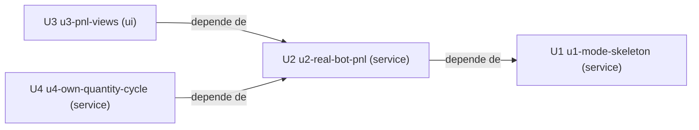

# Dependências entre as Units — paper-real-unico

Conversa: português (Brasil). Data: 2026-11-21.

Este documento descreve só a topologia: quem depende de quem e por onde as Units conversam. A sequência de entrega e o caminho crítico ficam para o Delivery Planning.

## Sources

- `units-generation-questions.md`: Q3 (dependências e paralelismo), Q4 (integração) e Q5 (implantação), com o resumo confirmado.
- `unit-of-work.md`: os componentes de cada Unit.
- `inception/domain-design/components.md` e `decisions.md` (ADR-002, ADR-003, ADR-006, ADR-007 e ADR-011).
- `aidlc/spaces/default/memory/team.md`: Walking Skeleton e "Fatia do intent `261121-paper-real-unico`".
- `reviews/review-01.md` e as decisões do fundador de 2026-11-21 (U2 uma Unit só com ponto de controle interno; U1 não implantada antes da U2).

## Grafo de dependências

- **U1 `u1-mode-skeleton`** não depende de nenhuma Unit. Ela usa só o que já existe no código: os ledgers PAPER e REAL, as ordens REAL com `bot_id`, a carteira do bot, a liberação, o kill switch e o cálculo por ordens do `RealPnlCalculator`.
- **U2 `u2-real-bot-pnl`** depende da U1. Ela completa o RealBotPnl que a U1 cria, devolve o bloco REAL pelo contrato que a U1 define e lê os metadados dos bots pela porta `BotDirectory` que a U1 implementa.
- **U3 `u3-pnl-views`** depende da U2. As parcelas rateadas, a origem de cada linha e o realizado por período só existem depois do RealBotPnl completo. Ela também usa o que a U1 entrega (o ModePnlView, o `PnlModeBlock` e o `SimulatedBadge`), mas essa dependência já passa pela U2.
- **U4 `u4-own-quantity-cycle`** depende da U2. O RealBotHoldings usa o RealCostBasis, o caminho de quantidade do RealProration, a leitura em fluxo do `ledger.api` na ordem de rede e o slot das ordens. Ela também tem uma restrição externa: só entra depois da Performance Validation do intent `261113-trading-real-bot`.
- **U3 e U4 não dependem uma da outra.**

O grafo não tem ciclos: U1 → U2 → U3 e U1 → U2 → U4.



Texto equivalente: U2 depende de U1; U3 depende de U2; U4 depende de U2.

## Pontos de integração

As Units conversam só pelas interfaces públicas Java e pelo contrato OpenAPI `openapi-guest.yaml`. Não há evento novo nem tabela compartilhada entre módulos [Q4].

| De | Para | Interface | O que passa |
|---|---|---|---|
| U2 | U1 | `pnl.api`: porta `BotDirectory` (declarada no `pnl`, implementada pelo `bots` na U1) | id, nome, `market`, `templateId`, estado e data de criação dos bots da pessoa, filtrados pelo tenant |
| U2 | U1 | Bloco REAL do ModePnlView (`pnl.modeview` chama o RealBotPnl) | linhas por bot, "Sem bot" e total REAL, no tipo e na moeda do REAL; a U1 fixa a forma, a U2 preenche o cálculo |
| U2 | U1 | `openapi-guest.yaml`: esquema da visão por modo | a U2 acrescenta campos dentro do bloco REAL ("Sem bot", parcelas); nenhum campo de total fora de um bloco |
| U2 | código existente | `ledger.api`: porta `RealCostMethod`, leitura em fluxo dos lançamentos e coluna `slot` | posições da carteira pelo custo único; lançamentos de swap e taxa na ordem de rede |
| U2 | código existente | `realexecution.api`: leitura das ordens com slot e assinatura | ordens com `bot_id`, origem, taxa, quem pagou, slot e assinatura |
| U3 | U2 | ModePnlView e `openapi-guest.yaml`: período, linhas de um bot e comparação | realizado do período e não realizado de agora; linhas com origem; um bot PAPER e um bot REAL lado a lado |
| U3 | U1 | Componentes web `PnlModeBlock` (variante `compact`) e `SimulatedBadge` | painel e comparação reaproveitam o bloco e o selo |
| U4 | U2 | `pnl.api`: interface `RealBotHoldings`, sobre o RealCostBasis e o caminho de quantidade do RealProration | quantidade e custo próprios do bot por mint e a quantidade disponível |
| U4 | U2 | `realexecution.api`: vendas do bot ainda não assentadas e venda de uma quantidade dada | ordens SELL em `PROPOSED`, `QUOTED`, `SIGNED`, `SENT` ou `AMBIGUOUS`; decisão de venda com a quantidade do bot |
| U4 | U1 | Lista `/bots` e estado da configuração exposto pela API | aviso FR6.2 só quando a mudança está ligada |

Regras que valem em todos os pontos:
- O tenant vem sempre do token; o bot de outra pessoa responde 404.
- REAL e PAPER nunca compartilham dados; só o `pnl.modeview` vê os dois modos, e nunca os soma (ADR-003).
- O `ledger` nunca depende do `pnl`, e o `pnl` nunca depende do `bots` (ADR-002, ADR-007).

## Oportunidades de desenvolvimento em paralelo

- **U3 ∥ U4.** Depois da U2, a U3 e a U4 não dependem uma da outra; as duas ordens topológicas U1 → U2 → U3 → U4 e U1 → U2 → U4 → U3 são válidas. Elas mexem em lugares diferentes: a U3 no `apps/web/src/features/{bots,pnl}` e nas leituras do ModePnlView; a U4 no `bots.worker`, no `pnl.api` (RealBotHoldings) e no `realexecution`. O único arquivo que as duas podem tocar é a lista `/bots`: o filtro da U3 e o aviso da U4.
- O trabalho é feito por uma pessoa só, então esse paralelismo é possível, não planejado [Q3]. A U4 tem ainda a restrição externa da Performance Validation do intent 261113, que pode deixá-la para depois da U3 independentemente da escolha do Delivery Planning.
- A U1 e a U2 não têm paralelismo entre si: a U2 depende da U1.

## Esqueleto (walking skeleton)

A U1 é a primeira Unit do grafo e é a fatia fina deste intent (`team.md`, "Fatia do intent `261121-paper-real-unico`"). Ela roda de ponta a ponta antes das outras Units porque não depende de nenhuma delas:
- **Caminho exercitado:** navegador (telas de Bots e de P&L) → API (criação no modo, lista única e P&L por bot nos dois modos) → ledger PAPER e ledger REAL → blocos separados Simulado (US$) e Real (SOL), sem total geral, com o aviso fixo no simulado.
- **Por que roda sozinha:** o bloco PAPER usa o P&L PAPER que já existe. O bloco REAL usa as ordens REAL que já guardam o `bot_id` e o cálculo por ordens que já existe, sem rateio. A criação do bot REAL usa a carteira do bot, a liberação e o kill switch do intent 261113, sem mudança.
- **Verificação:** um spec de ponta a ponta novo cria um bot PAPER e um bot REAL no validador Solana local, faz uma compra em cada modo e confere que cada bloco mostra só o próprio modo e que os modos nunca são somados. O responsável acrescenta o spec ao `scripts/verify.sh`; o comando de verificação continua sendo `bash scripts/verify.sh`.
- **O que fica para depois:** o rateio, a linha "Sem bot", a ordem por slot, a correção da condicional e a conferência REAL (U2); o detalhe, os períodos, o painel e a comparação (U3); o ciclo com a quantidade própria (U4).
- **Cenários do spec:** o spec da U1 usa só compras simples, que já fecham com o ledger; liquidação, condicional e excedente ficam para os testes da U2.
- **Rodar não é implantar (decisão do fundador, 2026-11-21):** a U1 roda e é verificada sozinha no validador local e na CI, mas não é implantada na mainnet, nem na devnet com convidados, antes da U2. Os totais REAL da U1 só fecham com o ledger a partir da U2. Isso é uma restrição de implantação, não uma aresta do grafo.

## Ponto de controle interno da U2

A U2 continua uma Unit só (decisão do fundador, 2026-11-21). Dentro dela, o ponto de controle intermediário é: a migração do slot com o preenchimento das linhas antigas, a porta `RealCostMethod` e o RealCostBasis prontos, com o teste de paridade verde. Se esse ponto atrasar, a U2 é dividida no corte da revisão (parte 1: slot, custo médio e paridade; parte 2: rateio, "Sem bot", conferência, período e carga). Nesse caso, a U3 e a U4 passam a depender da parte 2, a parte 2 da parte 1, e o bloco `yaml` abaixo muda junto com o plano aprovado (Q2). Hoje o bloco tem a U2 inteira.

A U1 também é a primeira Unit no bloco abaixo, que é o que o runtime usa para ordenar.

## Bloco de dependências (máquina)

```yaml
units:
  - name: u1-mode-skeleton
    kind: service
    depends_on: []
  - name: u2-real-bot-pnl
    kind: service
    depends_on: [u1-mode-skeleton]
  - name: u3-pnl-views
    kind: ui
    depends_on: [u2-real-bot-pnl]
  - name: u4-own-quantity-cycle
    kind: service
    depends_on: [u2-real-bot-pnl]
```

## Assumptions & Open Questions

- [assumption] A U3 não declara dependência direta da U1, porque a U1 já é dependência da U2. O grafo fica mínimo e a ordem continua a mesma.
- [assumption] A restrição da Performance Validation do intent 261113 sobre a U4 é externa ao grafo e não vira uma aresta; o Delivery Planning a considera na sequência.
