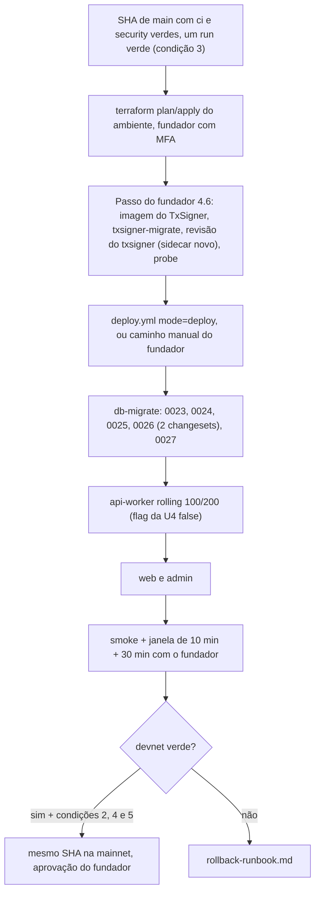

# Configuração da entrega contínua (CD) — intent `261121-paper-real-unico`

Data: 2026-11-25. Commit de referência: `09de0a8daea32fc9ec9d8bfe380a9eac9f3b6c29` (`main`), com `ci` **45550427456** (tentativa 2, 7 jobs verdes) e `security` **45550427465** verdes. Conversa: português (Brasil).

Decisões deste estágio (`deployment-pipeline-questions.md`, Q1 a Q5 todas opção A, resumo confirmado):
- estratégia sem mudança: rolling no ECS, circuit breaker, TxSigner primeiro, smoke e 10 minutos de observação; nenhum serviço novo [Q1];
- promoção: o mesmo SHA verde passa pela devnet e depois pela mainnet, com a aprovação do fundador; as condições da transição da Construction entram como portões [Q2];
- migrações `0023` a `0027` pelo `db-migrate`, antes das imagens, só de expansão; repetição em caso de `lock_timeout` [Q3];
- flag da U4 pela F4 (duas variáveis por ambiente no `tfvars`), desligada até a condição 1; flags do REAL, kill switch e liberação sem mudança [Q4];
- rollback: o runbook do 261113 mais as adições deste intent [Q5].

**O que este estágio mudou no repositório:** nada fora desta pasta. Nenhum arquivo em `.github/workflows/`, `infra/terraform/`, `scripts/` ou de código foi editado. Nenhuma conta AWS foi tocada. Nenhum commit foi feito.

Documentos irmãos: `deployment-strategy.md` (estratégia, flags, ordem da virada) e `rollback-runbook.md` (passo a passo do rollback).

## 1. Base: o que vem do 261113 sem mudança

Este documento **não repete** o `cd-config.md` do intent `261113-trading-real-bot` (`aidlc/spaces/default/intents/261113-trading-real-bot/operation/deployment-pipeline/cd-config.md`). Continuam valendo, como estão lá:

| Parte do 261113 | Seção lá | Situação neste intent |
|---|---|---|
| Fluxo geral (verify → Environment → guarda de configuração → imagens pelo SHA → TxSigner do SHA em serviço → `db-migrate` → `api-worker` → web e admin → smoke → janela de 10 min) | 1 | herdado sem mudança |
| Papel de implantação por OIDC, permissões mínimas e Deny (SP-01) | 3.2, 3.3 | herdado; o intent não muda IAM |
| Texto do `deploy.yml` (jobs `verify` e `deploy`, guarda, smoke, janela) | 4.4, 4.5 | herdado; este documento só propõe duas linhas a mais na guarda e no resumo (seção 7) |
| Passo do fundador com MFA (imagem do TxSigner, `txsigner-migrate`, revisão em serviço, probe de prontidão) | 4.6 | herdado sem mudança; agora leva também as revisões só do sidecar `metrics-agent` do `txsigner` (U2 D-INF1, U4) |
| Configuração do ECS por serviço (100/200, circuit breaker, health checks) | 5 | herdado; conferido no Terraform: `modules/services/api-worker.tf`, `main.tf` e `web-admin.tf` têm `deployment_minimum_healthy_percent = 100`, `deployment_maximum_percent = 200` e `deployment_circuit_breaker` |
| Matriz de promoção do 261113 (etapas 0 a 4, inclusive os pré-requisitos do REAL na mainnet) | 6 | herdada; a seção 4 abaixo acrescenta as linhas deste intent |
| Tabela de flags do REAL e "mudar uma flag é uma implantação auditada" | 7 | herdada para as flags do REAL; a flag da U4 segue a F4 (seção 5 e divergência na seção 8) |

**O que este intent acrescenta:** a carga do deploy deste SHA (seção 2), a ordem das migrações `0023` a `0027` com a repetição (seção 3), as linhas da matriz de promoção (seção 4), a flag da U4 (seção 5), as cinco condições da transição como portões verificáveis (seção 6), o texto proposto para a guarda do `deploy.yml` (seção 7) e as pendências do responsável (seção 9).

## 2. Fluxo de implantação deste intent



Texto equivalente: um commit de `main` com `ci` e `security` verdes recebe primeiro o `terraform apply` do ambiente (fundador, MFA), depois o passo do fundador para o TxSigner, depois o `deploy.yml` (ou o caminho manual enquanto ele não existe), que roda o `db-migrate` com as migrações `0023` a `0027`, troca `api-worker`, web e admin em rolling, roda o smoke e a janela de 10 minutos. Só depois de verde na devnet, e com as condições 2, 4 e 5 cumpridas, o mesmo SHA vai para a mainnet com a aprovação do fundador. A flag da U4 fica `false` nos dois ambientes durante todo esse fluxo.

### 2.1 O que o `terraform apply` deste SHA registra (nenhuma revisão entra em serviço sozinha, `ignore_changes = [task_definition]`)

| Origem | Mudança no plano | Família afetada |
|---|---|---|
| U1 | `MEMETRADE_PNL_BYMODE_BLOCKTIMEOUT`, `MEMETRADE_BOTS_REALELIGIBILITYTIMEOUT`, `MEMETRADE_PNL_BYMODE_REALMAXORDERS` em `api_environment` (iguais aos padrões do código) | `api-worker` |
| U2 (D-INF1) | `pnl_real_reconciliation_mismatches_total` na lista de permissão; alarme `real_ops_pnl_reconciliation_mismatch` | sidecar `metrics-agent` de `api-worker` e `txsigner` |
| U3 | nada (`plan` vazio para a U3) | — |
| U4 (F4) | `MEMETRADE_REAL_OWN_QUANTITY_SELL = "false"` nos contêineres `api` e `worker`; 3 métricas na lista; alarmes `real_ops_own_holdings_unavailable` e `real_ops_own_holdings_stuck_bots` | `api-worker`, sidecar do `txsigner` |

O fundador confere, no `plan`, que nenhuma família, papel, segredo ou imagem muda além disso, e que `MEMETRADE_REAL_ENABLED`, `TXSIGNER_REAL_ENABLED` e `MEMETRADE_REAL_EXITS_ENABLED` continuam `"false"`.

### 2.2 Dois caminhos de execução

| Caminho | Quando | Credencial | Referência |
|---|---|---|---|
| **A. `deploy.yml`** (`workflow_dispatch`, Environments `devnet` e `mainnet`, OIDC) | depois que o responsável criar o workflow, os Environments e o OIDC (seção 9) | papel de implantação por OIDC, sessão de 1 h | `cd-config.md` do 261113, 4.4 |
| **B. Caminho manual do fundador** | **hoje**, enquanto o `deploy.yml` não existe (`ls .github/workflows` mostra só `ci.yml`, `load-test.yml`, `security.yml`) | perfil de administração com MFA (`eureka-devnet-admin`, `eureka-mainnet-admin`) | `construction/u4-own-quantity-cycle/infrastructure-design/cicd-pipeline.md`, "Caminho manual do fundador" (R-04) |

Caminho B, comandos (Git Bash, raiz do repositório, árvore limpa no SHA):

```bash
set -euo pipefail
export AWS_PROFILE=eureka-devnet-admin        # eureka-mainnet-admin na mainnet; pede o código MFA
export SHA=<sha de main, verde em ci e security>
git fetch origin main && git checkout --detach "$SHA" && test -z "$(git status --porcelain)"

# 1. Terraform do ambiente (o tfvars fica fora do repositório)
cd infra/terraform
terraform plan -var-file=environments/devnet.tfvars -out=devnet.plan   # revisar: só as diferenças da tabela 2.1
terraform apply devnet.plan
VARS=$(terraform output -json github_environment_variables); cd ../..
NAME=$(jq -r .NAME_PREFIX <<< "$VARS"); CLUSTER=$NAME
SUBNET_B=$(jq -r .SUBNET_PRIVATE_B <<< "$VARS"); APP_SG=$(jq -r .APP_SECURITY_GROUP <<< "$VARS")

# 2. Passo do fundador para o TxSigner: cd-config.md do 261113, seção 4.6, inteiro, com o mesmo SHA.

# 3. Imagem da API pelo SHA (build e push só se a etiqueta não existir; as etiquetas são imutáveis)
REG=$(aws sts get-caller-identity --query Account --output text).dkr.ecr.$(jq -r .AWS_REGION <<< "$VARS").amazonaws.com
REPO=$REG/$NAME/api
aws ecr describe-images --repository-name "$NAME/api" --image-ids "imageTag=$SHA" > /dev/null 2>&1 || {
  aws ecr get-login-password | docker login --username AWS --password-stdin "$REG"
  docker build --build-arg BUILD_SHA="$SHA" -t "$REPO:$SHA" apps/api && docker push "$REPO:$SHA"; }
IMG=$REPO@$(aws ecr describe-images --repository-name "$NAME/api" --image-ids "imageTag=$SHA" \
  --query 'imageDetails[0].imageDigest' --output text)

# 4. Revisão nova = a mais recente registrada pelo Terraform, com a imagem trocada pelo digest
register() {
  aws ecs register-task-definition --query taskDefinition.taskDefinitionArn --output text --cli-input-json "$(
    aws ecs describe-task-definition --task-definition "$1" --query taskDefinition --output json \
    | jq -c --arg img "$IMG" --arg repo "$REPO" '
        .containerDefinitions |= map(if (.image | startswith($repo)) then .image = $img else . end)
        | {family, taskRoleArn, executionRoleArn, networkMode, containerDefinitions, volumes, placementConstraints,
           requiresCompatibilities, cpu, memory, runtimePlatform, ephemeralStorage, proxyConfiguration}
        | with_entries(select(.value != null))')"
}

# 5. Migrações (0023 a 0027), código de saída 0 obrigatório
MIG=$(register "$NAME-db-migrate")
T=$(aws ecs run-task --cluster "$CLUSTER" --task-definition "$MIG" --launch-type FARGATE --count 1 \
  --network-configuration "awsvpcConfiguration={subnets=[$SUBNET_B],securityGroups=[$APP_SG],assignPublicIp=DISABLED}" \
  --started-by "founder-${SHA:0:12}" --query 'tasks[0].taskArn' --output text)
aws ecs wait tasks-stopped --cluster "$CLUSTER" --tasks "$T"
aws ecs describe-tasks --cluster "$CLUSTER" --tasks "$T" --query 'tasks[0].containers[0].exitCode' --output text  # 0

# 6. api-worker em rolling e conferência da revisão PRIMARY
NEW=$(register "$NAME-api-worker")
aws ecs update-service --cluster "$CLUSTER" --service api-worker --task-definition "$NEW" > /dev/null
aws ecs wait services-stable --cluster "$CLUSTER" --services api-worker
aws ecs describe-services --cluster "$CLUSTER" --services api-worker \
  --query 'services[0].deployments[?status==`PRIMARY`].[taskDefinition,rolloutState,runningCount,desiredCount]' --output text
# esperado: $NEW COMPLETED 1 1; outro ARN = o circuit breaker devolveu a revisão anterior: PARE

# 7. web e admin: o mesmo, com REPO=$REG/$NAME/web e /admin e as famílias $NAME-web e $NAME-admin
# 8. Smoke: rollback-runbook.md do 261113, passo 6 (comandos); janela de 10 min e os 30 min seguintes
```

O passo 4 parte da **revisão mais recente** da família, que é a registrada pelo `terraform apply` do passo 1 (com a flag da U4 do `tfvars`). O caminho B não usa o papel de implantação do GitHub, não liga o REAL e não toca no TxSigner além do passo 4.6.

**Nota da implantação** (obrigatória nos dois caminhos; num arquivo novo em `docs/proofs/` ou no resumo do run): SHA, ambiente, ID do run `ci` com o número da tentativa (condição 3), ARNs das revisões anteriores e novas, saída do `db-migrate`, resultado do smoke, valores de `real_own_quantity_sell_api` e `real_own_quantity_sell_worker`, horários em UTC.

## 3. Migrações: ordem e repetição

O `db-migrate` (perfil `migrate`, login dono do esquema, pool de 1 conexão) aplica, antes de qualquer imagem nova e nesta ordem (`db.changelog-master.yaml`):

| # | Changeset | Origem | Atributos | Trava | Se falhar |
|---|---|---|---|---|---|
| 1 | `0023-real-entry-slot` | U2 | em transação | curta (tabela nova) | transação desfeita |
| 2 | `0023-real-entry-slot-append-only` | U2 | `splitStatements:false` | idem | idem |
| 3 | `0023-real-entry-slot-privileges` | U2 | `splitStatements:false` | idem | idem |
| 4 | `0023-real-ledger-entry-wallet-created-idx` | U2 | `runInTransaction:false`; `DROP INDEX CONCURRENTLY IF EXISTS` + `CREATE INDEX CONCURRENTLY` | `SHARE UPDATE EXCLUSIVE`, espera transações abertas (segundos) | índice `INVALID`, sem linha no changelog; a repetição apaga e recria (runbook, seção 9) |
| 5 | `0024-real-risk-day-deferred` e `-privileges` | U2 | em transação | curta | transação desfeita |
| 6 | `0025-real-position-epoch`, `-append-only`, `-privileges` | U2 (Etapa 14b) | em transação | curta | transação desfeita |
| 7 | `0026-bot-cycle-outcome-not-valid` | U4 | `SET LOCAL lock_timeout = '5s'` | `ACCESS EXCLUSIVE` só na troca do catálogo, até 5 s de espera | `55P03`: regra antiga intacta; repetir (runbook, seção 12) |
| 8 | `0026-bot-cycle-outcome-validate` | U4 | `SET LOCAL lock_timeout = '5s'` | `SHARE UPDATE EXCLUSIVE` | regra fica `NOT VALID` (já vale para linhas novas); a repetição roda só este |
| 9 | `0027-real-decision-request-bot-pending-sell-idx` | U4 | `runInTransaction:false`; `DROP ... IF EXISTS` + `CREATE INDEX CONCURRENTLY` | `SHARE UPDATE EXCLUSIVE` | índice `INVALID`; a repetição apaga e recria |

Todas são só de expansão (0 colunas removidas, 0 DML em tabela existente): a imagem anterior funciona sobre o esquema novo (`Migration0023AdditiveIT`, `Migration0026IT`). **Nenhuma migração é revertida em produção**; o rollback volta só as imagens (`team.md`, Deployment).

Num ambiente que ainda não existe, a primeira implantação aplica de `0001` a `0027` de uma vez; a ordem acima vale para um ambiente que já está na `0022`.

**Repetição depois de `lock_timeout` (`55P03`) ou de índice `INVALID`:**

| Passo | Ação | Verificação |
|---|---|---|
| 1 | O `db-migrate` sai com código diferente de zero; a troca de imagens **não** começa (o `deploy.yml` para; no caminho B, o fundador para no passo 5). | revisão `PRIMARY` do `api-worker` continua a anterior |
| 2 | Ler a causa no grupo `/ecs/<NAME_PREFIX>/migrate`: `aws logs filter-log-events --log-group-name /ecs/<NAME_PREFIX>/migrate --filter-pattern '"55P03"'` (ou `INVALID`, `changeset`) | changeset que falhou identificado |
| 3 | Esperar de 1 a 5 minutos (as transações do ciclo e da fila duram segundos). **Nunca** matar a transação do ciclo nem a da fila. | — |
| 4 | Disparar de novo a mesma implantação com o **mesmo SHA** (`gh workflow run deploy.yml --ref main -f sha=<SHA> -f environment=<env> -f mode=deploy`, ou o passo 5 do caminho B). | `db-migrate` com saída 0 |
| 5 | Depois de 3 repetições com a mesma falha: parar, classificar como P2 e escalar ao fundador (único on-call). | nota da implantação |

A conferência por SQL do runbook (seção 12: `pg_stat_activity`; seção 9: `to_regclass`, `databasechangeloglock`) **não tem caminho na nuvem hoje** (lacuna IR-G3 do 261113, seção 8 abaixo). Até ela ser fechada, a repetição dos passos 3 e 4 é o único caminho; uma trava do changelog presa (`databasechangeloglock`) bloqueia a implantação até o IR-G3.

**Teto de conexões no rolling (D-INF2 da U2).** Durante o rolling, duas tarefas `api-worker` podem somar cerca de 127 conexões contra cerca de 112 da `db.t4g.micro` (fórmula padrão; confirmar com `SHOW max_connections` na primeira conta). O regime fica em no máximo 66. **Decisão do responsável antes da primeira implantação na nuvem** (seção 9, item 6).

## 4. Matriz de promoção entre ambientes

A matriz do 261113 (`cd-config.md` lá, seção 6, etapas 0 a 4) continua valendo inteira. Este intent acrescenta, em cada etapa:

| # | Etapa | O que este intent acrescenta | Quem aprova | Evidência |
|---|---|---|---|---|
| 0 | Local | `bash scripts/verify.sh` verde com os 62 specs, inclusive `zz-paper-real-unico` (20 casos); se o local morrer por memória, vale o run do `ci` do mesmo commit (`team.md`, `verify-checkpoint.sh`) | fundador | saída do `verify.sh` ou ID do run |
| 1 | CI verde | G1 a G19 de `construction/ci-pipeline/quality-gates.md` no `ci` e no `security` do SHA; **um** run verde do `ci`, com as repetições do `e2e` registradas (condição 3) | automático (job `verify`) ou fundador (caminho B) | IDs dos runs e número da tentativa |
| 2 | Devnet | migrações `0023` a `0027` com saída 0; `api-worker` com `MEMETRADE_REAL_OWN_QUANTITY_SELL = "false"` nos dois contêineres (condição 1); alarmes `real_ops_pnl_reconciliation_mismatch`, `real_ops_own_holdings_*` em `OK`; **medição do fundador na devnet** das leituras do P&L por modo (AC3.11.2, U3 NFR1.6, limite de 1.000 ms), registrada em `docs/perf/` | fundador (sem revisor obrigatório) | nota da implantação; arquivo em `docs/perf/` |
| 3 | Mainnet | mesmo SHA verde na devnet; **bloqueada** até: `performance-validation` registrar o `pnl-by-mode` verde nos grupos U2 e U3 e a medição da devnet (condição 2); passo `node --test` no `ci.yml` (condição 4); os 16 `Unverified` conferidos (condição 5); D-INF2 decidido; flag da U4 `false` (condição 1) | fundador, revisor obrigatório do Environment `mainnet` | lista de conferência da seção 6 marcada; run ou nota da mainnet |
| 4 | Convidados | sem mudança: liberação por pessoa, as três condições do `team.md` | fundador | as do 261113 |
| F | **Virada da flag da U4** (não é etapa de promoção de SHA) | só depois da condição 1; primeiro na devnet, depois na mainnet com o mesmo SHA de imagem; ordem API → worker (`deployment-strategy.md`, seção 3) | fundador | `terraform plan` com uma diferença, nota da virada, prova do alarme na devnet |

Os usuários usam só a mainnet; a devnet fica para os testes do fundador e a pré-produção (`project.md`, Forbidden).

## 5. Flag da U4 (F4)

| Flag | Variável Terraform | Variável de ambiente | Contêiner | Padrão | Onde o valor ligado vive |
|---|---|---|---|---|---|
| quantidade própria, API (aviso em `/bots`) | `real_own_quantity_sell_api` | `MEMETRADE_REAL_OWN_QUANTITY_SELL` | `api` (`api_environment`) | `false` | `environments/<env>.tfvars`, fora do repositório |
| quantidade própria, worker (corte da venda) | `real_own_quantity_sell_worker` | `MEMETRADE_REAL_OWN_QUANTITY_SELL` | `worker` (`worker_environment`) | `false` | idem |

A validação de `real_own_quantity_sell_worker` (`infra/terraform/main.tf`, linhas 161 a 170) recusa no `plan` o worker ligado com a API desligada. A chave nunca entra em `app_environment`. A ordem de virada, as conferências SQL e o desligamento estão em `deployment-strategy.md`, seção 3. **Fica `false` em todos os ambientes até a condição 1.**

## 6. Condições da transição como portões (`phase-check-construction.md`, seções 7 e 8)

O fundador aprovou a transição condicional em 2026-11-25. Cada condição vira um portão com dono, evidência e comando:

| # | Condição | Bloqueia | Quem confere | Evidência exigida | Comando de conferência |
|---|---|---|---|---|---|
| 1 | U4 (U4-NFR1.1, NFR1.13, TGT-U4-ALARM): flag `false` em todo ambiente até a medida por passo, a decisão F7 e a medida oficial (10.000 × 3, Linux, com ciclos) dentro da meta | **a virada da flag** em qualquer ambiente (não bloqueia a implantação do código) | fundador, em toda implantação e antes da virada | em toda implantação: a flag `"false"` na revisão em serviço. Para liberar a virada: decisão F7 registrada, U4 de volta à Code Generation e ao Build and Test aprovada, medida oficial em `docs/perf/` com mediana do p99,9 ≤ meta | `grep -E '^real_own_quantity_sell_(api\|worker)' infra/terraform/environments/<env>.tfvars` (os dois `= false`); `aws ecs describe-task-definition --task-definition "$(aws ecs describe-services --cluster <NAME_PREFIX> --services api-worker --query 'services[0].taskDefinition' --output text)" --query "taskDefinition.containerDefinitions[?name=='api' \|\| name=='worker'].[name, environment[?name=='MEMETRADE_REAL_OWN_QUANTITY_SELL'].value \| [0]]" --output text` (esperado `api false`, `worker false`); medida: `sh apps/api/mvnw -B -ntp -f apps/api/pom.xml -Dit.test=RealBotHoldingsMeasurementIT -Du4.measure.reads=10000 -Du4.measure.cycles=100 verify` (3 vezes, Linux) |
| 2 | Carga (AC3.11.1, AC3.11.2, NFR1, U2-NFR1.9): `load-test.yml` com `pnl-by-mode` aplicado e disparado num SHA verde; mainnet bloqueada até `performance-validation` registrar U2 e U3 verdes e a medição na devnet | **a mainnet** | fundador (responsável aplica o arquivo); `performance-validation` registra | run verde do `load-test` com `pnl-by-mode`; `docs/perf/u2-real-bot-pnl-<data>.md` e `docs/perf/u3-pnl-views-<data>.md` com resultado verde em cada grupo; medição da devnet em `docs/perf/`; artefato da `performance-validation` deste intent | `grep -c pnl-by-mode .github/workflows/load-test.yml` (> 0); `gh workflow run load-test -f scenario=pnl-by-mode`; `gh run list --workflow load-test.yml --status success --json databaseId,displayTitle,headSha,createdAt`; `gh run download <id> -n load-test-report` |
| 3 | TGT-E2E-FLAKY: defeito aberto e investigado; toda repetição do `e2e` registrada; só um run verde vale | **toda implantação** (devnet e mainnet) | fundador | run `ci` verde do SHA; se a tentativa for > 1, a nota registra a falha da tentativa anterior e confirma que é a mesma assinatura (compra REAL do `real-swap` sem confirmação); issue do defeito aberta | `gh run view <id> --json attempt,conclusion,headSha,jobs --jq '{attempt, conclusion, headSha, failed: [.jobs[] \| select(.conclusion=="failure") \| .name]}'`; `gh run view <id> --attempt <n-1> --log-failed \| grep -n "swap.spec.ts"`; `gh issue list --search "real-swap in:title"` |
| 4 | Passo `node --test "scripts/load/*.test.mjs"` no job `frontend` do `ci.yml` | **a mainnet** (junto com a condição 2) | fundador (responsável aplica o texto de `ci-config.md`, seção 2.2) | o passo existe e ficou verde no run do SHA | `grep -n 'node --test "scripts/load/\*.test.mjs"' .github/workflows/ci.yml`; `gh run view <id> --json jobs --jq '.jobs[] \| select(.name=="frontend") \| .steps[] \| select(.name \| test("load scenarios")) \| .conclusion'` (esperado `success`) |
| 5 | Os 16 `Unverified` conferidos pelos donos | **a mainnet** | fundador, na aprovação do Environment `mainnet` | por dono: `performance-validation` (U2-NFR1.1, 1.2, 1.3, 1.6, 1.24, 1.25; U3-NFR1.6); `build-and-test` com `-D` (U4-NFR1.2, 1.5, 2.17); `environment-provisioning` (TGT-IAC-1, TGT-IAC-2, U4-NFR8.4, U2-NFR8.2, U4-NFR8.2); `deployment-execution` (U4-NFR8.3: ordem devnet → mainnet) | `docker run --rm -v "$PWD/infra/terraform:/w" -w /w hashicorp/terraform:1.9.8 fmt -check -recursive` e `terraform validate`/`terraform test` (TGT-IAC-1); `docker run --rm -v "$PWD/infra/terraform:/w" bridgecrew/checkov:3 -d /w` (TGT-IAC-2); `aws ce get-cost-and-usage` por conta (custos); a nota da devnet com o mesmo SHA da mainnet (U4-NFR8.3) |

**Lista de conferência na aprovação da mainnet** (acrescenta às do 261113):
- [ ] condição 1: flag da U4 `false` na revisão em serviço da devnet e no `tfvars` da mainnet;
- [ ] condição 2: `pnl-by-mode` verde nos grupos U2 e U3 e medição da devnet registrada;
- [ ] condição 3: run `ci` verde do SHA, repetições registradas;
- [ ] condição 4: passo `node --test` verde no run do SHA;
- [ ] condição 5: os 16 `Unverified` com evidência do dono;
- [ ] D-INF2 decidido e aplicado;
- [ ] IR-G3 fechado, ou o fundador aceita implantar sem leitura SQL na nuvem (sem virada da flag).

## 7. Texto proposto para o `deploy.yml` do 261113 (não aplicado)

Só o responsável altera `.github/workflows/`. Quando ele criar o `deploy.yml` a partir do texto do 261113 (4.4), duas linhas tornam a condição 1 verificável por máquina, como a guarda já faz com `MEMETRADE_REAL_EXITS_ENABLED`:

1. No passo `Configuration guard`, dentro do `jq -e`, depois da linha de `MEMETRADE_REAL_EXITS_ENABLED`:

   ```text
                 and (all($envs[]; (.MEMETRADE_REAL_OWN_QUANTITY_SELL // "false") != "true"))
   ```

2. No passo `Summary for the approver`, na lista da mainnet:

   ```text
                 echo "- [ ] 261121 conditions 2, 4 and 5 closed (load pnl-by-mode U2+U3 green, devnet measured, node --test step, 16 Unverified)"
                 echo "- [ ] memetrade.real.own-quantity-sell stays false (261121 condition 1); the job checks it too"
   ```

Quando a condição 1 for cumprida, a linha 1 é retirada pelo responsável no mesmo commit que registra a decisão. Assim a virada nunca sai por acidente. Na mesma linha do 261113: as ações continuam fixadas pelo SHA (nenhuma ação nova aqui).

## 8. Lacunas herdadas que afetam este intent

| ID | Lacuna | Efeito aqui | Dono |
|---|---|---|---|
| IR-G3 (261113, `incident-response/runbooks.md`) | não existe caminho de leitura SQL do banco na nuvem para o fundador (sem tarefa avulsa de leitura, sem `ExecuteCommand`) | as conferências SQL da virada da flag (runbook, seção 11) e as de recuperação das migrações (seções 9 e 12) **não rodam na nuvem**; a virada fica bloqueada também por isso; a recuperação de migração fica só na repetição | Environment Provisioning: família avulsa do fundador, só leitura, com MFA |
| D-INF2 (U2) | teto teórico de cerca de 127 conexões no rolling contra cerca de 112 | risco de recusa de conexão durante a troca | responsável |

## 9. Pendências do responsável

| # | Pendência | Onde está o texto pronto | Bloqueia |
|---|---|---|---|
| 1 | Criar `.github/workflows/deploy.yml` | `cd-config.md` do 261113, 4.4, mais as duas linhas da seção 7 deste documento | caminho A; até lá vale o caminho B |
| 2 | Criar os GitHub Environments `devnet` (branch `main`) e `mainnet` (revisor obrigatório `rafaelcruz-net`, "Prevent self-review" desmarcado, branch `main`) e as variáveis de 4.3 do 261113 | `cd-config.md` do 261113, 4.1 e 4.3 | caminho A |
| 3 | OIDC: `terraform apply` do módulo `delivery` em cada conta e copiar `deploy_role_arn` para `AWS_DEPLOY_ROLE_ARN` | `cd-config.md` do 261113, 3 e 4.1 | caminho A |
| 4 | `WorkflowsTest` aceitar `id-token: write` **só** no job `deploy` do `deploy.yml` (hoje exige só leitura em todo workflow) | `team.md`, Pendências da CI | o `deploy.yml` entrar com a CI verde |
| 5 | `load-test.yml` com `pnl-by-mode` e o passo `node --test` no `ci.yml` | `construction/ci-pipeline/ci-config.md`, 2.1 e 2.2 | mainnet (condições 2 e 4) |
| 6 | D-INF2: `max_connections` no grupo de parâmetros (estático, pede reinício), classe maior ou outra saída | `u2-real-bot-pnl/infrastructure-design/infrastructure-specification.md`, item 2 | primeira implantação na nuvem |
| 7 | Provisionar as contas `devnet` e `mainnet` (nenhum ambiente na nuvem existe) | `team.md`, Deployment | qualquer implantação na nuvem |
| 8 | Demais pendências da CI do `team.md` (Node 24, CodeQL v4, Maven, Terraform e Checkov na CI) | `ci-config.md` do 261113 e deste intent, seção 4 | nada neste estágio |

## Sources

- `operation/deployment-pipeline/deployment-pipeline-questions.md` (Q1 a Q5 e o resumo confirmado)
- `aidlc/spaces/default/intents/261113-trading-real-bot/operation/deployment-pipeline/cd-config.md` (1, 3, 4.1 a 4.6, 5, 6, 7, 8), `deployment-strategy.md`, `rollback-runbook.md`
- `aidlc/spaces/default/intents/261113-trading-real-bot/operation/incident-response/runbooks.md` (leitura do banco na nuvem, IR-G3)
- `construction/ci-pipeline/ci-config.md` (1, 2.1, 2.2, 3, 4, 6) e `construction/ci-pipeline/quality-gates.md` (G1 a G19, seção 4)
- `verification/phase-check-construction.md` (seções 6, 7 e 8: condições 1 a 5 e a decisão do fundador de 2026-11-25)
- `construction/u1-mode-skeleton/infrastructure-design/cicd-pipeline.md` (promoção da U1), `u2-real-bot-pnl/infrastructure-design/infrastructure-specification.md` e `cicd-pipeline.md` (`0023`, `0024`, D-INF1, D-INF2), `u3-pnl-views/infrastructure-design/cicd-pipeline.md` (medição na devnet), `u4-own-quantity-cycle/infrastructure-design/infrastructure-specification.md` e `cicd-pipeline.md` (F4, `0026`, `0027`, caminho manual, virada)
- `docs/runbooks/real-operations.md`, seções 9 a 13
- `infra/terraform/main.tf` (variáveis 145 a 170, `api_environment`, `worker_environment`, saídas), `environments/devnet.tfvars.example`, `environments/mainnet.tfvars.example`, `modules/services/api-worker.tf`, `main.tf`, `web-admin.tf` (100/200 e circuit breaker), `modules/services/outputs.tf`
- `apps/api/src/main/resources/db/changelog/db.changelog-master.yaml` e `changes/0023` a `0027` (changesets e atributos)
- `.github/workflows/` (lista: sem `deploy.yml`)
- `team.md` (Way of Working, Testing Posture, Deployment), `project.md` (Forbidden, Mandated)

## Assumptions & Open Questions

1. [assumption] O caminho B copia o padrão do passo 4.6 do 261113 para a API e o web/admin; a regra "partir da revisão mais recente da família" vale porque, no caminho B, só o Terraform e o fundador registram revisões. Quando o `deploy.yml` existir, vale a regra do 4.6 (partir da revisão do Terraform e conferir `registeredBy`).
2. [assumption] A nota da implantação fica em `docs/proofs/` (nome a definir pelo responsável), como as provas do 261113.
3. O smoke do 261113 é sem autenticação (`/api/v1/legal/current`, `/api/health`, `/privacidade`). As telas de P&L exigem login; elas são conferidas pelo fundador no navegador na devnet (etapa 2) e pelo alarme `real_ops_pnl_reconciliation_mismatch` na janela. Este estágio não cria smoke autenticado.
4. Aberta: a decisão D-INF2 (seção 9, item 6). Entre as saídas listadas na U2, `deployment_minimum_healthy_percent = 0` no `api-worker` contraria a estratégia do `team.md` ("tarefa nova saudável antes de a antiga sair") e não é recomendada aqui.
5. Aberta: o fechamento do IR-G3 (família de leitura do fundador). Sem ele, a virada da flag não tem as conferências SQL na nuvem.
6. Divergência registrada para o ritual de aprendizados: o `team.md` (Deployment, Flags) diz que mudar uma flag é um commit em `main` com o Terraform versionado; a F4 da U4 põe o valor ligado no `tfvars` fora do repositório, com o registro no `plan`, no `apply` com MFA, no CloudTrail e na nota (`deployment-strategy.md`, seção 3.5).
