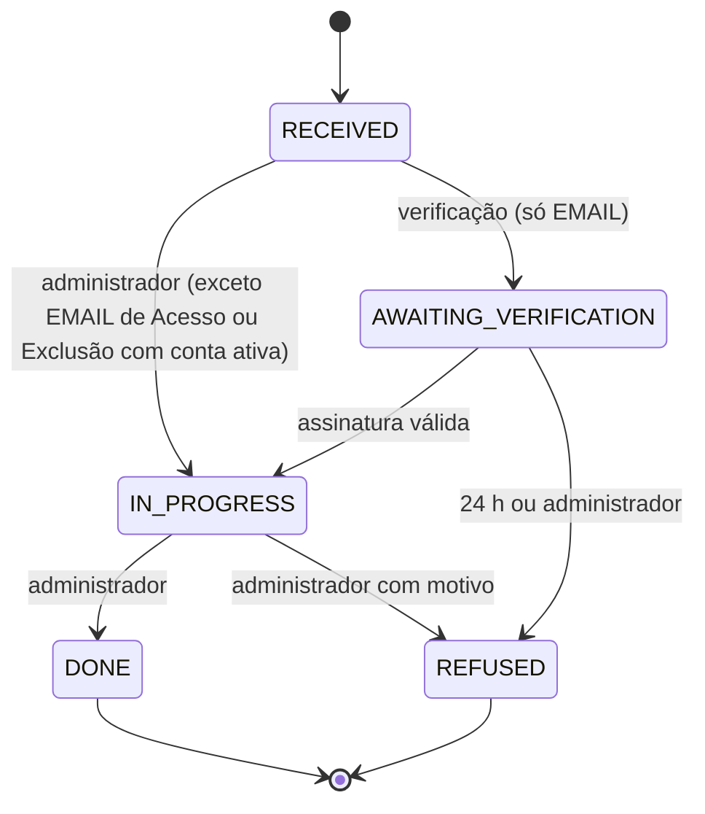

# U4 — Pedidos de titular (LGPD)

Intent `261109-termos-lgpd`, Unit `u4-data-requests`. Módulo `com.memetrade.privacy`. Contratos P1 (convidado) e P2 (administrador, sem a rota de anonimização, que é da U5) em `aidlc/spaces/default/intents/261109-termos-lgpd/inception/contract-design/contract-summary.md`. O OpenAPI gerado do código (`apps/api/openapi/openapi-guest.yaml` e `openapi-admin.yaml`) prevalece.

## Rotas

### Convidado (P1, escopo `CLIENT`)

Tenant e pessoa vêm sempre do token. Todo `POST` exige `Idempotency-Key`. O prefixo `/api/v1/privacy/` fica liberado na trava de novo aceite: a pessoa exerce os direitos de titular mesmo sem aceitar os termos novos.

| Método e caminho | O que faz | Respostas principais |
|---|---|---|
| `GET /api/v1/privacy/requests` | Pedidos da pessoa, do mais novo para o mais antigo | 200 |
| `POST /api/v1/privacy/requests` | Novo pedido `{type, details}` | 201; 400 `VALIDATION_FAILED`; 409 `DATA_REQUEST_ALREADY_OPEN`; 429 `RATE_LIMITED` com `Retry-After` |
| `GET /api/v1/privacy/requests/{requestId}` | Um pedido da pessoa | 200; 404 (também para pedido de outra pessoa ou tenant, ou id malformado) |

`response`, `refusalReason` e `accessSummary` vêm `null` até o pedido ficar `DONE` ou `REFUSED`.

### Administrador (P2, escopo `ADMIN`)

| Método e caminho | O que faz | Respostas principais |
|---|---|---|
| `GET /api/v1/admin/privacy/requests?status=&cursor=&limit=` | Página por prazo (`due_at`, depois id), 50 por padrão, até 100 | 200 `{items, nextCursor}`; 400 |
| `POST /api/v1/admin/privacy/requests` | Registra pedido recebido por e-mail `{type, details, contact, receivedAt, userId?}` | 201; 400; 409 `DATA_REQUEST_ALREADY_OPEN` |
| `GET /api/v1/admin/privacy/requests/{requestId}` | Pedido com texto, contato, verificação e, para Acesso aberto ligado a conta, a prévia do resumo | 200; 404 |
| `POST /api/v1/admin/privacy/requests/{requestId}/transitions` | `{to, response?, refusalReason?, releaseAccessSummary?}` | 200; 400; 409; 422 |
| `POST /api/v1/admin/privacy/requests/{requestId}/verification` | Gera a mensagem de verificação (24 h) | 200 `VerificationView`; 409 |
| `POST /api/v1/admin/privacy/requests/{requestId}/verification/confirm` | `{signature}` da carteira da conta | 200; 409 `VERIFICATION_EXPIRED`, `VERIFICATION_ALREADY_USED`, `DATA_REQUEST_CLOSED`; 422 `VERIFICATION_INVALID` |
| `POST /api/v1/admin/privacy/requests/{requestId}/reply-sent` | Registra o envio da resposta ao contato (só EMAIL encerrado; o primeiro registro fica) | 200; 409 |

Cada item da lista e do detalhe traz `overdue` (aberto e vencido) e `dueSoon` (aberto, a 3 dias ou menos do prazo).

## Estados

Texto: o pedido nasce Recebido, com prazo de 15 dias corridos. O administrador o leva a Em andamento; um pedido por e-mail de Acesso ou Exclusão ligado a uma conta ativa passa antes por Aguardando verificação, que só sai pela assinatura válida (Em andamento) ou por recusa (24 h sem assinatura, ou o administrador). De Em andamento, o pedido vai a Concluído ou a Recusado com motivo. Concluído e Recusado são finais: qualquer mudança responde `409 DATA_REQUEST_CLOSED`.

- Só um pedido aberto por pessoa e tipo, de qualquer origem (índice único parcial `uq_open_request_per_type`).
- Liberar o resumo de Acesso em um pedido por e-mail exige identidade confirmada (`409 IDENTITY_NOT_VERIFIED`).
- A cada 15 minutos, o job `dataRequestTimers` recusa as verificações vencidas ("identidade não confirmada") e publica um único `DATA_REQUEST_OVERDUE` por pedido aberto vencido.
- Às 04:00 UTC, o expurgo `dataSubjectRequestPurge` apaga os pedidos encerrados há 12 meses, com a verificação e o contato.

## Verificação por assinatura

1. A mensagem tem a primeira linha fixa `MemeTrade - verificação de pedido de titular`, o domínio do app do convidado, o identificador do pedido, a finalidade, a validade (UTC) e a frase "Esta assinatura não autoriza login nem operações."
2. A conferência usa a J1 `PersonDataPort.verifyAccountSignature`, com Ed25519 nativo do Java contra a carteira da conta ligada. Uma mensagem que não começa pela primeira linha, inclusive uma mensagem de login, é sempre recusada.
3. O login aceita só a mensagem exata de um desafio emitido por nonce, então a assinatura de verificação nunca serve para entrar (provado em `IdentityVerificationIT`).
4. A assinatura nunca é guardada, registrada em log, evento, métrica ou erro.

## Passo a passo do administrador: pedido recebido por e-mail

1. Em **Pedidos LGPD**, clique em **Registrar pedido recebido por e-mail**. Preencha o tipo, o texto, o e-mail do titular e quando o e-mail chegou (nunca no futuro). Preencha o identificador da conta só quando a pessoa disser qual é.
2. Para **Correção** ou **Outro**, ou sem conta ligada, use **Iniciar atendimento** e depois **Concluir** com a resposta (a de Correção vem preenchida com o modelo), ou **Recusar** com o motivo.
3. Para **Acesso** ou **Exclusão** ligado a uma conta ativa:
   1. use **Iniciar verificação**;
   2. **Copiar mensagem** e envie ao contato pelo e-mail do encarregado, pedindo que a pessoa assine com a carteira da conta;
   3. cole a assinatura recebida em **Assinatura recebida** e use **Conferir**. Uma assinatura que não confere mantém o pedido aguardando;
   4. com a identidade confirmada, o pedido fica Em andamento. Para Acesso, marque **Liberar o resumo de Acesso na conclusão** e use **Concluir**.
4. Sem assinatura em 24 h, o pedido é recusado automaticamente com "identidade não confirmada". Para carteira perdida, use **Recusar** com o modelo "carteira perdida".
5. Com o pedido encerrado, a seção **Resposta ao contato** mostra o texto pronto. Use **Copiar resposta**, envie pelo e-mail do encarregado e clique em **Marcar como enviada**.
6. Uma conta já anonimizada não admite verificação: inicie o atendimento e recuse com o modelo que orienta sem expor dados.

## Operação

- **Métricas:** `memetrade_data_requests_open{type}`, `memetrade_data_requests_overdue` e `memetrade_data_requests_due_soon`, lidos de um cache atualizado a cada 60 s em cada instância; `memetrade_data_requests_created_total{type,origin}`; `memetrade_purge_*{purge="dataSubjectRequestPurge"}`.
- **Saúde:** `dataRequests` fica `DEGRADED` (HTTP 200) com algum pedido aberto vencido; `dataSubjectRequestPurge` fica `DEGRADED` depois de 48 h sem sucesso. Nenhuma das duas entra em liveness ou readiness.
- **Configuração:** `memetrade.privacy.*` no `application.yml` (15 dias, 24 h, 12 meses, 10 pedidos por hora, cron dos jobs). O perfil `loadtest` eleva o limite por hora.
- **Agendador:** o pool da API passa de 18 para 21 threads (`SCHEDULER_POOL_SIZE`, faixa 21 a 32).

## Testes

- Comandos da Unit: `aidlc/spaces/default/intents/261109-termos-lgpd/construction/u4-data-requests/code-generation/unit-test-instructions.md`.
- Ponta a ponta: `apps/web/e2e/data-requests/smoke.spec.ts`. O responsável do projeto acrescenta `e2e/data-requests` à lista de specs do `scripts/verify.sh`.
- Carga: `LOAD_SCENARIO=data-requests scripts/load-test.sh` (relatório em `docs/perf/u4-data-requests-<data>.md`). O responsável do projeto acrescenta a opção `data-requests` ao `.github/workflows/load-test.yml`.
